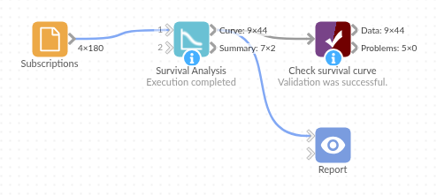

# Survival Analysis

*Omniscope custom block · Analytics · Statistics*

**How long do customers stay, machines run or patients go without an event, counting fairly those who are still going? Kaplan-Meier curves per group, with confidence limits and the median time.**

**R** · survival · comes with R

## The problem it solves

A subscription business sells monthly and annual plans and wants to know how long subscribers stay on each. Many are still subscribed, some only joined a few months ago: averaging the lifetimes of those who left, or counting the share who cancelled, understates how long people stay.

Survival analysis counts each subscriber for as long as they have been followed, and only counts a cancellation where one happened. The block gives one curve per plan, the share still subscribed after each month, and the median time to cancelling.

- **8 months**: median time to cancelling on the monthly plan (95% limits 6 to 10)
- **61 %** of annual subscribers still subscribed after their first renewal at 12 months, against **25 %** on the monthly plan
- **89 of 179** subscribers still subscribed (censored) and counted correctly

### How it works

- One record per subscriber: months followed, and whether they cancelled (1) or are still subscribed (0).
- Kaplan-Meier: at each month with cancellations, survival is multiplied by the share of those still at risk who stayed.
- One curve per value of the Group field, starting at month 0 with everyone subscribed.
- The summary gives each group's counts and median time with its 95% limits.

## What goes in

### Subscriptions

180 invented subscriptions on two plans, followed for up to 24 months.

| Customer | Plan | Months | Cancelled |
|---|---|---|---|
| S-0001 | Monthly | 12 | 1 |
| S-0002 | Annual | 7 | 0 |
| S-0003 | Annual | 22 | 0 |
| S-0004 | Monthly | 1 | 1 |

*180 rows in the sample file: 100 monthly and 80 annual; one annual subscription (S-0041) has no Months and is left out.*

## The options

| Option | Demo setting | What it does |
|---|---|---|
| Time | `Months` | How long each subscriber was followed. |
| Event | `Cancelled` | 1 = cancelled, 0 = still subscribed (censored). |
| Group | `Plan` | One curve per plan. |
| Method | Kaplan-Meier | The standard product-limit estimate. |

## What comes out

### Curve (selected rows)

| Plan | Time | At risk | Events | Censored | Survival | Lower 95% | Upper 95% |
|---|---|---|---|---|---|---|---|
| Annual | 0 | 79 | 0 | 0 | 1.000 | 1.000 | 1.000 |
| Annual | 11 | 50 | 3 | 1 | 0.940 | 0.876 | 1.000 |
| Annual | 12 | 46 | 16 | 1 | 0.613 | 0.491 | 0.766 |
| Annual | 24 | 3 | 1 | 2 | 0.409 | 0.178 | 0.938 |
| Monthly | 0 | 100 | 0 | 0 | 1.000 | 1.000 | 1.000 |
| Monthly | 1 | 100 | 7 | 0 | 0.930 | 0.881 | 0.981 |
| Monthly | 6 | 55 | 4 | 1 | 0.574 | 0.483 | 0.683 |
| Monthly | 12 | 18 | 3 | 0 | 0.254 | 0.172 | 0.374 |

*44 rows in all: one per plan and month with a cancellation or a subscriber's last month, plus month 0. Draw Survival against Time as a step line, coloured by Plan.*

Annual subscribers hardly leave until the 12-month renewal, where 16 of the 46 still at risk cancel; monthly subscribers leave steadily from the first month.

### Summary

| Plan | Records | Events | Censored | Median time | Median lower 95% | Median upper 95% |
|---|---|---|---|---|---|---|
| Annual | 79 | 20 | 59 | 24 | 12 | |
| Monthly | 100 | 70 | 30 | 8 | 6 | 10 |

The annual median rests on the 3 subscribers followed for the full 24 months, so its upper limit is empty: too few remain to bound it.

## Where it pays off

### Subscriptions and SaaS: Retention by plan

Compare how long customers stay on each plan, channel or sign-up cohort, counting current customers fairly.

### Maintenance: Time to failure

Estimate how long components or machines run before failing, per model or site, with units still running as censored.

### HR: Staff retention

Time from hiring to leaving, per department or role, with current staff as censored.

### Health and research: Time to event

The classic use: time to relapse, recovery or death per treatment group, from follow-up times and status codes.

*Use cases describe typical scenarios and are illustrative; the sample data is invented.*

## Why do this in Omniscope

- **Curves that move with the customer base**: the block reads durations straight from the subscription data in the same workflow, so each refresh of the source redraws the curves and the medians in the Report, with no export to a statistics tool.
- **A median you can watch**: the Summary output is one record per plan, so a rule in Validate data can flag a run where a plan's median falls below an agreed number of months, and a scheduled workflow raises it the day it happens.
- **Fleming-Harrington and 1 / 2 coding included**: the Method option gives the Fleming-Harrington estimate, and Event accepts the 1 / 2 coding (2 = event) that many medical and engineering datasets use, as well as 0 / 1 and true / false.
- **R's survival package, open in the editor**: the script is a short `survfit()` call; changing the confidence interval type or adding Cox regression from the same package is an edit once you have unlocked the block's design.

## How it fits into an Omniscope workflow

Subscriptions (Database) → Field Organiser (Months = DATEDIFF of start and end or today) → **Survival Analysis** → Report (line chart of Survival by Time, per Plan)

The Curve output feeds a line chart directly; the Summary output feeds a table or KPI view of the median time per group.

## Try it

1. Open the demo project (`demo.iox` on the demo server, or import `demo.ioz` from this folder): 180 invented subscriptions on two plans.
2. The question: how long do subscribers stay on each plan?
3. Open Survival Analysis: Time Months, Event Cancelled, Group Plan, Method Kaplan-Meier. Run it.
4. Look at **Curve**: annual subscribers drop from 0.94 to 0.61 at month 12; monthly ones fall steadily to 0.25 by month 12.
5. Look at **Summary**: median 8 months on the monthly plan, 24 on the annual plan.

## Running in Omniscope

*The demo project's workflow: the sample data, the block, and a Validate data check on its output.*

<!--language-->
## Language and libraries

R. It uses the survival package (LGPL 2 or later), one of R's recommended packages that come with most R installations; install it with `install.packages("survival")` if it is missing.
<!--/language-->

## Tested

The block is covered by automated tests that run its script against a stand-in for Omniscope's R API: the sample data per plan and overall, values against the previous version of the block, both methods against their formulas, event codings, an empty Group option, missing values and a group with one value, empty input, wrong field types and missing choices, and 100,000 subjects in 50 groups.
