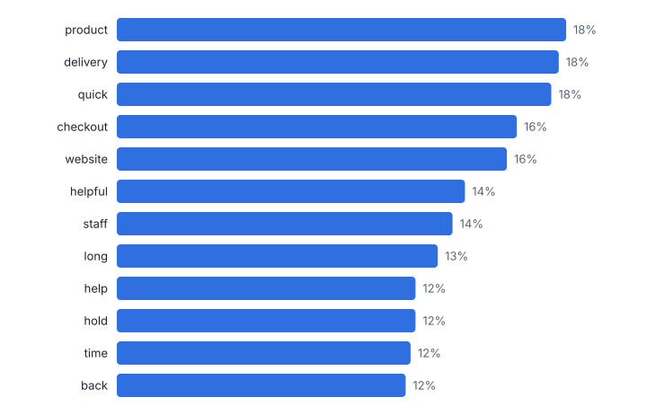
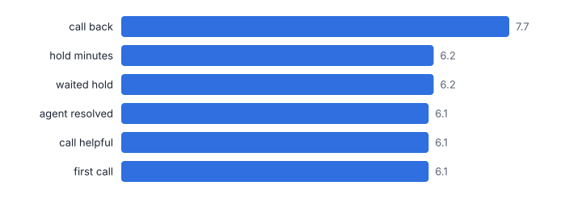
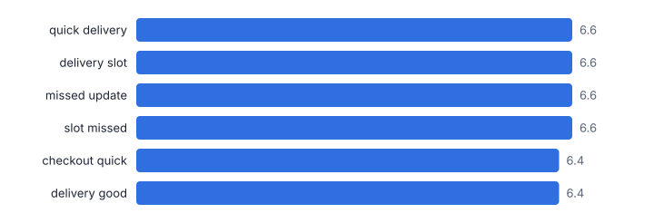
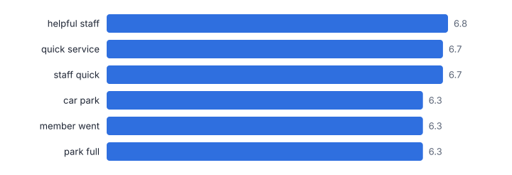
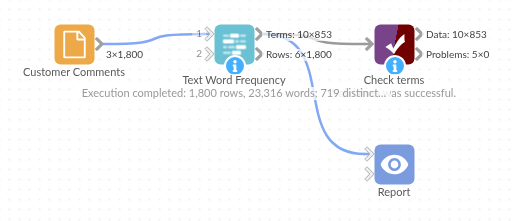

# Text Word Frequency

*Omniscope custom block · Analytics*

**What are people writing about? Word and phrase counts from any text field, per group, with the terms that set each group apart.**

**Python** · pandas, numpy · nothing extra to install

## The problem it solves

Survey comments, complaints, reviews and ticket notes hold the reasons behind the scores, but reading thousands of them is slow, and overall word clouds mostly show the words every group uses.

This block counts words and short phrases with stop words removed, counts how many comments use each one, and, with groups, scores how distinctive each term is of the group, so the Contact Centre's *call back* and *waited hold* ("waited on hold" with the stop word removed) stand out from the Online channel's *checkout* and *delivery*.

- **1,800** comments (synthetic, three channels)
- **23,316** words read
- **196** term and channel pairs flagged as distinctive
- **call back** most distinctive Contact Centre phrase

### How it works

- Connect data with a text field. Optionally choose group fields to compare (channel, product, region, NPS category from the Net Promoter Score block).
- Choose the longest phrase (1 to 4 words), the shortest word, the minimum number of comments a term must appear in, and extra stop words such as your brand name.
- Outputs: one row per group and term with counts, shares, rank and distinctiveness; and the comments with word counts and the top terms each uses.

## What goes in

### Customer comments

1,800 synthetic comments made from template sentences, so the counts are cleaner than real text.

| Response ID | Channel | Comment |
|---|---|---|
| R00001 | Store | Returns process was simple. Could not find anyone to ask for help. |
| R00002 | Online | Order arrived on time and the product was as described. Delivery was fast, next day as promised. |
| R00003 | Contact Centre | Long wait on hold again. |
| R00004 | Online | Delivery slot was missed, no update. Easy to find what I wanted on the website. Returns process was simple. |
| R00005 | Contact Centre | Call back took two days. Great range of products. The agent was polite but could not fix the problem. |
| R00006 | Store | Helpful staff, quick service. Order arrived on time and the product was as described. |

*1,800 rows in the sample file.*

## The options

| Option | Demo setting | What it does |
|---|---|---|
| Text field | `Comment` | The free text to count words in, such as comments. |
| Compare groups (optional) | `Channel` | For example Channel, Product or NPS Category. |
| Longest phrase (words) | `2` | 1 = single words only. |
| Minimum rows using a term | `2` | Rarer terms are left out. |

## What comes out

### Most distinctive terms per channel

| Channel | Term | Words In Term | Occurrences | Rows Using Term | Share Of Rows | Rank | Share Of Rows In Other Groups | Distinctiveness (z) | Distinctive |
|---|---|---|---|---|---|---|---|---|---|
| Contact Centre | hold | 1 | 230 | 217 | 0.413 | 1 | 0 | 9.99 | Yes |
| Contact Centre | call | 1 | 223 | 206 | 0.392 | 3 | 0 | 9.83 | Yes |
| Contact Centre | back | 1 | 221 | 210 | 0.399 | 2 | 0 | 9.79 | Yes |
| Contact Centre | transferred | 1 | 156 | 150 | 0.285 | 4 | 0 | 8.21 | Yes |
| Contact Centre | agent | 1 | 147 | 142 | 0.27 | 6 | 0 | 7.97 | Yes |
| Online | delivery | 1 | 351 | 323 | 0.442 | 1 | 0 | 11.17 | Yes |
| Online | checkout | 1 | 311 | 292 | 0.399 | 2 | 0 | 10.5 | Yes |
| Online | website | 1 | 308 | 284 | 0.389 | 3 | 0 | 10.45 | Yes |
| Online | quick | 1 | 224 | 218 | 0.298 | 4 | 0.092 | 9.58 | Yes |
| Online | good | 1 | 158 | 148 | 0.202 | 6 | 0.053 | 8.73 | Yes |
| Store | helpful | 1 | 178 | 169 | 0.311 | 2 | 0.068 | 12.8 | Yes |
| Store | help | 1 | 155 | 146 | 0.269 | 3 | 0.057 | 12.01 | Yes |
| Store | staff | 1 | 264 | 245 | 0.451 | 1 | 0 | 11.03 | Yes |
| Store | store | 1 | 149 | 143 | 0.263 | 4 | 0 | 8.26 | Yes |
| Store | till | 1 | 144 | 139 | 0.256 | 5 | 0 | 8.12 | Yes |

### Rows

| Response ID | Channel | Comment | Word Count | Terms Kept | Top Terms Used |
|---|---|---|---|---|---|
| R00001 | Store | Returns process was simple. Could not find anyone to ask for help. | 12 | 7 | find; help |
| R00002 | Online | Order arrived on time and the product was as described. Delivery was fast, next day as promised. | 17 | 10 | day; delivery; fast; next; product; promised; time |
| R00003 | Contact Centre | Long wait on hold again. | 5 | 3 | hold; long |
| R00004 | Online | Delivery slot was missed, no update. Easy to find what I wanted on the website. Returns process was simple. | 19 | 11 | delivery; easy; find; missed; slot; update; wanted; website |
| R00005 | Contact Centre | Call back took two days. Great range of products. The agent was polite but could not fix the problem. | 19 | 12 | agent; back; call; problem |
| R00006 | Store | Helpful staff, quick service. Order arrived on time and the product was as described. | 14 | 9 | helpful; product; quick; service; staff; time |

*Overall counts mix the channels together: delivery, checkout and hold are all near the top (synthetic data).*

*Two-word phrases that Contact Centre comments use far more than the other channels (synthetic data).*

*Two-word phrases that Online comments use far more than the other channels (synthetic data).*

*Two-word phrases that Store comments use far more than the other channels (synthetic data).*

## Where it pays off

### Customer experience: Survey verbatims

What detractors write about compared with promoters, or one region compared with the rest, alongside the NPS and Likert blocks.

### Service operations: Complaints and tickets

The words and phrases driving complaints by product or team, tracked month by month.

### Retail and e-commerce: Product reviews

What reviewers of each product or brand mention most and least compared with the category.

### HR: Employee survey comments

Themes by department in engagement survey free text, with rare terms filtered out to protect anonymity.

*Use cases describe typical scenarios and are illustrative.*

## Why do this in Omniscope

- **From a term to the comments behind it.** The rows output lists the top terms each comment uses, so choosing a term in a bar chart filters the report to those comments, and new responses are counted on the next refresh.
- **Distinctive, not just frequent.** The z-score compares each group with the others, and a term must appear in a minimum number of comments, which also keeps rare words out of an employee-survey report.
- **Stop words under your control.** Extra stop words such as a brand name are an option, and the English list is in the block's script, where words for another language could be added.

## How it fits into an Omniscope workflow

Survey or ticket data → Net Promoter Score (optional: NPS Category) → **Text Word Frequency** → Report (bar charts, filtered comments)

Group by any field, including the NPS Category from the Net Promoter Score block to compare promoters and detractors.

Chart the distinctive terms as bars, and use the rows output (Top Terms Used) to filter to the comments behind a term.

Comments, NPS categories and term counts stay linked in the report, so choosing a term filters to the comments behind it, and new survey responses are counted on the next refresh.

## In one step

Word and phrase counts, with a distinctiveness score for each group.

## Try it

1. Open the demo project (`demo.iox` on the demo server, or import `demo.ioz` from this folder): 1,800 synthetic customer comments from three channels.
2. The question: what is each channel's customers' main complaint, without reading every comment?
3. Open the block: text field Comment, compare by Channel, phrases up to two words. Run it.
4. Look at the overall counts, then the distinctive phrases: the Contact Centre's top ones are call back, hold minutes, waited hold.
5. Filter the rows output on a term to read the comments behind it.

## Running in Omniscope

*The demo project's workflow: the sample data, the block, and a Validate data check on its output.*

<!--language-->
## Language and libraries

Python. It uses pandas and numpy, plus the Python standard library (collections, re).

pandas and numpy are part of Omniscope's Docker Python image, and the block was run in both host mode and Docker mode on an Omniscope server, with the same results. It needs nothing else installed.
<!--/language-->

## Tested

The demo workflow completed without errors on an Omniscope server (853 records in Terms and 1,800 in Rows). Automated tests check normal data, empty input, wrong types and large input.
