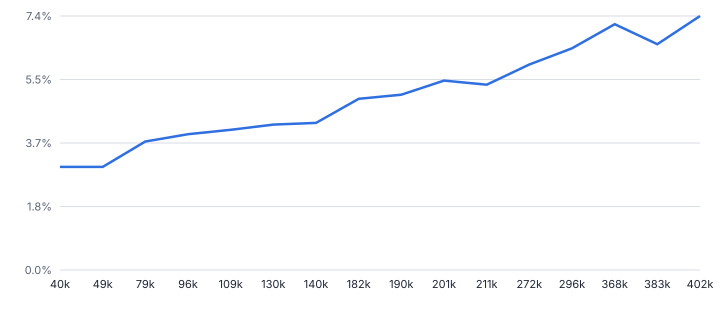
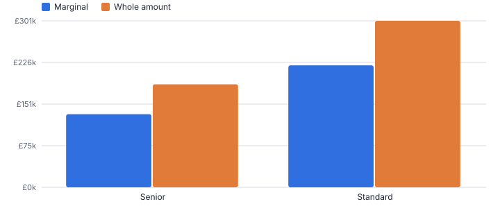
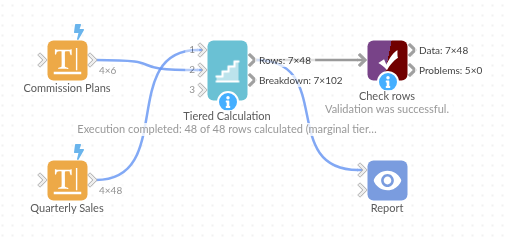

# Tiered Calculation

*Omniscope custom block · Analytics*

**Apply commission plans, tax bands, volume discounts and stepped tariffs from a tier table, marginally or to the whole amount, with a breakdown by tier.**

**Python** · pandas, numpy · nothing extra to install

## The problem it solves

Tiered calculations are everywhere in finance: commission accelerators, rebate scales, banded fees, tax bands, energy tariffs. In workflows they turn into long nested IF formulas that are hard to check and break when a threshold changes.

This block reads the tiers from a table (with a plan key so different people or customers can have different scales), applies them marginally or to the whole amount, and shows how much of each result came from each tier.

- **48** salesperson-quarters calculated (illustrative)
- **2** commission plans in one tier table
- **£353k** total commission, marginal
- **£134k** more if the whole amount earned the reached rate

### How it works

- Connect the amounts to input 1 (and optionally a plan field), and a tier table to input 2 with from, to, rate and optional fixed amount and plan key; or type the tiers in the options.
- Choose marginal (each slice at its tier's rate) or whole amount (the whole amount at the reached tier's rate).
- Outputs: rows with result, effective rate and tier reached, and the breakdown by tier.

## What goes in

### Input 1: quarterly sales

| Salesperson | Plan | Quarter | Sales (GBP) |
|---|---|---|---|
| Amelia | Senior | 2025 Q1 | 90442.42 |
| Amelia | Senior | 2025 Q2 | 295662.58 |
| Amelia | Senior | 2025 Q3 | 75506.53 |
| Oliver | Standard | 2025 Q1 | 203816.52 |
| Oliver | Standard | 2025 Q2 | 95525.53 |
| Oliver | Standard | 2025 Q3 | 145618.54 |

*48 rows in the sample file.*

### Input 2: commission plans

| Plan | From | To | Rate |
|---|---|---|---|
| Standard | 0 | 50000 | 3% |
| Standard | 50000 | 150000 | 5% |
| Standard | 150000 |  | 8% |
| Senior | 0 | 100000 | 4% |
| Senior | 100000 | 250000 | 7% |
| Senior | 250000 |  | 10% |

*6 rows in the sample file.*

## The options

| Option | Demo setting | What it does |
|---|---|---|
| Amount field | `Sales (GBP)` | The amount to apply the tiers to, such as sales. |
| Plan field (optional) | `Plan` | Matches the plan key of the tier table. |
| Plan key (input 2) | `Plan` | Plan name in the tier table, matched to the plan field of input 1. |
| From (input 2) | `From` | Lower bound of each tier. |
| To (input 2) | `To` | Upper bound of each tier; when empty, the next tier's lower bound. |
| Rate (input 2) | `Rate` | Rate for each tier, such as 0.05 for 5%. |
| Result field name | `Commission (GBP)` | Name of the new field holding the result. |
| Method | `Marginal (each slice at its tier's rate)` | Marginal applies each tier's rate to its own slice, as income tax does; whole applies the reached rate to everything. |

## What comes out

### Rows

| Salesperson | Plan | Quarter | Sales (GBP) | Commission (GBP) | Effective Rate | Tier Reached |
|---|---|---|---|---|---|---|
| Amelia | Senior | 2025 Q1 | 90,442.42 | 3,617.70 | 0.04 | 0 to 100,000 |
| Amelia | Senior | 2025 Q2 | 295,662.58 | 19,066.26 | 0.0645 | 250,000 and over |
| Amelia | Senior | 2025 Q3 | 75,506.53 | 3,020.26 | 0.04 | 0 to 100,000 |
| Oliver | Standard | 2025 Q1 | 203,816.52 | 10,805.32 | 0.053 | 150,000 and over |
| Oliver | Standard | 2025 Q2 | 95,525.53 | 3,776.28 | 0.0395 | 50,000 to 150,000 |
| Oliver | Standard | 2025 Q3 | 145,618.54 | 6,280.93 | 0.0431 | 50,000 to 150,000 |
| Isla | Standard | 2025 Q1 | 168,919.89 | 8,013.59 | 0.0474 | 150,000 and over |
| Isla | Standard | 2025 Q2 | 272,495.22 | 16,299.62 | 0.0598 | 150,000 and over |
| Isla | Standard | 2025 Q3 | 78,153.49 | 2,907.67 | 0.0372 | 50,000 to 150,000 |

### Breakdown for one row

| Row Number | Plan | Tier | Band | Rate | Amount In Tier | Result In Tier |
|---|---|---|---|---|---|---|
| 2 | Senior | 1 | 0 to 100,000 | 0.04 | 100,000 | 4,000 |
| 2 | Senior | 2 | 100,000 to 250,000 | 0.07 | 150,000 | 10,500 |
| 2 | Senior | 3 | 250,000 and over | 0.1 | 45,662.58 | 4,566.26 |

*Marginal tiers make the effective rate rise smoothly with sales, with no cliff edge at the thresholds (illustrative figures).*

*The same tier table applied as whole-amount tiers pays more: the method is a policy choice the block makes explicit.*

## Where it pays off

### Sales operations: Commission and bonus plans

Accelerated commission by plan and quarter, with a tier breakdown for statements.

### Finance and tax: Banded taxes and levies

Illustrative band calculations such as stamp duty style or income tax style bands, maintained in a table.

### Wholesale and B2B: Volume discounts and rebates

Rebates by customer agreement on annual volumes, marginal or whole-amount.

### Utilities and telecoms: Stepped tariffs

Charges for usage across tariff steps, per tariff plan.

*Use cases describe typical scenarios and are illustrative.*

## Why do this in Omniscope

- **Tiers maintained by finance.** The tier table is a Data Table block or spreadsheet in the workflow, so a changed threshold recalculates every amount on the next run with no nested formula to edit.
- **Statements that can be checked.** The breakdown output gives each row's amount and result per tier, so a salesperson's statement can be checked tier by tier; the tests cover marginal bands, fixed amounts and several plans.
- **Two policies one option apart.** Marginal and whole-amount are a single choice, so the cost of each can be compared on the same sales; the tier logic is in the block's script if a plan needs a cap.

## How it fits into an Omniscope workflow

Amounts (sales, usage, income) → Tier table (Data Table block or spreadsheet) → **Tiered Calculation** → Report / statements

Keep the tier table where finance can maintain it; the plan key links each row to its scale.

Use the breakdown output for statements and audit, and the rows output for totals.

## In one step

Marginal or whole-amount tiers per plan, driven by a table.

## Try it

1. Open the demo project (`demo.iox` on the demo server, or import `demo.ioz` from this folder): invented quarterly sales and two commission plans in one tier table.
2. The question: what does each salesperson earn under their plan, and how does it break down?
3. Run the block: commission, effective rate and tier reached per row; breakdown by tier.
4. Switch to whole amount to see how much the method matters.
5. Change a threshold in the tier table and re-run: no formulas to edit.

## Running in Omniscope

*The demo project's workflow: the sample data, the block, and a Validate data check on its output.*

<!--language-->
## Language and libraries

Python. It uses pandas and numpy, plus the Python standard library (re).

pandas and numpy are part of Omniscope's Docker Python image, and the block was run in both host mode and Docker mode on an Omniscope server, with the same results. It needs nothing else installed.
<!--/language-->

## Tested

The demo workflow runs without errors on an Omniscope server and produces 48 records in Rows and 102 in Breakdown. Its automated tests cover marginal and whole-amount tiers, fixed amounts and plans, the sample data, bad tier tables, non-numeric amounts and large input.
