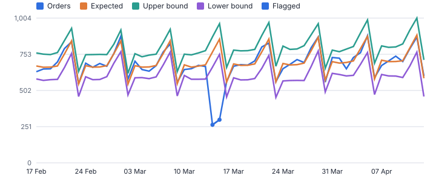
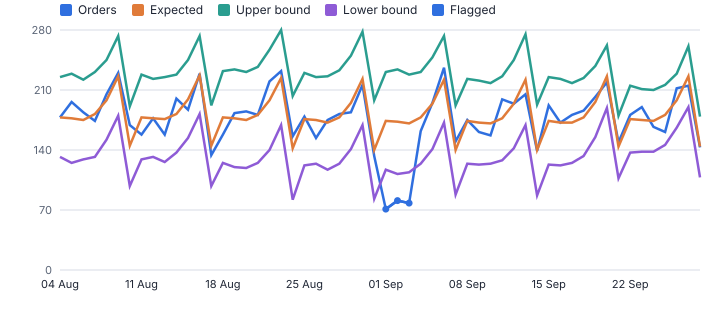
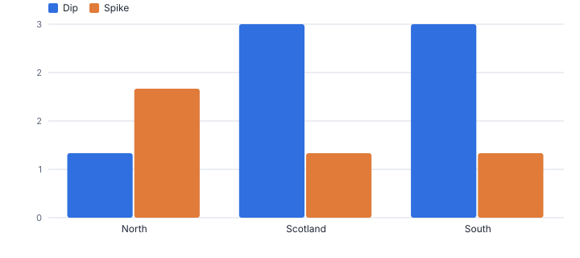
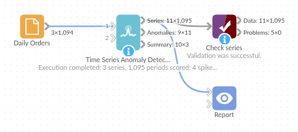

# Time Series Anomaly Detection

*Omniscope custom block · Analytics*

**Flag the unusual days, weeks or months in every series at once, against a robust baseline that allows for the weekly pattern.**

**Python** · pandas, numpy · nothing extra to install

## The problem it solves

Daily dashboards are full of ups and downs, and most of them are the normal weekly rhythm or noise. The ones that matter (an outage, a feed that stopped, a promotion that worked, a fraud spike) are easy to miss across dozens of stores or products, and a fixed threshold on the raw value flags every Saturday.

This block scores every period of every series against a rolling median with a weekday effect, using the median absolute deviation as the spread so the anomalies do not distort their own baseline, and returns the flags, the band to chart and a ranked list.

- **1,095** region-days scored (3 regions, 2025, synthetic)
- **10 of 10** planted anomalous days found
- **1** other day flagged
- **16** flags without the weekday effect, 10 of them Saturdays

### How it works

- Connect data with a date and a value (or count rows). Choose fields that define each series, such as Region or Store.
- Choose the period (day, week, month) and how to aggregate; empty periods count as zero for sums and counts, so gaps in a feed show up.
- Choose centred (review history) or trailing (as if live) baseline, the window, the threshold and whether to flag spikes, dips or both.
- Outputs: every period with expected value, bounds and robust z; the anomalies ranked by severity; and a summary per series with the latest status.

## What goes in

### Daily orders

Synthetic daily orders for three regions in 2025 with a weekly pattern, and planted events: an outage, promotions, Black Friday, a warehouse problem and a missing day.

| Order Date | Region | Orders |
|---|---|---|
| 2025-01-01 | North | 434 |
| 2025-01-02 | North | 442 |
| 2025-01-03 | North | 481 |
| 2025-01-04 | North | 546 |
| 2025-01-05 | North | 345 |
| 2025-01-06 | North | 439 |

*1,094 rows in the sample file.*

## The options

| Option | Demo setting | What it does |
|---|---|---|
| Date field | `Order Date` | Date of each value. |
| Value field | `Orders` | Not needed when counting rows. |
| One series per (optional) | `Region` | For example Region or Store. |
| Weekday effect (daily data) | `Automatic` | Allows for regular weekday patterns, so a busy Saturday is not flagged. Automatic tests whether the pattern is there. |
| Baseline | `Centred (review history)` | Centred uses periods on both sides, for reviewing history. Trailing uses only earlier ones, as a live check would. |
| Window (periods) | `28` | For example 28 days. |
| Threshold (robust z) | `3.5` | 3.5 is a common choice; lower flags more. |

## What comes out

### Anomalies, most severe first

| Region | Period | Anomaly | Value | Expected | Deviation | Deviation % | Robust Z | Severity |
|---|---|---|---|---|---|---|---|---|
| South | 2025-11-28 (Fri) | Spike | 1,558 | 800.50 | 757.50 | 0.95 | 31.9 | 31.9 |
| North | 2025-11-28 (Fri) | Spike | 1,035 | 515 | 520 | 1.01 | 21.9 | 21.9 |
| South | 2025-03-15 (Sat) | Dip | 299 | 858.25 | -559.25 | -0.65 | -18.4 | 18.4 |
| North | 2025-08-20 (Wed) | Dip | 0 | 436 | -436 | -1 | -17.6 | 17.6 |
| Scotland | 2025-11-28 (Fri) | Spike | 399 | 198 | 201 | 1.02 | 16.9 | 16.9 |
| South | 2025-03-14 (Fri) | Dip | 264 | 768.75 | -504.75 | -0.66 | -16.8 | 16.8 |
| North | 2025-06-09 (Mon) | Spike | 739 | 466.75 | 272.25 | 0.58 | 9.7 | 9.7 |
| Scotland | 2025-09-01 (Mon) | Dip | 71 | 174 | -103 | -0.59 | -6.3 | 6.3 |
| Scotland | 2025-09-03 (Wed) | Dip | 78 | 171 | -93 | -0.54 | -5.7 | 5.7 |
| Scotland | 2025-09-02 (Tue) | Dip | 81 | 173.25 | -92.2 | -0.53 | -5.3 | 5.3 |
| South | 2025-08-16 (Sat) | Dip | 773 | 845.50 | -72.5 | -0.09 | -4.1 | 4.1 |

### Summary per region

| Region | Periods | Scored | Spikes | Dips | Latest Period | Latest Value | Latest Status | Largest Spike Z | Largest Dip Z |
|---|---|---|---|---|---|---|---|---|---|
| North | 365 | 365 | 2 | 1 | 2025-12-31 | 466 | No | 21.9 | -17.6 |
| Scotland | 365 | 365 | 1 | 3 | 2025-12-31 | 179 | No | 16.9 | -6.3 |
| South | 365 | 365 | 1 | 3 | 2025-12-31 | 709 | No | 31.9 | -18.4 |

*The two-day outage in March falls far below the band; the busy Saturdays stay inside it because the weekday effect is allowed for (synthetic data).*

*Three days of low orders during a warehouse problem are each flagged (synthetic data).*

*Black Friday is flagged in every region; the North's missing day of data shows as a dip to zero.*

## Where it pays off

### Retail and e-commerce: Sales and traffic monitoring

Flag stores, products or channels whose day was far from normal, from outages and stock-outs to promotions that over-delivered.

### Finance and fraud: Transaction volumes

Spikes in refunds, chargebacks or payments per merchant or account, against each one's own normal level.

### Data engineering: Feed and pipeline checks

Row counts per source per day: a feed that stops or doubles shows as a dip or spike before reports go out.

### Manufacturing and utilities: Sensor and meter readings

Readings per machine or meter outside their usual band, with trailing mode to mimic live alerts.

*Use cases describe typical scenarios and are illustrative.*

## Why do this in Omniscope

- **A daily scan of every series.** Scheduled with the trailing baseline, each store or region is scored against its own recent history, and the anomalies output can be emailed when it has rows.
- **A baseline the outliers cannot bend.** The rolling median and MAD are not pulled about by the spikes themselves; in the demo all ten planted days were found with one other flag, and an empty day counts as zero, so a stopped feed shows as a dip.
- **Detection rules you can retune.** Window, threshold, direction and the weekday effect are options; a month-of-year effect could sit next to the weekday one in the scoring code.

## How it fits into an Omniscope workflow

Daily data (database / files) → **Time Series Anomaly Detection** → Report (band chart) → Email output (today's anomalies)

Schedule daily with the trailing baseline and email the anomalies output when it is not empty; Time Series Filler is not needed because empty periods are filled here.

Chart Value with Lower and Upper Bound in a Report for any series, and filter the anomalies list by severity.

The email goes out only on days with something to report.

## In one step

Robust anomaly flags that allow for weekday patterns, for many series at once.

## Try it

1. Open the demo project (`demo.iox` on the demo server, or import `demo.ioz` from this folder): a year of synthetic daily orders for three regions.
2. The question: which days were really unusual, and which were just Saturdays?
3. Open the block: date, orders, one series per Region, centred baseline, threshold 3.5. Run it.
4. Look at the anomalies list: all 10 planted anomalous days, from the March outage to Black Friday and the missing day of data.
5. Switch the weekday effect off and run again: 16 flags, 10 of them Saturdays. The weekday effect accounts for the difference.

## Running in Omniscope

*The demo project's workflow: the sample data, the block, and a Validate data check on its output.*

<!--language-->
## Language and libraries

Python. It uses pandas and numpy.

pandas and numpy are part of Omniscope's Docker Python image, and the block was run in both host mode and Docker mode on an Omniscope server, with the same results. It needs nothing else installed.
<!--/language-->

## Tested

Run on an Omniscope server, the demo workflow finished without errors (1,095 records in Series, 11 in Anomalies and 3 in Summary). Automated tests also cover normal data, empty input, wrong types and large input.
