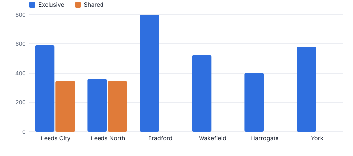
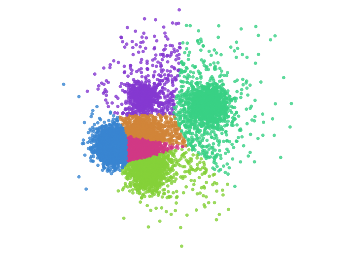
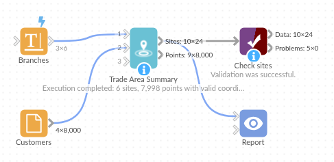

# Trade Area Summary

*Omniscope custom block · Analytics*

**How many customers, and how much spend, lie within 1, 3, 5 and 10 km of each site, and how much of each catchment overlaps with another site.**

**Python** · pandas, numpy · nothing extra to install

## The problem it solves

Opening, closing or merging branches starts with catchments: who lives near each site, what they spend, and how much of that another branch would pick up anyway. Spatial joins per radius and per site, plus the overlap, take several steps to build.

This block computes great-circle distances between every site and point, summarises each radius per site with exclusive and shared counts, and gives each point its nearest site and distance band.

- **6** branches (illustrative)
- **8,000** customer locations (synthetic)
- **345** Leeds City customers within 5 km also within 5 km of Leeds North
- **1,225** customers more than 10 km from any branch

### How it works

- Connect sites with latitude and longitude to input 1, and points (customers, households) to input 2, with an optional value such as spend.
- Set the radii (for example 1, 3, 5, 10) and the unit.
- Outputs: one row per site and radius, and the points with their nearest site, distance and band.

## What goes in

### Input 1: branches

| Branch | Latitude | Longitude |
|---|---|---|
| Leeds City | 53.7965 | -1.5478 |
| Leeds North | 53.8421 | -1.5338 |
| Bradford | 53.7938 | -1.752 |
| Wakefield | 53.6833 | -1.4977 |
| Harrogate | 53.9921 | -1.5418 |
| York | 53.959 | -1.0815 |

*6 rows in the sample file.*

### Input 2: customers

8,000 synthetic customer locations; two have no latitude.

| Customer ID | Latitude | Longitude | Annual Spend (GBP) |
|---|---|---|---|
| K100000 | 53.81658 | -1.51316 | 1838.16 |
| K100001 | 53.80791 | -1.52073 | 222.8 |
| K100002 | 53.816 | -1.48727 | 329.88 |
| K100003 | 53.82575 | -1.4912 | 246.82 |
| K100004 | 53.86723 | -1.54866 | 1248.84 |

*8,000 rows in the sample file.*

## The options

| Option | Demo setting | What it does |
|---|---|---|
| Site name | `Branch` | Names each site, such as a store or branch. |
| Latitude | `Latitude` | Latitude of each site, in decimal degrees. |
| Longitude | `Longitude` | Longitude of each site, in decimal degrees. |
| Latitude | `Latitude` | Latitude of each point in input 2, in decimal degrees. |
| Longitude | `Longitude` | Longitude of each point in input 2, in decimal degrees. |
| Value (optional) | `Annual Spend (GBP)` | For example annual spend or households. |
| Point ID (optional) | `Customer ID` | Identifies each point in the per-point output. |
| Radii | `1, 3, 5, 10` | Comma-separated, for example: 1, 3, 5, 10 |
| Unit | `Kilometres` | Unit for the radii and distances. |

## What comes out

### Sites at 3 and 10 km

| Branch | Radius | Unit | Points Within | Value Within | Share Of All Points | Share Of All Value | Exclusive Points | Shared Points | Average Distance |
|---|---|---|---|---|---|---|---|---|---|
| Leeds City | 3 | km | 384 | 308,945.95 | 0.05 | 0.05 | 361 | 23 | 2.04 |
| Leeds City | 10 | km | 2578 | 2,069,430.39 | 0.32 | 0.32 | 49 | 2529 | 5.97 |
| Leeds North | 3 | km | 285 | 233,860.10 | 0.04 | 0.04 | 262 | 23 | 1.98 |
| Leeds North | 10 | km | 2049 | 1,640,575.19 | 0.26 | 0.25 | 146 | 1903 | 6.07 |
| Bradford | 3 | km | 344 | 275,177.41 | 0.04 | 0.04 | 344 | 0 | 1.97 |
| Bradford | 10 | km | 1929 | 1,556,558.05 | 0.24 | 0.24 | 1309 | 620 | 5.59 |
| Wakefield | 3 | km | 219 | 180,679.57 | 0.03 | 0.03 | 219 | 0 | 2.01 |
| Wakefield | 10 | km | 1379 | 1,133,658.01 | 0.17 | 0.17 | 834 | 545 | 5.86 |
| Harrogate | 3 | km | 198 | 166,910.06 | 0.02 | 0.03 | 198 | 0 | 1.92 |
| Harrogate | 10 | km | 677 | 576,122.13 | 0.08 | 0.09 | 637 | 40 | 4.67 |
| York | 3 | km | 248 | 209,811.07 | 0.03 | 0.03 | 248 | 0 | 2 |
| York | 10 | km | 1208 | 984,146.95 | 0.15 | 0.15 | 1208 | 0 | 5.22 |

*The two Leeds branches share much of their 5 km catchment; the others stand alone (synthetic data).*

*The points output mapped by nearest branch.*

## Where it pays off

### Retail and banking: Branch network reviews

Customers and value that would remain within reach of another branch if one closed.

### Healthcare and public services: Access to services

Population within set distances of clinics, schools or libraries, and who is furthest away.

### Property: Site selection

Households and spend around candidate sites at several radii, with overlap against existing stores.

### Logistics: Depot coverage

Deliveries within each depot's radius and the share served by more than one depot.

*Use cases describe typical scenarios and are illustrative.*

## Why do this in Omniscope

- **Map and catchment table from one run.** Sites, customers and catchments are fields in one workflow, so adding a candidate site as a row recalculates the overlaps and the map together.
- **Overlap measured.** Exclusive and shared points per radius show how much of a branch's catchment another would keep, such as the 345 Leeds City customers also near Leeds North; rows without coordinates are kept and marked, and the distances are tested against known values.
- **Radii as a list.** The radii and unit are options; the distance bands and the sharing rule are open in the script, so a drive-time weighting is a local change.

## How it fits into an Omniscope workflow

Sites → Customers (geocoded; UK Postcode Tools) → **Trade Area Summary** → Report (map, catchment table)

Geocode customers first if needed; Point in Polygon can add territories, Find Nearest the k nearest sites.

Map the points output coloured by nearest site and show the catchment table per radius.

## In one step

Catchments at several radii, with overlap and the nearest site for every point.

## Try it

1. Open the demo project (`demo.iox` on the demo server, or import `demo.ioz` from this folder): six invented branches and synthetic customer locations.
2. The question: if we merged the two Leeds branches, how many customers would still be within 5 km of the other one?
3. Run the block with radii 1, 3, 5 and 10 km.
4. Look at the 5 km rows: 345 of Leeds City's 935 customers are shared with Leeds North.
5. Look at the map and the customers more than 10 km from any branch.

## Running in Omniscope

*The demo project's workflow: the sample data, the block, and a Validate data check on its output.*

<!--language-->
## Language and libraries

Python. It uses pandas and numpy, plus the Python standard library (re).

pandas and numpy are part of Omniscope's Docker Python image, and the block was run in both host mode and Docker mode on an Omniscope server, with the same results. It needs nothing else installed.
<!--/language-->

## Tested

Run on an Omniscope server, the demo workflow finished without errors (24 records in Sites and 8,000 in Points). Automated tests also cover known distances and bands, exclusive and shared counts, the sample data, bad inputs and large input.
