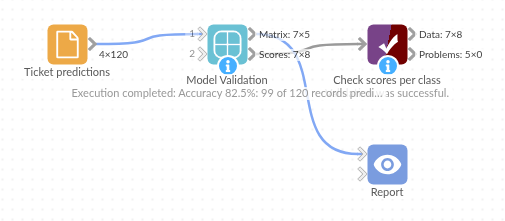

# Model Validation

*Omniscope custom block · Analytics*

**How good are the predictions, really? A confusion matrix and precision, recall and F1 per class, so you can see which categories the model gets wrong and what it mistakes them for.**

**Python** · pandas, numpy · nothing extra to install

## The problem it solves

A model routes incoming support tickets to a team. Overall it is right about four times in five, which sounds fine, until you look by team: some teams' tickets are routed well, and one team's tickets never reach it at all.

The block compares the predicted team with the team that actually handled each ticket, and breaks the result down by team.

- **120** tickets compared, **99** routed correctly: **82.5%** accuracy
- **0** of the 4 Complaints tickets routed to Complaints: the model never predicts that team
- **Account** tickets caught well (recall 0.86), but 7 tickets from other teams sent there too (precision 0.73)
- **2** tickets the model gave no team for, counted as wrong rather than quietly dropped

### How it works

- Choose the field with the actual values and the field with the predicted values.
- The Matrix output counts the tickets for every actual and predicted team; correct predictions are on the diagonal.
- The Scores output gives each team's precision (of the tickets sent to it, how many were its own), recall (of its own tickets, how many reached it) and F1 score, then the macro, weighted and micro averages.

## What goes in

### Ticket predictions

120 invented support tickets with the team a model predicted and the team that actually handled each one.

| Ticket | Opened | Actual Team | Predicted Team |
|---|---|---|---|
| T-5001 | 2025-05-01 | Delivery | Delivery |
| T-5002 | 2025-05-01 | Account | Technical |
| T-5003 | 2025-05-01 | Billing | Billing |
| T-5018 | 2025-05-05 | Delivery | |
| T-5088 | 2025-05-22 | Complaints | Account |

*120 rows in the sample file; two have no predicted team.*

## The options

| Option | Demo setting | What it does |
|---|---|---|
| Actual values | Actual Team | The true category of each record. |
| Predicted values | Predicted Team | The category the model predicted. |

## What comes out

### Confusion matrix

| Actual class | Account | Billing | Complaints | Delivery | Technical | (no prediction) |
|---|---|---|---|---|---|---|
| Account | 19 | 2 | 0 | 0 | 1 | 0 |
| Billing | 2 | 26 | 0 | 2 | 3 | 1 |
| Complaints | 2 | 0 | 0 | 2 | 0 | 0 |
| Delivery | 0 | 1 | 0 | 18 | 0 | 1 |
| Technical | 3 | 1 | 0 | 0 | 36 | 0 |

The Complaints column is all zeros: no ticket is ever sent to Complaints. Its four tickets went to Account and Delivery.

### Scores per class

| Class | Actual records | Predicted records | Correct | Precision | Recall | F1 score |
|---|---|---|---|---|---|---|
| Account | 22 | 26 | 19 | 0.731 | 0.864 | 0.792 |
| Billing | 34 | 30 | 26 | 0.867 | 0.765 | 0.812 |
| Complaints | 4 | 0 | 0 | 0.000 | 0.000 | 0.000 |
| Delivery | 20 | 22 | 18 | 0.818 | 0.900 | 0.857 |
| Technical | 40 | 40 | 36 | 0.900 | 0.900 | 0.900 |
| Macro average | 120 | 118 | 99 | 0.663 | 0.686 | 0.672 |
| Weighted average | 120 | 118 | 99 | 0.816 | 0.825 | 0.818 |
| Micro average | 120 | 118 | 99 | 0.839 | 0.825 | 0.832 |

The weighted average (0.818) looks healthy because Complaints is a small team; the macro average (0.672), where every team counts the same, shows the gap. The micro average recall, 0.825, is the accuracy.

## Where it pays off

### Customer service: Ticket routing

Check an automatic routing or tagging model by team, and find the teams whose work it misroutes.

### Maintenance: Condition predictions

Compare predicted machine conditions with what engineers found, and see whether Faulty machines are being called Worn.

### Marketing: Segment or churn models

Measure how well a model picks out the customers who leave, not just how often it is right overall.

### Data quality: Two classifications of the same thing

Compare two coding schemes or two people's categorisation of the same records, and see where they disagree.

*Use cases describe typical scenarios and are illustrative; the sample data is invented.*

## Why do this in Omniscope

- **Scored where the predictions are made.** Put it straight after the Prediction or Support Vector Machine block, on records held back from training, and the scores sit beside the model that produced them.
- **A check that runs every time.** Each scheduled run re-scores the latest predictions; checking the Scores output with Validate data can stop or flag the workflow when a class's recall falls below a level you set.
- **The mistakes are records you can open.** The matrix shows where the errors are; on the input, a Formula field that compares the two teams and a Record filter on it list the tickets behind each cell.

## How it fits into an Omniscope workflow

Known records → Split data → Support Vector Machine (training part first, test part second) → **Model Validation** → Report

For predictions made elsewhere: a File or Database block with the actual and predicted fields → **Model Validation** → Report (a table of the matrix, a bar chart of recall per class).

## Try it

1. Open the demo project (`demo.iox` on the demo server, or import `demo.ioz` from this folder): 120 tickets with their predicted and actual teams.
2. The question: is the routing model good enough, and where does it go wrong?
3. Open Model Validation: Actual values Actual Team, Predicted values Predicted Team. Run it.
4. Look at the Scores output: 82.5% overall, but Complaints has a recall of 0 and the macro average F1 is 0.672.
5. Look at the Matrix output: the Complaints column is empty, and the (no prediction) column holds the two tickets with no team.

## Running in Omniscope

*The demo project's workflow: the sample data, the block, and a Validate data check on its output.*

<!--language-->
## Language and libraries

Python. It uses pandas and numpy.

pandas and numpy are part of Omniscope's Python environment. It needs nothing else installed.
<!--/language-->

## Tested

The block is covered by automated tests that run its script against a stand-in for Omniscope's Python API: the sample tickets, a class that is never predicted, scores checked against scikit-learn on 500 random records, numbers and text as the same class, missing actual values and missing predictions, Boolean classes, empty input, set-up mistakes and no input, and 200,000 records.
