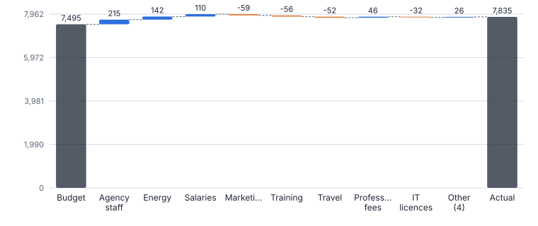
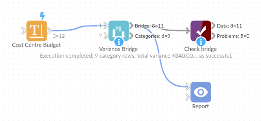

# Variance Bridge

*Omniscope custom block · Analytics*

**Bridge any two totals (budget to actual, last year to this year) by category, as waterfall steps with favourable and adverse labels.**

**Python** · pandas, numpy · nothing extra to install

## The problem it solves

Every month-end pack explains the gap between budget and actual, or this year and last, with a bridge chart. Building one by hand means sorting variances, grouping the small ones, and working out where each bar starts and ends.

This block produces the bridge steps per category (per group if needed), with bar positions for a waterfall chart, favourable / adverse labels and each step's share of the total variance.

- **£7,495k** budget (illustrative)
- **£7,835k** actual
- **+£340k** total variance
- **6** of 12 cost lines over budget

### How it works

- Connect data with a category and two value fields (base and current), and optionally a group field for one bridge each.
- Choose whether higher or lower is better, the step order, how many steps before Other, and the labels for the two totals.
- Outputs: the bridge steps with bar start and end, and the categories with variances.

## What goes in

### Cost centre budget

Invented budget and actual for twelve cost lines.

| Cost Line | Budget (GBP k) | Actual (GBP k) |
|---|---|---|
| Salaries | 4200 | 4310 |
| Agency staff | 180 | 395 |
| Rent and rates | 960 | 960 |
| Energy | 310 | 452 |
| IT licences | 420 | 388 |
| Travel | 150 | 98 |
| Marketing | 600 | 541 |
| Training | 120 | 64 |
| Professional fees | 240 | 286 |
| Equipment | 180 | 203 |
| Postage | 40 | 37 |
| Insurance | 95 | 101 |

*12 rows in the sample file.*

## The options

| Option | Demo setting | What it does |
|---|---|---|
| Category field | `Cost Line` | Each category becomes a step of the bridge, such as a cost line. |
| Base value (for example Budget) | `Budget (GBP k)` | The value the bridge starts from. |
| Current value (for example Actual) | `Actual (GBP k)` | The value the bridge ends at. |
| Better when | `Lower (costs)` | Sets which variances are favourable: higher for revenue, lower for costs. |
| Steps before Other | `8` | 0 = all categories. |

## What comes out

### Bridge

| Step | Label | Kind | Value | Bar Start | Bar End | Direction | Share Of Total Variance |
|---|---|---|---|---|---|---|---|
| 1 | Budget | Total | 7,495 | 0 | 7,495 |  |  |
| 2 | Agency staff | Variance | 215 | 7,495 | 7,710 | Adverse | 0.632 |
| 3 | Energy | Variance | 142 | 7,710 | 7,852 | Adverse | 0.418 |
| 4 | Salaries | Variance | 110 | 7,852 | 7,962 | Adverse | 0.324 |
| 5 | Marketing | Variance | -59 | 7,962 | 7,903 | Favourable | -0.174 |
| 6 | Training | Variance | -56 | 7,903 | 7,847 | Favourable | -0.165 |
| 7 | Travel | Variance | -52 | 7,847 | 7,795 | Favourable | -0.153 |
| 8 | Professional fees | Variance | 46 | 7,795 | 7,841 | Adverse | 0.135 |
| 9 | IT licences | Variance | -32 | 7,841 | 7,809 | Favourable | -0.094 |
| 10 | Other (4) | Variance | 26 | 7,809 | 7,835 | Adverse | 0.076 |
| 11 | Actual | Total | 7,835 | 0 | 7,835 |  |  |

### Categories

| Category | Budget | Actual | Variance | Variance % | Direction |
|---|---|---|---|---|---|
| Agency staff | 180 | 395 | 215 | 1.194 | Adverse |
| Energy | 310 | 452 | 142 | 0.458 | Adverse |
| Salaries | 4,200 | 4,310 | 110 | 0.026 | Adverse |
| Marketing | 600 | 541 | -59 | -0.098 | Favourable |
| Training | 120 | 64 | -56 | -0.467 | Favourable |
| Travel | 150 | 98 | -52 | -0.347 | Favourable |
| Professional fees | 240 | 286 | 46 | 0.192 | Adverse |
| IT licences | 420 | 388 | -32 | -0.076 | Favourable |
| Other (4) | 1,275 | 1,301 | 26 | 0.02 | Adverse |

*Agency staff and energy drive the overspend; travel and training savings offset part of it (illustrative figures).*

## Where it pays off

### Finance: Budget vs actual

Monthly cost centre and P&L bridges with favourable and adverse variances.

### Sales: Year-on-year revenue

Revenue change by region, channel or product from last year to this year.

### Operations: Forecast vs outturn

Where an outturn differs from the forecast, by cost driver.

### Public sector: Spend against allocation

Variance against allocation by service line, per directorate.

*Use cases describe typical scenarios and are illustrative.*

## Why do this in Omniscope

- **Same ledger as the rest of the pack.** The bridge comes from the ledger that feeds the other views, so the waterfall, the variance table and the Period Comparison table share report filters.
- **Bars that close.** Each step's start and end run from the base total to the current total, and favourable or adverse follows the better-when setting; the tests check the steps and bar positions.
- **Steps grouped your way.** Labels, step order and the number of steps before Other are options; the script is short if your pack groups cost lines into families first.

## How it fits into an Omniscope workflow

Budget and actuals (ledger) → **Variance Bridge** → Report (waterfall chart, variance table)

Period Comparison and Price-Volume-Mix Bridge give other cuts of the same question.

Chart Bar Start and Bar End as a floating bar (waterfall) in a Report.

## In one step

Variance bridges ready for a waterfall chart, labelled favourable or adverse.

## Try it

1. Open the demo project (`demo.iox` on the demo server, or import `demo.ioz` from this folder): an invented cost centre's budget and actual.
2. The question: why are we over budget?
3. Run the block with lower is better and the top eight lines plus Other.
4. Look at the waterfall: +£340k overall, mostly agency staff and energy.
5. Switch the order to name, or add a group field for one bridge per region.

## Running in Omniscope

*The demo project's workflow: the sample data, the block, and a Validate data check on its output.*

<!--language-->
## Language and libraries

Python. It uses pandas and numpy.

pandas and numpy are part of Omniscope's Docker Python image, and the block was run in both host mode and Docker mode on an Omniscope server, with the same results. It needs nothing else installed.
<!--/language-->

## Tested

The demo workflow runs without errors on an Omniscope server and produces 11 records in Bridge and 9 in Categories. Its automated tests cover bridge steps and bar positions, Other, order and groups, the sample data, empty input and bad fields.
