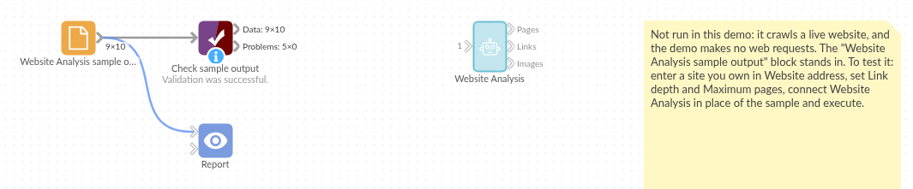

# Website Analysis

*Omniscope custom block · Analytics*

**What is on a website, and what is broken? Every page with its title, heading, text and status, every link and every image, from one start address.**

**Python** · HTTPX, Beautiful Soup, pandas · HTTPX and Beautiful Soup installed on first run

## The problem it solves

A website grows for years: pages are moved, renamed and forgotten, links break, images go up without alternative text. Finding that out by clicking through is slow, and the answer is out of date as soon as the next page is published.

The block starts at one address, follows the site's own links level by level, and writes down what it finds: one record per page, per link and per image, ready to filter, count and report.

- **10** addresses read on the sample site, from the home page down to **3** clicks deep
- **1** broken link found: "Last year's offers" on the home page leads to a 404
- **1** redirect followed: `/contact` to `/contact/`
- **1** PDF listed but not downloaded, **1** page skipped because the site's robots.txt asks crawlers to keep out
- **4** images found, **1** with no alternative text

### How it works

- Enter the start address. The block reads it, then the same-site pages it links to, one depth at a time, up to the link depth and the maximum pages.
- Each page gets its title, first heading, visible text, HTTP status and, if it failed, the reason.
- Every link and image on the pages read is listed with the page it is on.

## What goes in

The block has no input: it starts from the address in its options. The examples here come from a small simulated website, an invented garden supplies shop at `www.example.com`, used by the block's tests.

| Page | Links to |
|---|---|
| `/` (Fernhill Garden Supplies) | `about/`, `products/index.html`, `/contact`, `/private/stock.html`, `/old-offers.html` (missing), another site, an e-mail address |
| `/about/` | `team.html`, `../products/index.html`, `/` |
| `/products/index.html` | `pots.html`, `tools.html#trowels`, `tools.html`, `catalogue.pdf` |
| `/products/tools.html` | `deep/spades.html` |

*The site's robots.txt asks crawlers not to fetch `/private/`.*

## The options

| Option | Demo setting | What it does |
|---|---|---|
| Website address | `https://www.example.com/` | The page to start from. |
| Link depth | 4 | How many links to follow away from the start page. |
| Maximum pages | 100 | Stop after this many pages. |
| Pages fetched at once | 5 | How many requests at the same time. |
| Respect robots.txt | ticked | Skip pages the site's robots.txt rules out. |

## What comes out

### Pages

| url | title | h1 | depth | status | content_type | error |
|---|---|---|---|---|---|---|
| https://www.example.com/ | Fernhill Garden Supplies | Welcome to Fernhill | 0 | 200 | text/html | |
| https://www.example.com/about/ | About Fernhill | About us | 1 | 200 | text/html | |
| https://www.example.com/products/index.html | Products | Products | 1 | 200 | text/html | |
| https://www.example.com/contact | Contact | Contact us | 1 | 200 | text/html | |
| https://www.example.com/old-offers.html | | | 1 | 404 | text/html | HTTP 404 Not Found |
| https://www.example.com/about/team.html | Our team | Our team | 2 | 200 | text/html | |
| https://www.example.com/products/pots.html | Pots | Terracotta pots | 2 | 200 | text/html | |
| https://www.example.com/products/tools.html | Tools | Tools | 2 | 200 | text/html | |
| https://www.example.com/products/catalogue.pdf | | | 2 | 200 | application/pdf | |
| https://www.example.com/products/deep/spades.html | Spades | Spades | 3 | 200 | text/html | |

Each page also has its visible text (the home page's starts "Skip to content About us Products Contact Stock list Welcome to Fernhill Pots, compost and tools for gardens of every size.") and `final_url`: for `/contact` it is `https://www.example.com/contact/`.

### Links (the home page's)

| parent | url | link_text | internal |
|---|---|---|---|
| https://www.example.com/ | https://www.example.com/ | Skip to content | true |
| https://www.example.com/ | https://www.example.com/about/ | About us | true |
| https://www.example.com/ | https://www.example.com/products/index.html | Products | true |
| https://www.example.com/ | https://www.example.com/contact | Contact | true |
| https://www.example.com/ | https://www.example.com/private/stock.html | Stock list | true |
| https://www.example.com/ | https://social.example.org/fernhill | Social | false |
| https://www.example.com/ | mailto:hello@example.com | hello@example.com | false |
| https://www.example.com/ | https://www.example.com/old-offers.html | Last year's offers | true |

17 links in all on the eight web pages read.

### Images

| page | image | alt |
|---|---|---|
| https://www.example.com/ | https://www.example.com/img/logo.png | Fernhill logo |
| https://www.example.com/about/ | https://www.example.com/img/shop.jpg | The shop |
| https://www.example.com/about/team.html | https://www.example.com/img/team.jpg | |
| https://www.example.com/products/pots.html | https://www.example.com/products/pot-30.jpg | 30 cm pot |

## Where it pays off

### Website upkeep: Broken links

Join the Links output to the Pages output on the link's address and filter on an error, to list every broken link with the page it is on and its text.

### Accessibility: Images without alternative text

Filter the Images output on an empty `alt` to list the images screen-reader users can't make sense of, page by page.

### Content audits: An inventory of pages

List every page with its title, heading and depth, and spot duplicate titles, missing headings or pages buried many clicks deep.

### Text analysis: A site's words as data

Feed the Pages output's text to text-analysis blocks (word counts, topics, sentiment) to see what a site talks about.

*Use cases describe typical scenarios and are illustrative; the sample data is invented.*

## Why do this in Omniscope

- **Three tables, joined in the workflow.** Pages, links and images come out as separate outputs that share their addresses, so a Join of Links to Pages turns "which links are broken, and where" into one table for the Report.
- **A scheduled check of the site.** Run the workflow every week and the same pages are read in the same order, so Validate data, pointed at the Pages output, can flag a new 404 or a sudden drop in the number of pages.
- **A crawler you can read.** The rules (same host only, a 20-second time limit, the user agent, which tags count as text) are in the block's script, open in the block editor to adjust.

## How it fits into an Omniscope workflow

**Website Analysis** → Pages: Record filter (error is not empty) → Report · Links: Join to Pages on url → Report · Images: Record filter (alt is empty) → Report

## Try it

1. Open the demo project (`demo.iox` on the demo server, or import `demo.ioz` from this folder). The demo server does not crawl websites, so the demo shows the block with a sample address next to a File block holding the Pages output for the simulated site.
2. The question: which pages does the site have, and which links are broken?
3. On your own server, open Website Analysis and enter your site's address, with Link depth 1 and Maximum pages 20 for a first look. Run it.
4. Look at the Pages output: each page with its status; filter on the error field to see the broken ones.
5. Raise the link depth and the maximum pages to cover more of the site.

## Running in Omniscope

*The demo project's workflow: the sample data, the block, and a Validate data check on its output.*

<!--language-->
## Language and libraries

Python. It uses HTTPX (BSD licence) to fetch the pages, Beautiful Soup (MIT licence) to read them, and pandas.

pandas is part of Omniscope's Python environment. HTTPX and Beautiful Soup are listed in the block's dependencies, so Omniscope installs them with pip on first run if they are missing; the server needs access to the Python package index for that, or the packages installed beforehand. The server also needs access to the websites you analyse.
<!--/language-->

## Tested

The block is covered by automated tests that run its script against a stand-in for Omniscope's Python API and a simulated website (no real site is contacted): the whole sample site, links relative to their page, a start address that redirects, links with #fragments, link depth and page limits, robots.txt respected and ignored, an unreachable site, bad options, and a generated site of 400 pages.
