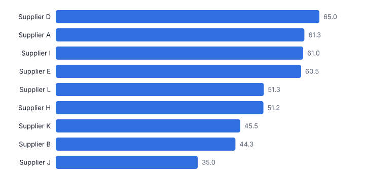
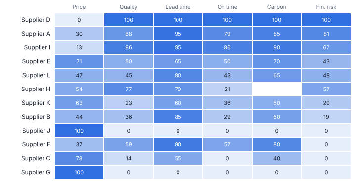
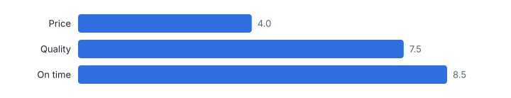
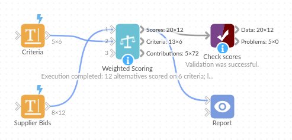

# Weighted Scoring

*Omniscope custom block · Analytics*

**Multi-criteria scorecards for suppliers, sites, bids and projects: normalised criteria, weights, must-pass thresholds, ranking, and a check of how much the winner depends on the weights.**

**Python** · pandas, numpy · nothing extra to install

## The problem it solves

Tender evaluations, site selections and project prioritisation usually end up in a spreadsheet with hand-built scales, hidden weights and pass / fail rules applied by eye. The result is hard to audit, easy to break, and rarely tells you whether the winner would still win if the weights moved a little.

This block does the whole scorecard in one step: each criterion on a 0-100 scale (with lower-is-better criteria turned round), weights applied, alternatives that miss a must-have knocked out with the reason, ranks within groups, and a sensitivity check per weight.

- **12** bids scored on 6 criteria (illustrative)
- **3** knocked out by a must-pass threshold
- **Supplier D** leads with 65.0, 3.7 points ahead
- **+4.0 pts** change in the price weight that would hand the win to Supplier E

### How it works

- Connect the alternatives, one row per supplier, site or bid, with a numeric field per criterion.
- Either choose the criteria fields and type the weights (`Price: 35, Quality: 25`), marking lower-is-better fields; or connect a criteria table on input 2 with a row per criterion: name, weight, Higher / Lower, and optional minimum and maximum thresholds.
- Choose the normalisation (min-max, percent of best, rank, z-score) and how to treat missing values. Optionally rank within groups such as lots.
- Outputs: scores, points and ranks; the criteria with weight sensitivity; and the points in long form for stacked bar charts.

## What goes in

### Input 1: supplier bids

Twelve fictional suppliers with invented figures. Supplier H did not report carbon.

| Supplier | Region | Annual Price (GBP k) | Quality Score | Lead Time (days) | On-Time Delivery % | Carbon (kg CO2e per unit) | Financial Risk Score |
|---|---|---|---|---|---|---|---|
| Supplier A | UK | 412 | 8.1 | 6 | 96.5 | 1.9 | 22 |
| Supplier B | UK | 398 | 7.4 | 8 | 93.0 | 2.4 | 35 |
| Supplier C | EU | 365 | 6.9 | 14 | 89.5 | 2.8 | 48 |
| Supplier D | UK | 441 | 8.8 | 5 | 98.0 | 1.6 | 18 |
| Supplier E | EU | 372 | 7.7 | 12 | 94.5 | 2.2 | 30 |
| Supplier F | UK | 405 | 7.9 | 7 | 95.0 | 2.0 | 74 |
| Supplier G | Asia | 331 | 6.2 | 28 | 87.0 | 3.9 | 41 |
| Supplier H | EU | 389 | 8.3 | 11 | 92.5 |  | 27 |
| Supplier I | UK | 428 | 8.5 | 6 | 97.0 | 1.8 | 25 |
| Supplier J | Asia | 344 | 6.6 | 25 | 91.0 | 3.6 | 39 |
| Supplier K | EU | 380 | 7.1 | 13 | 93.5 | 2.6 | 33 |
| Supplier L | UK | 395 | 7.6 | 9 | 94.0 | 2.3 | 29 |

*12 rows in the sample file.*

### Input 2: criteria

| Criterion | Weight | Better When | Minimum | Maximum |
|---|---|---|---|---|
| Annual Price (GBP k) | 35 | Lower |  |  |
| Quality Score | 25 | Higher | 6.5 |  |
| Lead Time (days) | 10 | Lower |  |  |
| On-Time Delivery % | 15 | Higher | 90.0 |  |
| Carbon (kg CO2e per unit) | 10 | Lower |  |  |
| Financial Risk Score | 5 | Lower |  | 70.0 |

*6 rows in the sample file.*

## The options

| Option | Demo setting | What it does |
|---|---|---|
| Alternative name field | `Supplier` | Names each option being scored, such as a supplier. |
| Criterion name | `Criterion` | Must match a field of input 1. |
| Weight | `Weight` | Weight of each criterion; scaled to sum to 100%. |
| Better when (Higher / Lower) | `Better When` | Higher or Lower: which way is better for the criterion. |
| Minimum (must pass) | `Minimum` | Lowest acceptable value; options below it fail. |
| Maximum (must pass) | `Maximum` | Highest acceptable value; options above it fail. |
| Normalisation | `Min-max (worst 0, best 100)` | How each criterion is put on a common 0 to 100 scale before weighting. |
| Missing values | `Score as worst (0)` | How an option with no value for a criterion is scored. |

## What comes out

### Scorecard

| Supplier | Total Score | Rank | Gap To Leader | Passes Thresholds | Failed On | Price pts | Quality pts | Lead time pts | On time pts | Carbon pts | Fin. risk pts |
|---|---|---|---|---|---|---|---|---|---|---|---|
| Supplier D | 65 | 1 | 0 | Yes |  | 0 | 25 | 10 | 15 | 10 | 5 |
| Supplier A | 61.3 | 2 | 3.7 | Yes |  | 10.5 | 17 | 9.5 | 11.8 | 8.5 | 4 |
| Supplier I | 61 | 3 | 4 | Yes |  | 4.7 | 21.6 | 9.5 | 12.9 | 9 | 3.3 |
| Supplier E | 60.5 | 4 | 4.5 | Yes |  | 24.9 | 12.5 | 6.5 | 7.5 | 7 | 2.1 |
| Supplier L | 51.3 | 5 | 13.7 | Yes |  | 16.6 | 11.4 | 8 | 6.4 | 6.5 | 2.4 |
| Supplier H | 51.2 | 6 | 13.8 | Yes |  | 18.8 | 19.3 | 7 | 3.2 | 0 | 2.9 |
| Supplier K | 45.5 | 7 | 19.5 | Yes |  | 22 | 5.7 | 6 | 5.4 | 5 | 1.4 |
| Supplier B | 44.3 | 8 | 20.7 | Yes |  | 15.5 | 9.1 | 8.5 | 4.3 | 6 | 1 |
| Supplier J | 35 | 9 | 30 | Yes |  | 35 | 0 | 0 | 0 | 0 | 0 |
| Supplier F | 53.3 |  |  | No | Financial Risk Score above 70 | 13 | 14.8 | 9 | 8.6 | 8 | 0 |
| Supplier C | 40.3 |  |  | No | On-Time Delivery % below 90 | 27.4 | 3.4 | 5.5 | 0 | 4 | 0 |
| Supplier G | 35 |  |  | No | Quality Score below 6.5; On-Time Delivery % below 90 | 35 | 0 | 0 | 0 | 0 | 0 |

### Criteria and sensitivity

| Criterion | Weight Share | Better When | Minimum | Maximum | Leader | New Leader | Sensitivity |
|---|---|---|---|---|---|---|---|
| Annual Price (GBP k) | 35 | Lower |  |  | Supplier D | Supplier E | Leader changes to Supplier E if the weight rises to 39.0% (+4.0 points) |
| Quality Score | 25 | Higher | 6.5 |  | Supplier D | Supplier E | Leader changes to Supplier E if the weight falls to 17.5% (-7.5 points) |
| Lead Time (days) | 10 | Lower |  |  | Supplier D |  | Supplier D leads at any weight for this criterion |
| On-Time Delivery % | 15 | Higher | 90 |  | Supplier D | Supplier E | Leader changes to Supplier E if the weight falls to 6.5% (-8.5 points) |
| Carbon (kg CO2e per unit) | 10 | Lower |  |  | Supplier D |  | Supplier D leads at any weight for this criterion |
| Financial Risk Score | 5 | Lower |  | 70 | Supplier D |  | Supplier D leads at any weight for this criterion |

*Supplier D wins, but the top four are within 4.5 points of each other (illustrative data).*

*Where each supplier's score comes from. Knocked-out suppliers are scored against the range of those that passed, capped at 0 and 100.*

*A small move in the price weight changes the winner; Lead time, Carbon, Fin. risk could take any weight without changing it.*

## Where it pays off

### Procurement: Tender evaluation

Score bids on price, quality, delivery and social value with published weights and must-pass rules, and keep the scorecard as an auditable workflow.

### Retail and property: Site selection

Rank candidate locations on footfall, catchment spend, rent, competition and access, per region.

### Portfolio management: Project prioritisation

Score proposed projects on value, cost, risk and strategic fit, and show how robust the top of the list is to the weights.

### HR: Structured shortlisting

Combine assessment scores with agreed weights and minimum standards, with the reason any candidate was screened out.

*Use cases describe typical scenarios and are illustrative.*

## Why do this in Omniscope

- **Weights the panel can change.** The criteria and weights are an editable table inside the workflow, so the panel can adjust them and see ranks and sensitivity update on the same bids.
- **How close the decision is.** For each criterion the block finds the weight change that would hand the lead to someone else, such as 4 points on price for Supplier E; the tests check that this flip point is found.
- **Knock-outs with reasons.** Must-pass thresholds remove bids with the criterion they failed on, so the scorecard is an auditable record rather than a judgement applied by eye.
- **Scales you can add.** Four normalisations and three missing-value rules are options; another scale is a function in the block's script.

## How it fits into an Omniscope workflow

Bids or candidates (file, form, database) → Criteria table (Data Table block) → **Weighted Scoring** → Report (scorecard, stacked bars)

Keep the criteria and weights in an editable table so the panel can change them and re-run; Find Nearest or Point in Polygon upstream can add distance or territory criteria for sites.

Show the scorecard with the contributions output as stacked bars, and the sensitivity table next to the decision.

## In one step

Scales, weights, thresholds, ranks and a sensitivity check, driven by a criteria table.

## Try it

1. Open the demo project (`demo.iox` on the demo server, or import `demo.ioz` from this folder): twelve fictional supplier bids and a criteria table with weights and must-pass rules.
2. The question: who wins the tender, why, and would they still win if the panel had weighted price differently?
3. Look at the criteria table on input 2, then the block options: the scoring comes from the table, so the panel can change weights without touching the workflow.
4. Look at the scorecard: 3 suppliers knocked out with the reason, Supplier D leading with 65.0.
5. Look at the sensitivity: if the price weight rises from 35% to 39.0%, Supplier E wins instead.

## Running in Omniscope

*The demo project's workflow: the sample data, the block, and a Validate data check on its output.*

<!--language-->
## Language and libraries

Python. It uses pandas and numpy, plus the Python standard library (re).

pandas and numpy are part of Omniscope's Docker Python image, and the block was run in both host mode and Docker mode on an Omniscope server, with the same results. It needs nothing else installed.
<!--/language-->

## Tested

The demo workflow completed without errors on an Omniscope server (12 records in Scores, 6 in Criteria and 72 in Contributions). Automated tests check normal data, empty input, wrong types and large input.
