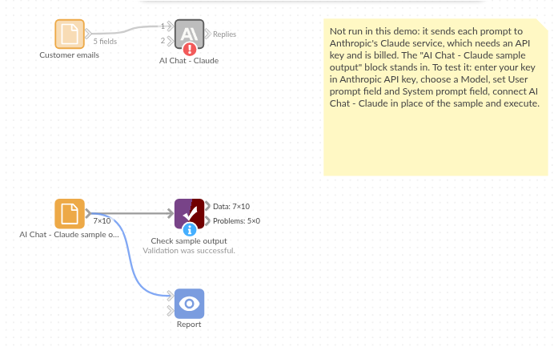

# AI Chat - Claude

*Omniscope custom block · Connectors*

**A pile of customer emails, each needing a category? One Claude reply per record, added beside the email, ready to count and chart.**

**Python** · anthropic, pandas · anthropic installed on first run

## The problem it solves

A shared mailbox gets a few hundred customer emails a day. Before anyone can say which kind of problem is growing, each email needs a category, and reading them all to tag them by hand is the slow part.

This block sends each email to Claude with the same instruction, "reply with one category only", and writes the answer beside the email, so the categories can be counted by day, charted, and checked.

- **10** invented emails in, **10** records out, in the same order
- **9** categorised: Delivery, Returns, Billing, Product fault or Other
- **1** email with no text not sent, and kept with an empty Response

### How it works

- Paste an Anthropic API key, and keep the default model (claude-haiku-5-5) or enter another.
- Choose the field with each record's prompt, and the field with the instructions (the system prompt).
- The block sends one request per record, 4 at a time by default, and adds **Response** and **Truncated** to each record.

## What goes in

### Customer emails

10 invented emails to an online homeware shop.

| Ticket | Received | Customer | Message |
|---|---|---|---|
| T-4101 | 2025-05-12 | Harriet Cole | My order was due on Friday and still hasn't arrived. The tracking page hasn't changed for four days. |
| T-4102 | 2025-05-12 | Dev Patel | The bedside lamp I bought flickers and then switches itself off after a few minutes. |
| T-4103 | 2025-05-12 | Moira Lennox | I was charged twice for the same order. Please refund the second payment. |
| T-4104 | 2025-05-13 | Tom Ashworth | The curtains are lovely but the wrong length. How do I send them back and swap them? |
| T-4105 | 2025-05-13 | Priya Nair | Do you have a showroom in Manchester where I could see the sofas? |
| T-4106 | 2025-05-13 | Gareth Lloyd |  |

*10 rows in the sample file. The Instruction field holds the same text on every row: "You triage customer emails for an online homeware shop. Reply with one category only: Delivery, Returns, Billing, Product fault or Other."*

## The options

| Option | Demo setting | What it does |
|---|---|---|
| Anthropic API key | (your key) | A key from the Claude Console. |
| Model | `claude-haiku-5-5` | The Claude model ID. |
| User prompt field | `Message` | The text sent for each record. |
| System prompt field | `Instruction` | The instructions: the role and the five categories. |
| Maximum response length (tokens) | `1024` | Replies longer than this are cut short and marked as truncated. |
| Requests at a time | `4` | How many requests are sent at once. |

## What comes out

### Replies (selected fields)

| Ticket | Message | Response | Truncated |
|---|---|---|---|
| T-4101 | My order was due on Friday and still hasn't arrived. The tracking page hasn't changed for four days. | Delivery | false |
| T-4102 | The bedside lamp I bought flickers and then switches itself off after a few minutes. | Product fault | false |
| T-4103 | I was charged twice for the same order. Please refund the second payment. | Billing | false |
| T-4104 | The curtains are lovely but the wrong length. How do I send them back and swap them? | Returns | false |
| T-4105 | Do you have a showroom in Manchester where I could see the sofas? | Other | false |
| T-4106 |  |  |  |
| T-4107 | The courier left my parcel with a neighbour I don't know and I can't find it. | Delivery | false |
| T-4108 | One of the four dining chairs arrived with a cracked leg. | Product fault | false |
| T-4109 | I returned a rug three weeks ago and haven't had my refund yet. | Returns | false |
| T-4110 | My discount code wasn't applied at checkout, so I paid full price. | Billing | false |

10 records in all, with every input field kept. T-4106 has no message, so it was not sent and its Response is empty.

## Where it pays off

### Customer service: Email and chat triage

Tag incoming messages by topic or urgency, then count them per day and route the urgent ones.

### Complaints handling: Reasons and products

Pull the product and the reason out of free-text complaints, to report complaint rates per product line.

### Sales: Call notes to next steps

Summarise each call note into one line and a next action, for a weekly pipeline review.

### Compliance: First-pass screening

Flag messages that mention cancellations, refunds or legal words, for a person to review first.

*Use cases describe typical scenarios and are illustrative; the sample data is invented.*

## Why do this in Omniscope

- **Categories beside the email, in the same workflow.** The Response field sits on the email record, so an Aggregate block can count emails per category per day and the Report can chart them, with no export to a spreadsheet and back.
- **A check on what the model said.** A model's replies can vary from run to run; a Validate data block after this one can stop a scheduled run if any Response is not one of the five categories, before the counts reach the Report.
- **Your key, and a script you can change.** The key and model are block options, not server settings, and the call to the API is one small Python function you can edit: add stop sequences, or change how the reply is read, in a few lines.

## How it fits into an Omniscope workflow

Mailbox export (File or database) → Filter (today's emails) → **AI Chat - Claude** → Validate data (Response is one of the five categories) → Aggregate (emails per category per day) → Report

Filter the input to new emails first: every run sends every record with a prompt again.

## Try it

1. Open the demo project (`demo.iox` on the demo server, or import `demo.ioz` from this folder). It holds the AI Chat - Claude block (unconfigured: no API key), and a File block with `placeholder.csv`: the sample records with the replies the block writes for them.
2. The question: which kind of problem do customers write about most?
3. Follow the File block into the rest of the workflow: emails per category (Delivery 2, Returns 2, Billing 2, Product fault 2, Other 1, and one empty).
4. To use it with your own data: enter an Anthropic API key in the AI Chat - Claude block, connect your records and choose the prompt and instruction fields, run it, and connect its Replies output where the File block was.

## Running in Omniscope

*The demo project's workflow: the placeholder data, the block, and a Validate data check on the output.*

<!--language-->
## Language and libraries

Python. It uses the anthropic package (Apache License 2.0), Anthropic's Python SDK, and pandas (BSD 3-Clause).

pandas is part of Omniscope's Python environment. anthropic is listed in the block's dependencies, so Omniscope installs it with pip on first run if it is missing.
<!--/language-->

## Tested

The block is covered by automated tests that run its script against a stand-in for Omniscope's Python API and invented Anthropic replies (no live calls): the sample data, the request sent (model, system prompt, maximum length, no temperature), an optional system prompt, empty and missing prompts, numbers and dates as prompts, the input's fields kept, an existing Response field, empty input, replies cut short, failed requests (a refused key and an unknown model), option checks, 400 records sent several at a time, and replies that start with a thinking block or have no text. With the real anthropic package installed, further tests let it build the HTTP requests and read the canned replies.
