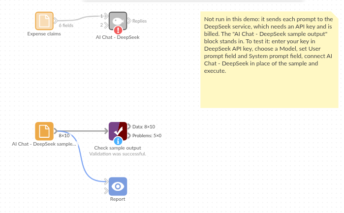

# AI Chat - DeepSeek

*Omniscope custom block · Connectors*

**Expense claims described in everyone's own words? A DeepSeek category per claim, added beside the amount, ready to total.**

**Python** · openai, pandas · openai installed on first run

## The problem it solves

Expense claims arrive with a free-text description: "Taxi from station to supplier's warehouse", "Team breakfast before planning day". To report spend per category, each one needs a category, and finance staff end up re-keying them.

This block sends each description to DeepSeek with the list of categories and writes the category beside the claim, so amounts can be totalled per category and the odd ones reviewed.

- **10** invented claims in, **10** records out, in the same order
- **7** categories to choose from, and every claim given one
- **Amount** kept as a number, ready to total per category

### How it works

- Paste a DeepSeek API key, and keep the default model (deepseek-flash) or enter another.
- Choose the field with each record's prompt, and the field with the instructions (the system prompt).
- The block sends one request per record, 4 at a time by default, and adds **Response** and **Truncated** to each record.

## What goes in

### Expense claims

10 invented expense claims from five employees.

| Claim | Employee | Date | Amount | Description |
|---|---|---|---|---|
| EX-7001 | A. Fairweather | 2025-06-02 | 48.6 | Return train Leeds to York for client workshop |
| EX-7002 | A. Fairweather | 2025-06-02 | 23.15 | Lunch with client team at workshop |
| EX-7003 | B. Okafor | 2025-06-03 | 129.0 | Hotel, one night, Bristol, for site audit |
| EX-7004 | B. Okafor | 2025-06-04 | 12.99 | Printer paper and toner refill for home office |
| EX-7005 | C. Hughes | 2025-06-05 | 19.0 | Monthly subscription, diagram drawing tool |
| EX-7006 | C. Hughes | 2025-06-06 | 350.0 | One-day spreadsheet modelling course |

*10 rows in the sample file. The Instruction field holds the same text on every row: "Classify this expense claim into one category: Travel, Accommodation, Meals, Office supplies, Software, Training or Other. Reply with the category only."*

## The options

| Option | Demo setting | What it does |
|---|---|---|
| DeepSeek API key | (your key) | A key from the DeepSeek platform. |
| Model | `deepseek-flash` | The DeepSeek model ID. |
| User prompt field | `Description` | The claim's description, sent for each record. |
| System prompt field | `Instruction` | The instruction and the seven categories. |
| Temperature | (empty) | The model's default (no effect while the model is thinking). |
| Maximum response length (tokens) | (empty) | DeepSeek's default. |
| Requests at a time | `4` | How many requests are sent at once. |

## What comes out

### Replies (selected fields)

| Claim | Amount | Description | Response | Truncated |
|---|---|---|---|---|
| EX-7001 | 48.6 | Return train Leeds to York for client workshop | Travel | false |
| EX-7002 | 23.15 | Lunch with client team at workshop | Meals | false |
| EX-7003 | 129.0 | Hotel, one night, Bristol, for site audit | Accommodation | false |
| EX-7004 | 12.99 | Printer paper and toner refill for home office | Office supplies | false |
| EX-7005 | 19.0 | Monthly subscription, diagram drawing tool | Software | false |
| EX-7006 | 350.0 | One-day spreadsheet modelling course | Training | false |
| EX-7007 | 7.5 | Parking at Manchester Piccadilly | Travel | false |
| EX-7008 | 31.4 | Taxi from station to supplier's warehouse | Travel | false |
| EX-7009 | 15.0 | Flowers for a colleague's leaving card | Other | false |
| EX-7010 | 54.2 | Team breakfast before quarterly planning day | Meals | false |

10 records in all, with every input field kept.

## Where it pays off

### Finance: Expense and transaction coding

Suggest a category or nominal code for each claim or card transaction, for a person to confirm.

### Procurement: Spend categories

Classify purchase order lines into a spend taxonomy, to see spend per category and supplier.

### IT service: Ticket routing

Assign each incoming ticket to a team from its description.

### Research: Coding open answers

Give each open survey answer a code from a fixed code frame, for counting.

*Use cases describe typical scenarios and are illustrative; the sample data is invented.*

## Why do this in Omniscope

- **Categories next to the amounts.** The category is added to the claim record, so an Aggregate block totals spend per category and employee in the same workflow, and the Report shows it, without copying claims into a spreadsheet to tag them.
- **A check before the totals.** A Validate data block after this one can stop a monthly scheduled run if any Response is not one of the seven categories, so a stray reply never reaches the finance report.
- **Thinking on or off, in the script.** The request is the OpenAI client pointed at DeepSeek's address, a short function in the block editor: for simple categories, adding DeepSeek's `thinking` setting (disabled) to it gives faster replies and lets the Temperature option take effect.

## How it fits into an Omniscope workflow

Expense claims (File or database) → Filter (this month) → **AI Chat - DeepSeek** → Validate data (Response is one of the seven categories) → Aggregate (Amount per Response and Employee) → Report

Filter the input to new claims first: every run sends every record with a prompt again.

## Try it

1. Open the demo project (`demo.iox` on the demo server, or import `demo.ioz` from this folder). It holds the AI Chat - DeepSeek block (unconfigured: no API key), and a File block with `placeholder.csv`: the sample records with the replies the block writes for them.
2. The question: how much was spent on each kind of expense?
3. Follow the File block into the rest of the workflow: Amount totalled per category (Travel: 87.50 over three claims, Meals: 77.35 over two).
4. To use it with your own data: enter a DeepSeek API key in the AI Chat - DeepSeek block, connect your records and choose the prompt and instruction fields, run it, and connect its Replies output where the File block was.

## Running in Omniscope

*The demo project's workflow: the placeholder data, the block, and a Validate data check on the output.*

<!--language-->
## Language and libraries

Python. It uses the openai package (Apache License 2.0), OpenAI's Python SDK, which DeepSeek's OpenAI-compatible API also works with, and pandas (BSD 3-Clause).

pandas is part of Omniscope's Python environment. openai is listed in the block's dependencies, so Omniscope installs it with pip on first run if it is missing.
<!--/language-->

## Tested

The block is covered by automated tests that run its script against a stand-in for Omniscope's Python API and invented DeepSeek replies (no live calls): the sample data, the request sent (model, system prompt, temperature and maximum length only when set), an optional system prompt, empty and missing prompts, numbers and dates as prompts, the input's fields kept, an existing Response field, empty input, replies cut short, failed requests (a refused key and an unknown model), option checks, and 400 records sent several at a time. With the real openai package installed, further tests let it build the HTTP requests and read the canned replies.
