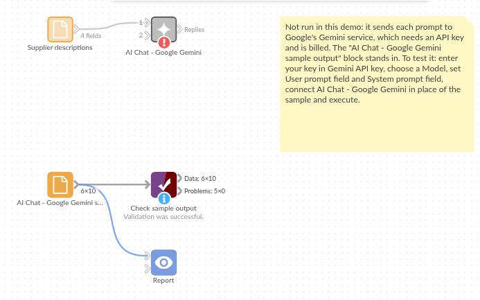

# AI Chat - Google Gemini

*Omniscope custom block · Connectors*

**Supplier product descriptions in every style but your own? A Gemini rewrite per product, added beside the original, ready to check and publish.**

**Python** · google-genai, pandas · google-genai installed on first run

## The problem it solves

Each supplier writes product descriptions its own way: abbreviations, odd capitals, units run together. A web shop needs short, consistent titles, and rewriting them by hand is slow every time a supplier sends a new range.

This block sends each description to Gemini with the shop's house rules for titles and writes the new title beside the original, so it can be checked and exported.

- **10** invented supplier descriptions in, **10** records out, in the same order
- **10** titles of at most 60 characters, in one house style
- **SKU** kept on every record, to join the titles back to the catalogue

### How it works

- Paste a Gemini API key, and keep the default model (gemini-3.5-flash-lite) or enter another.
- Choose the field with each record's prompt, and the field with the instructions (the system prompt).
- The block sends one request per record, 4 at a time by default, and adds **Response** and **Truncated** to each record.

## What goes in

### Supplier descriptions

10 invented product descriptions from three garden suppliers.

| SKU | Supplier | Description |
|---|---|---|
| GS-1001 | Greenleaf Supplies | galvanised steel watering can 9 litre long spout w/ removable brass rose, green powder coat finish |
| GS-1002 | Greenleaf Supplies | FSC beech handle hand trowel stainless blade 30cm overall, hanging hole |
| GS-1003 | Orchard Wholesale | pack 50 x biodegradable plant pots 8cm round, coir fibre, suitable seedlings / cuttings |
| GS-1004 | Orchard Wholesale | solar powered LED string lights 100 bulbs warm white 12m lead 8 modes IP44 |
| GS-1005 | Fernbrook Ltd | Bypass secateurs SK5 carbon steel blade, non-slip grip, safety lock, cuts up to 20mm |
| GS-1006 | Fernbrook Ltd | peat free multi purpose compost 40L bag enriched w/ seaweed, for containers + borders |

*10 rows in the sample file. The Instruction field holds the same text on every row: "Write a product title for an online garden shop from the supplier's description. At most 60 characters, British English, no marketing claims. Reply with the title only."*

## The options

| Option | Demo setting | What it does |
|---|---|---|
| Gemini API key | (your key) | A key from Google AI Studio. |
| Model | `gemini-3.5-flash-lite` | The Gemini model ID. |
| User prompt field | `Description` | The supplier's description, sent for each record. |
| System prompt field | `Instruction` | The house rules: at most 60 characters, British English, no marketing claims. |
| Temperature | (empty) | The model's default. |
| Maximum response length (tokens) | (empty) | The model's default. |
| Requests at a time | `4` | How many requests are sent at once. |

## What comes out

### Replies (selected fields)

| SKU | Description | Response | Truncated |
|---|---|---|---|
| GS-1001 | galvanised steel watering can 9 litre long spout w/ removable brass rose, green powder coat finish | Galvanised Steel Watering Can, 9 L, Brass Rose | false |
| GS-1002 | FSC beech handle hand trowel stainless blade 30cm overall, hanging hole | Stainless Steel Hand Trowel with Beech Handle | false |
| GS-1003 | pack 50 x biodegradable plant pots 8cm round, coir fibre, suitable seedlings / cuttings | Biodegradable Coir Plant Pots, 8 cm, Pack of 50 | false |
| GS-1004 | solar powered LED string lights 100 bulbs warm white 12m lead 8 modes IP44 | Solar LED String Lights, 100 Warm White Bulbs, 12 m | false |
| GS-1005 | Bypass secateurs SK5 carbon steel blade, non-slip grip, safety lock, cuts up to 20mm | Bypass Secateurs with Safety Lock, 20 mm Cut | false |
| GS-1006 | peat free multi purpose compost 40L bag enriched w/ seaweed, for containers + borders | Peat-Free Multi-Purpose Compost with Seaweed, 40 L | false |
| GS-1007 | kneeler / seat 2-in-1 folding steel frame, EVA foam pad, tool pouches both sides | Folding Garden Kneeler and Seat with Tool Pouches | false |
| GS-1008 | bird feeder hanging 4 port metal, squirrel guard cage, seed capacity approx 1kg | Squirrel-Guard Hanging Bird Feeder, 4 Ports | false |
| GS-1009 | expandable hose 15m (50ft) w/ 7 pattern spray gun, brass fittings, lightweight | Expandable Garden Hose, 15 m, 7-Pattern Spray Gun | false |
| GS-1010 | raised bed kit untreated larch 120 x 60 x 30cm, no tools needed, slot together | Larch Raised Bed Kit, 120 x 60 x 30 cm | false |

10 records in all, with every input field kept.

## Where it pays off

### E-commerce: Catalogue titles and descriptions

Rewrite supplier text into the shop's style, with length limits a check can enforce.

### Data quality: Standardising free text

Turn messy job titles, product names or addresses into one consistent form before matching.

### International teams: Translation

Translate short texts per record, keeping the record's ID and other fields beside them.

### Reporting: Plain-English summaries

Write a one-line summary for each long note or incident report, for a table in a Report.

*Use cases describe typical scenarios and are illustrative; the sample data is invented.*

## Why do this in Omniscope

- **Rewrite, check and export in one place.** The new title is added beside the SKU, so any title over 60 characters can stop the run at a Validate data check, and an output block can write the approved titles straight to the shop's import file.
- **Only the new products, each time.** Joined against the existing catalogue first, a scheduled workflow sends only SKUs without a title, so a supplier's new range is titled on the next run and earlier titles stay as they were.
- **A request you can change.** Unlock the block's design and the request is there to edit: add a thinking setting (`thinking_config`) to the config for faster replies, or ask for several title variants.

## How it fits into an Omniscope workflow

Supplier file (File) → Join (catalogue; keep SKUs with no title) → **AI Chat - Google Gemini** → Validate data (Response at most 60 characters) → output block (shop import file)

Send only the products that need a title: every run sends every record with a prompt again.

## Try it

1. Open the demo project (`demo.iox` on the demo server, or import `demo.ioz` from this folder). It holds the AI Chat - Google Gemini block (unconfigured: no API key), and a File block with `placeholder.csv`: the sample records with the replies the block writes for them.
2. The question: what would these products be called in the shop's own style?
3. Follow the File block into the rest of the workflow: the titles beside the descriptions, and a check that every title is at most 60 characters.
4. To use it with your own data: enter a Gemini API key in the AI Chat - Google Gemini block, connect your records and choose the prompt and instruction fields, run it, and connect its Replies output where the File block was.

## Running in Omniscope

*The demo project's workflow: the placeholder data, the block, and a Validate data check on the output.*

<!--language-->
## Language and libraries

Python. It uses the google-genai package (Apache License 2.0), Google's Gen AI SDK for Python, and pandas (BSD 3-Clause).

pandas is part of Omniscope's Python environment. google-genai is listed in the block's dependencies, so Omniscope installs it with pip on first run if it is missing.
<!--/language-->

## Tested

The block is covered by automated tests that run its script against a stand-in for Omniscope's Python API and invented Gemini replies (no live calls): the sample data, the request sent (model, system prompt, temperature and maximum length only when set), an optional system prompt, empty and missing prompts, numbers and dates as prompts, the input's fields kept, an existing Response field, empty input, replies cut short, failed requests (a refused key and an unknown model), option checks, and 400 records sent several at a time. With the real google-genai package installed, further tests let it build the HTTP requests and read the canned replies.
