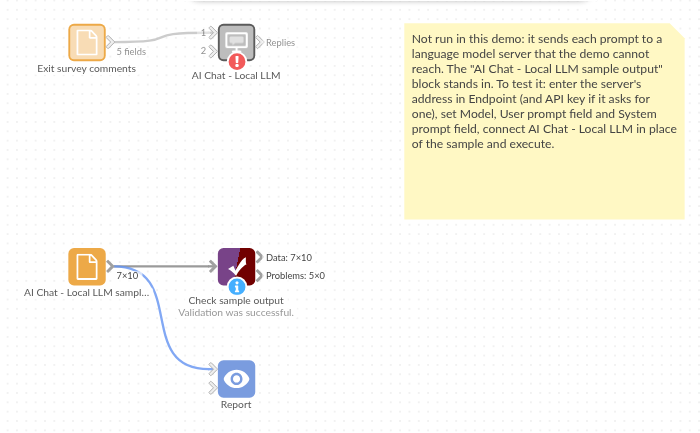

# AI Chat - Local LLM

*Omniscope custom block · Connectors*

**Free-text comments too sensitive to send to a cloud service? A reply per record from a model on your own network, added beside the comment.**

**Python** · openai, pandas · openai installed on first run

## The problem it solves

Exit surveys ask leavers why they are going, and the honest answer is in the free-text comment. Those comments name managers and colleagues; HR may not be allowed to send them to an outside service, so they are read one by one, or not at all.

This block sends each comment to a model running on a machine you control, with the list of reasons to choose from, and writes the reason beside the comment, so leavers' reasons can be counted per department.

- **10** invented survey responses in, **10** records out, in the same order
- **9** comments given a reason: Pay, Career progression, Manager, Workload, Relocation or Other
- **1** response with no comment not sent, and kept with an empty Response

### How it works

- Enter the endpoint of your model server (for example http://localhost:8080/v1) and the model name it expects.
- Choose the field with each record's prompt, and the field with the instructions (the system prompt).
- The block sends one request per record, 1 at a time by default, and adds **Response** and **Truncated** to each record.

## What goes in

### Exit survey comments

10 invented exit-survey responses from five departments.

| Survey ID | Department | Leaving Date | Comment |
|---|---|---|---|
| X-301 | Finance | 2025-01-31 | I was offered the same role elsewhere for noticeably more money. |
| X-302 | Warehouse | 2025-02-14 | Shifts kept getting longer and cover was never arranged when people were off. |
| X-303 | Customer Service | 2025-02-28 |  |
| X-304 | IT | 2025-03-07 | After four years I could not see a route to a senior post here. |
| X-305 | Warehouse | 2025-03-21 | My family is moving to Scotland in the summer. |
| X-306 | Marketing | 2025-04-04 | My line manager rarely gave feedback and cancelled most one-to-ones. |

*10 rows in the sample file. The Instruction field holds the same text on every row: "You read comments from staff exit surveys. Give the main reason for leaving as one of: Pay, Career progression, Manager, Workload, Relocation, Other. Reply with the reason only."*

## The options

| Option | Demo setting | What it does |
|---|---|---|
| Endpoint | `http://localhost:8080/v1` | The model server's OpenAI-compatible address. |
| API key | (empty) | Only if the server asks for one. |
| Model | `LLaMA_CPP` | The model name the server expects. |
| User prompt field | `Comment` | The comment sent for each record. |
| System prompt field | `Instruction` | The instruction and the six reasons. |
| Temperature | (empty) | The server's default. |
| Maximum response length (tokens) | (empty) | The server's default. |
| Requests at a time | `1` | One request at a time, as most local servers answer. |

## What comes out

### Replies (selected fields)

| Survey ID | Department | Comment | Response | Truncated |
|---|---|---|---|---|
| X-301 | Finance | I was offered the same role elsewhere for noticeably more money. | Pay | false |
| X-302 | Warehouse | Shifts kept getting longer and cover was never arranged when people were off. | Workload | false |
| X-303 | Customer Service |  |  |  |
| X-304 | IT | After four years I could not see a route to a senior post here. | Career progression | false |
| X-305 | Warehouse | My family is moving to Scotland in the summer. | Relocation | false |
| X-306 | Marketing | My line manager rarely gave feedback and cancelled most one-to-ones. | Manager | false |
| X-307 | Finance | I am going back to university full-time. | Other | false |
| X-308 | Customer Service | Too many calls per hour and no time to follow anything up properly. | Workload | false |
| X-309 | IT | The pay review was frozen two years running. | Pay | false |
| X-310 | Marketing | I wanted to lead campaigns and that was not going to happen soon. | Career progression | false |

10 records in all, with every input field kept. X-303 has no comment, so it was not sent and its Response is empty.

## Where it pays off

### HR: Exit and engagement surveys

Code free-text answers into reasons or themes without the comments leaving the organisation.

### Healthcare and care services: Incident notes

Classify incident or complaint notes that contain personal details, on a server inside the network.

### Legal and finance: Confidential documents

Summarise or tag contract clauses and case notes that may not go to a cloud service.

### Offline and air-gapped sites: AI without internet

Run the same text tasks on a server with no internet connection at all.

*Use cases describe typical scenarios and are illustrative; the sample data is invented.*

## Why do this in Omniscope

- **The comments stay on your network.** The block talks only to the endpoint in its options, so sensitive text goes from the data source to your own model server and on to the Report, with no outside service in between.
- **Reasons beside the department.** The reason is added to the survey record, so an Aggregate block counts leavers per reason and department per quarter, and the Report charts it, in one workflow.
- **Any server, any model.** Swap the endpoint or model name to compare two local models on the same comments; if your server takes extra settings, unlock the block's design and add them to the request function.

## How it fits into an Omniscope workflow

Exit survey export (File or database) → **AI Chat - Local LLM** → Validate data (Response is one of the six reasons, or empty) → Aggregate (leavers per Response and Department) → Report

Every run sends every record with a prompt again; filter the input to new responses first.

## Try it

1. Open the demo project (`demo.iox` on the demo server, or import `demo.ioz` from this folder). It holds the AI Chat - Local LLM block (unconfigured: the endpoint is empty), and a File block with `placeholder.csv`: the sample records with the replies the block writes for them.
2. The question: why are people leaving, and does it differ by department?
3. Follow the File block into the rest of the workflow: leavers per reason and department (Pay 2, Workload 2, Career progression 2, Relocation 1, Manager 1, Other 1, and one with no comment).
4. To use it with your own data: start a model server with an OpenAI-compatible API, enter its endpoint and model name in the AI Chat - Local LLM block, connect your records and choose the prompt and instruction fields, run it, and connect its Replies output where the File block was.

## Running in Omniscope

*The demo project's workflow: the placeholder data, the block, and a Validate data check on the output.*

<!--language-->
## Language and libraries

Python. It uses the openai package (Apache License 2.0), OpenAI's Python SDK, used here only as a client for OpenAI-compatible servers, and pandas (BSD 3-Clause).

pandas is part of Omniscope's Python environment. openai is listed in the block's dependencies, so Omniscope installs it with pip on first run if it is missing.
<!--/language-->

## Tested

The block is covered by automated tests that run its script against a stand-in for Omniscope's Python API and invented model server replies (no live calls): the sample data, the request sent (model, system prompt, temperature and maximum length only when set, no API key needed), an optional system prompt, empty and missing prompts, numbers and dates as prompts, the input's fields kept, an existing Response field, empty input, replies cut short, failed requests (a refused key and an unknown model), option checks, 400 records sent several at a time, and one request at a time by default. With the real openai package installed, further tests let it build the HTTP requests and read the canned replies.
