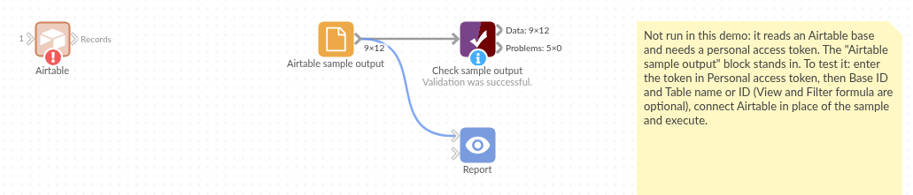

# Airtable

*Omniscope custom block · Connectors*

**Bookings, inventories or project trackers kept in Airtable? The whole table in your workflow, every page of it, with no export to download first.**

**Python** · pandas, requests · requests installed on first run

## The problem it solves

Teams keep live lists in Airtable: bookings, stock, content calendars, project trackers. Reporting on them usually means exporting a CSV by hand, which is out of date by the next morning, or writing an API loop that pages through 100 records at a time and untangles the lists and attachments Airtable returns.

This block reads the table straight from the Airtable API, follows every page, and gives one record per Airtable record, ready to aggregate and chart.

- **12** bookings in the invented demo table, read in **2** pages (the canned test responses split them 7 + 5)
- **8** paid, **4** unpaid: the 4 unticked checkboxes, which Airtable leaves out of a record, arrive as false
- multiple-select tags and attachments arrive as JSON text, for example `["weekend", "group"]`

### How it works

- Each request asks for up to 100 records; the `offset` Airtable returns is sent with the next request until there is none.
- A view or a filter formula, if set, is passed to Airtable, so only those records are sent.
- The record ID comes first; lists and objects become JSON text; a checkbox field becomes true/false; a field mixing text and numbers becomes text.
- "Too many requests" answers are waited out (30 seconds, up to 4 times); other errors stop the block with Airtable's message.

## What goes in

### Workshop bookings (an Airtable table)

An invented table of bookings for an arts centre's workshops: who booked, which workshop, how many seats, whether they have paid, tags and a booking form.

| Name | Email | Workshop | Seats | Paid | Tags | Booked on |
|---|---|---|---|---|---|---|
| Ana Ribeiro | ana@example.com | Pottery for beginners | 2 | ✓ | weekend | 2026-03-02 |
| Priya Nair | priya@example.com | Pottery for beginners | 3 | | weekend, group | 2026-03-03 |
| Callum Reid | callum@example.com | Life drawing | 1 | ✓ | evening | 2026-03-04 |
| Dev Patel | dev@example.com | Life drawing | | | | 2026-03-12 |

*12 bookings in the invented table.*

## The options

| Option | Demo setting | What it does |
|---|---|---|
| Personal access token | (yours) | A token with the `data.records:read` scope. |
| Base ID | (yours) | The base, from the table's web address (`app...`). |
| Table name or ID | `Bookings` | The table, by name or `tbl...` ID. |
| View | empty | Optional: read only one view's records, in its order. |
| Filter formula | empty | Optional: read only the records for which an Airtable formula is true. |
| Page size | 100 | Records per request; all pages are read whatever the size. |

## What comes out

### Records (selected)

| id | Name | Workshop | Seats | Paid | Tags | Booked on |
|---|---|---|---|---|---|---|
| rec01AbCdEfGhIjK | Ana Ribeiro | Pottery for beginners | 2 | true | ["weekend"] | 2026-03-02 |
| rec03AbCdEfGhIjK | Priya Nair | Pottery for beginners | 3 | false | ["weekend", "group"] | 2026-03-03 |
| rec04AbCdEfGhIjK | Callum Reid | Life drawing | 1 | true | ["evening"] | 2026-03-04 |
| rec11AbCdEfGhIjK | Dev Patel | Life drawing | | false | | 2026-03-12 |

12 records, with Email and an Attachments field (JSON text, on the one booking with a form) as well. Aggregated by workshop: Screen printing has 7 seats booked and all 3 bookings paid; Pottery for beginners has 6 seats and only 1 of 3 paid.

## Where it pays off

### Events and bookings: Seats, payments and no-shows

Report seats sold and unpaid bookings per event from the booking table the front desk already uses.

### Operations: Stock and asset registers

Join an Airtable inventory to sales or usage data from a database, and flag items running low.

### Marketing: Content calendars

Count planned, drafted and published pieces per channel and month from a content calendar, with a view such as "This quarter".

### Project tracking: Status across trackers

Combine trackers kept in several bases into one status report, refreshed on a schedule.

*Use cases describe typical scenarios and are illustrative; the sample data is invented.*

## Why do this in Omniscope

- **One workflow from base to report**: the Airtable records feed an Aggregate block and the report directly, so the workshop totals above come from the table as it is now, not from last week's export.
- **Recomputed the same way on every run**: schedule the project and the paging, type clean-up and checks run again each time; a Validate data block after this one can stop the run if a field the report needs disappears from the base.
- **Views and formulas as options**: point the block at an Airtable view or type a filter formula, and only those records travel, which the core HTTP blocks would need as hand-built query parameters.
- **Readable code**: about 120 lines of Python sit behind the block, visible once you unlock its design; change it to send `fields[]` parameters, or to read `createdTime`, without starting from scratch.

## How it fits into an Omniscope workflow

**Airtable** (Bookings) → Field Organiser (Booked on to a date) → Aggregate (seats and paid by workshop) → Report

Booked on and other date fields arrive as text; set their type in a Field Organiser before working with dates.

## Try it

1. Open the demo project (`demo.iox` on the demo server, or import `demo.ioz` from this folder). It holds the Airtable block, not connected to any base, and a File block with `placeholder.csv`: what the block outputs for the invented bookings table. The rest of the workflow runs from the File block.
2. The question: how many seats are booked per workshop, and how many bookings are unpaid?
3. Look at the File block's output: 12 records, with `id` first, Paid as true/false and Tags as JSON text.
4. To read your own table: create a personal access token with the `data.records:read` scope, open the Airtable block, enter the token, base ID and table name, and run it. Then connect it in place of the File block.
5. Set a view or a filter formula such as `{Paid} = FALSE()` and run again: only the matching records arrive.

## Running in Omniscope

*The demo project's workflow: the block, the sample output in a File block, and a Validate data check on it.*

<!--language-->
## Language and libraries

Python. It uses pandas and requests.

pandas is part of Omniscope's Python environment. requests (Apache License 2.0) is listed in the manifest's dependencies; Omniscope installs it on first run if it is missing.
<!--/language-->

## Tested

The block is covered by automated tests that run its script against a stand-in for Omniscope's Python API and canned Airtable responses (no call reaches Airtable): two pages followed by offset, the request sent (address, token header, page size, timeout), table names with spaces and slashes, views and filter formulas, an empty table, a table with its own `id` field, mixed text and numbers, a rate-limit answer waited out, error answers and bad options, and 6,000 records in 60 pages.
