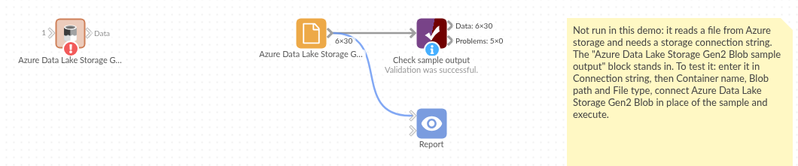

# Azure Data Lake Storage Gen2 Blob

*Omniscope custom block · Connectors*

**Exports and data lake files landing in Azure storage? Read the CSV or Parquet file straight from the container, with the account's connection string, and nothing copied to the server first.**

**Python** · pandas, azure-storage-blob, pyarrow · Azure and Parquet libraries installed on first run

## The problem it solves

Data platforms on Azure drop their files into storage containers: a nightly sales export as CSV, curated tables as Parquet in a data lake. Getting one into a report usually means downloading it by hand, or setting up a shared link that expires.

This block reads the file from the container on every run and outputs its records.

- **30** daily store sales records in the invented demo file, 5 stores over 6 days
- **9** store-days on promotion, kept as true/false
- **2,204** units and £25,836 revenue in all, North the largest region with 937 units

### How it works

- The connection string signs in to the storage account; the container and blob path pick the file.
- The file type comes from the extension (`.parquet`, `.pq`, `.csv`, `.tsv`, `.txt`, optionally `.gz`) unless you choose CSV or Parquet.
- The file is read in memory. Parquet values Omniscope can't hold directly become numbers or text: decimals to numbers, durations to seconds, lists and structs to JSON text.

## What goes in

### Daily store sales (a CSV file in an Azure container)

An invented export from a chain of five shops: one record per store per day.

| Date | Store | Region | Units | Revenue | Promotion |
|---|---|---|---|---|---|
| 2026-03-02 | Leeds Kirkgate | North | 133 | 1899.24 | False |
| 2026-03-02 | York Micklegate | North | 95 | 910.10 | False |
| 2026-03-02 | Bristol Harbourside | South West | 54 | 434.16 | False |
| 2026-03-02 | Norwich Elm Hill | East | 117 | 1164.15 | True |

*30 rows in the sample file, stored as `sales/2026/march.csv` in a container called `retail`.*

## The options

| Option | Demo setting | What it does |
|---|---|---|
| Connection string | (yours) | Signs in to the storage account (Access keys in the Azure portal). |
| Container name | `retail` | The container (file system) holding the file. |
| Blob path | `sales/2026/march.csv` | Folders and file name inside the container. |
| File type | Automatic | From the extension, or choose CSV or Parquet. |

## What comes out

### Data (first rows)

| Date | Store | Region | Units | Revenue | Promotion |
|---|---|---|---|---|---|
| 2026-03-02 | Leeds Kirkgate | North | 133 | 1899.24 | false |
| 2026-03-02 | York Micklegate | North | 95 | 910.10 | false |
| 2026-03-02 | Bristol Harbourside | South West | 54 | 434.16 | false |
| 2026-03-02 | Norwich Elm Hill | East | 117 | 1164.15 | true |

30 records, the file's own fields. Aggregated by region: North 937 units, South West 699, East 568.

## Where it pays off

### Retail: Nightly sales drops

Read the latest export from the till system's container each morning and refresh the sales report on a schedule.

### Data platforms: Curated Parquet tables

Pick up a curated Parquet table from a data lake zone for a report, without querying the warehouse behind it.

### Finance: Files from partners

Read statements or settlement files that partners upload to a shared container.

### Operations: Application exports

Load usage or audit exports that an application writes to Blob storage.

*Use cases describe typical scenarios and are illustrative; the sample data is invented.*

## Why do this in Omniscope

- **From container to report in one workflow**: the file's records go straight into the Aggregate and Report blocks, so the regional totals are always built from the file now in the container.
- **The same read every run**: schedule the project and the same blob is fetched, typed and checked each time; if the export arrives without a field the report uses, a Validate data step after it stops the run.
- **Sign in once, change the path**: with the connection string in the block, reading next month's file is a change of path, with no shared links to create or renew.
- **Adaptable**: roughly 100 lines of Python, editable in place; adapt them to read the newest file in a folder, or a semicolon-separated CSV.

## How it fits into an Omniscope workflow

**Azure Data Lake Storage Gen2 Blob** (sales/2026/march.csv) → Field Organiser (Date to a date) → Aggregate (units and revenue by region) → Report

Dates in a CSV arrive as text; set their type in a Field Organiser. Parquet dates arrive as dates.

## Try it

1. Open the demo project (`demo.iox` on the demo server, or import `demo.ioz` from this folder). It holds the block, not connected to any storage account, and a File block with `placeholder.csv`: the file the block would read. The rest of the workflow runs from the File block.
2. The question: which region sold most in the first week of March?
3. Look at the File block's output: 30 records, Promotion as true/false.
4. To read your own file: open the block, paste the storage account's connection string, enter the container and blob path, and run it. Then connect it in place of the File block.
5. Point the blob path at a `.parquet` file and run again: the file type follows the extension.

## Running in Omniscope

*The demo project's workflow: the block, the sample file in a File block, and a Validate data check on it.*

<!--language-->
## Language and libraries

Python. It uses pandas, numpy, azure-storage-blob and pyarrow.

pandas and numpy are part of Omniscope's Python environment. azure-storage-blob (MIT licence) and pyarrow (Apache License 2.0) are listed in the manifest's dependencies; Omniscope installs them on first run if they are missing.
<!--/language-->

## Tested

The block is covered by automated tests that run its script against a stand-in for Omniscope's Python API and a stand-in for the Azure storage library (no call reaches Azure): a CSV blob, a Parquet file with categories, decimals, lists, structs and durations, the file type from the extension, gzip and tab-separated files, a missing blob and a bad connection string, options checked before connecting, an empty file and a header-only CSV, and a 300,000-record Parquet file.
