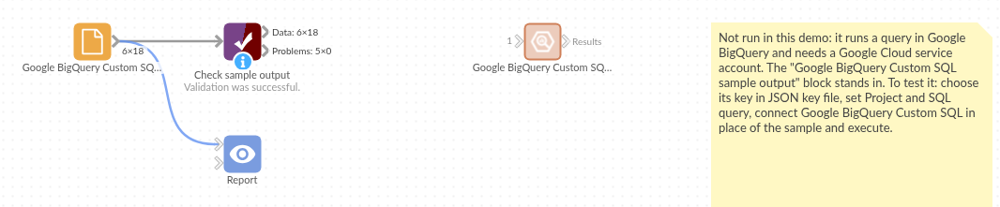

# Google BigQuery Custom SQL

*Omniscope custom block · Connectors*

**Millions of rows in BigQuery, and you need the monthly totals? Run the query where the data lives and bring back only the answer, with dates as dates and decimals as numbers.**

**Python** · pandas, google-cloud-bigquery, pyarrow, db-dtypes · Google libraries installed on first run

## The problem it solves

Order lines, web events and ledgers pile up in BigQuery by the million. Reading a whole table into a report to add it up is slow and moves far more data than the report needs; exporting query results by hand goes stale.

This block sends a query to BigQuery and outputs its result, with BigQuery's types turned into Omniscope field types.

- **18** records back: 6 regions × 3 months of an invented orders table, summarised by BigQuery
- **7,146** orders and £162,000 revenue in the result
- arrays come back as JSON text, for example the two best-selling products per region and month

### How it works

- The query runs in BigQuery, as the service account in the key file (or the server's own Google credentials), billed to the chosen project.
- The result's schema decides each field's type: NUMERIC to decimal numbers, DATE to dates, TIME to text, arrays and STRUCT to JSON text.
- A statement with no result table (INSERT, CREATE TABLE) runs and reports the rows affected.

## What goes in

### A GoogleSQL query

```sql
SELECT region, DATE_TRUNC(order_date, MONTH) AS month, COUNT(*) AS orders,
       SUM(amount) AS revenue, ROUND(AVG(amount), 2) AS avg_basket,
       ARRAY_AGG(product ORDER BY qty DESC LIMIT 2) AS top_products
FROM `example-project.retail.orders`
WHERE order_date >= '2026-01-01'
GROUP BY region, month
ORDER BY month, region
```

*Run against an invented `retail.orders` table of a food and drink wholesaler.*

## The options

| Option | Demo setting | What it does |
|---|---|---|
| JSON key file | (yours) | A service account's key file on the server; empty for the server's own credentials. |
| Project | empty | The project the query runs in and is billed to; default the key's project. |
| SQL query | the query above | GoogleSQL, tables named in full. |

## What comes out

### Results (first rows)

| region | month | orders | revenue | avg_basket | top_products |
|---|---|---|---|---|---|
| North | 2026-01-01 | 238 | 5471.62 | 22.99 | ["Oat flapjack", "Ginger beer"] |
| Midlands | 2026-01-01 | 236 | 5859.88 | 24.83 | ["Pork pie", "Ginger beer"] |
| South East | 2026-01-01 | 493 | 8213.38 | 16.66 | ["Sourdough", "Cold brew"] |
| South West | 2026-01-01 | 192 | 5896.32 | 30.71 | ["Cream tea kit", "Cider vinegar"] |

18 records. `month` is a date (BigQuery DATE), `revenue` and `avg_basket` decimal numbers (BigQuery NUMERIC), `orders` a whole number. Over the three months the Midlands leads on revenue (£33,439) and the South West trails (£19,767).

## Where it pays off

### Sales: Monthly summaries over large tables

Aggregate millions of order lines in BigQuery and report the summary, refreshed each morning.

### Marketing: Web and app events

Count sessions, conversions and funnels from analytics event exports in BigQuery, by day and campaign.

### Finance: Reconciliations

Join ledger and payment tables in BigQuery and bring back only the mismatches.

### Data teams: Checks on the warehouse

Run row-count and freshness queries and report them beside the business numbers.

*Use cases describe typical scenarios and are illustrative; the sample data is invented.*

## Why do this in Omniscope

- **Query, shape and publish in one workflow**: BigQuery's result goes straight into Omniscope blocks and the report, so the regional totals and the chart built on them come from the same query run.
- **Same types every run**: the field types come from BigQuery's schema rather than from the values, so a scheduled run with an empty or partly empty result still gives the same fields, and downstream checks on them keep working.
- **Scheduled, not exported by hand**: the scheduler runs the query and refreshes the report; no copying results out of the BigQuery console.
- **Extendable**: the Python behind it runs to about 100 lines; add query parameters, a location or a byte-billing limit to the query job.

## How it fits into an Omniscope workflow

**Google BigQuery Custom SQL** (monthly totals) → Formula (revenue per order) → Report (region by month chart)

Name tables in full in the query; JSON text fields such as `top_products` can be split with the community JSON blocks.

## Try it

1. Open the demo project (`demo.iox` on the demo server, or import `demo.ioz` from this folder). It holds the block, not signed in to Google Cloud, and a File block with `placeholder.csv`: the block's output for the query above on invented data. The rest of the workflow runs from the File block.
2. The question: which region grew fastest from January to March?
3. Look at the File block's output: 18 records, one per region and month.
4. To query your own data: create a service account with the BigQuery Job User and BigQuery Data Viewer roles, save its JSON key on the server, choose it in the block, type a query on one of your tables and run it. Then connect it in place of the File block.

## Running in Omniscope



*The demo project's workflow: the block, its sample output in a File block, and a Validate data check on it.*

<!--language-->
## Language and libraries

Python. It uses pandas, google-cloud-bigquery, pyarrow and db-dtypes.

pandas is part of Omniscope's Python environment. google-cloud-bigquery, pyarrow and db-dtypes (all Apache License 2.0) are listed in the manifest's dependencies; Omniscope installs them on first run if they are missing.
<!--/language-->

## Tested

The block is covered by automated tests that run its script against a stand-in for Omniscope's Python API and a stand-in for Google's BigQuery library answering from canned results (no call reaches Google): the sample query, every BigQuery type (INT64, BIGNUMERIC, DATE, TIMESTAMP, TIME, BOOL, FLOAT64, arrays, STRUCT, JSON, BYTES, GEOGRAPHY), DATE in the db-dtypes form, a key file and a billing project, an emptied key file, a statement with no result table, an empty result, query and sign-in errors, and a 200,000-row result.
