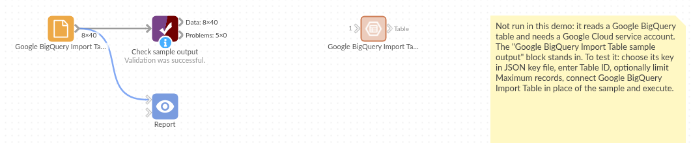

# Google BigQuery Import Table

*Omniscope custom block · Connectors*

**A table in BigQuery you want in your workflow as it is? Name it, and every record arrives, page by page, with dates, decimals and timestamps typed, and views read too.**

**Python** · pandas, google-cloud-bigquery, pyarrow, db-dtypes · Google libraries installed on first run

## The problem it solves

Curated tables, reference lists and the output of scheduled queries sit in BigQuery, and a report needs them as they are. Writing `SELECT *` costs a query each time; exporting to a file adds a step that goes stale.

This block names the table and reads every record with BigQuery's row-listing API, page by page.

- **40** orders in the invented demo table, read in pages
- **131** items, £401.90 in all, **8** orders for click and collect
- order dates as dates, order times in UTC, amounts as decimal numbers

### How it works

- The table's schema is fetched first. Tables are listed page by page; views, materialised views and external tables are read with `SELECT *` (a query, billed as one).
- Each page is converted using the schema, so every page has the same field types, even one whose values are all missing.
- An empty table still gives its fields, so the blocks after it can be set up.

## What goes in

### Orders (a BigQuery table)

An invented `example-project.retail.orders` table of a small food and drink chain.

| order_id | order_date | ordered_at | store | product | qty | amount | click_and_collect |
|---|---|---|---|---|---|---|---|
| 1001 | 2026-03-01 | 2026-03-01 09:07:00 UTC | Norwich | Pork pie | 3 | 12.60 | false |
| 1002 | 2026-03-01 | 2026-03-01 10:14:00 UTC | Exeter | Cold brew | 5 | 12.00 | false |
| 1003 | 2026-03-01 | 2026-03-01 11:21:00 UTC | Leeds | Sourdough | 4 | 12.40 | false |
| 1005 | 2026-03-02 | 2026-03-02 13:35:00 UTC | Norwich | Welsh cakes | 2 | 4.80 | true |

*40 rows in the invented table: INT64, DATE, TIMESTAMP, STRING, NUMERIC and BOOL columns.*

## The options

| Option | Demo setting | What it does |
|---|---|---|
| JSON key file | (yours) | A service account's key file on the server; empty for the server's own credentials. |
| Table ID | `example-project.retail.orders` | The table or view, as project.dataset.table. |
| Page size | 10,000 | Records per request; all pages are read. |
| Maximum records | empty | Read only the first N records; empty reads all. |

## What comes out

### Table (first rows)

| order_id | order_date | ordered_at | store | product | qty | amount | click_and_collect |
|---|---|---|---|---|---|---|---|
| 1001 | 2026-03-01 | 2026-03-01 09:07:00 | Norwich | Pork pie | 3 | 12.6 | false |
| 1002 | 2026-03-01 | 2026-03-01 10:14:00 | Exeter | Cold brew | 5 | 12.0 | false |
| 1003 | 2026-03-01 | 2026-03-01 11:21:00 | Leeds | Sourdough | 4 | 12.4 | false |
| 1004 | 2026-03-01 | 2026-03-01 12:28:00 | York | Cold brew | 5 | 21.0 | false |

40 records. `order_date` is a date, `ordered_at` a date and time in UTC, `amount` a decimal number. By store, Norwich took the most (£103.00) and Bristol the least (£58.20).

## Where it pays off

### Reporting: Curated tables

Read a table a data team maintains (customers, products, targets) into a report without writing SQL.

### Analytics: Output of scheduled queries

Pick up the table a BigQuery scheduled query refreshes each night and publish it.

### Data quality: Spot checks on large tables

Read the first 10,000 records with Maximum records to check a new table's fields and values.

### Joins with other sources

Bring a BigQuery reference table into a workflow and join it to spreadsheets or another database.

*Use cases describe typical scenarios and are illustrative; the sample data is invented.*

## Why do this in Omniscope

- **From BigQuery to the report in one workflow**: the table's records feed joins with other sources and the report directly, with no export in between.
- **Typed from the schema, on every run**: each page and each scheduled run gets the same field types from BigQuery's schema, so a Validate data block after the block can check the fields the report depends on.
- **Tables without query costs**: tables are listed through the row API rather than queried, so reading them is not billed as a query; views still work, read with a query.
- **Code within reach**: around 110 lines of Python, open in the editor; read only some columns (the listing takes a column list), or start part-way through the table.

## How it fits into an Omniscope workflow

**Google BigQuery Import Table** (retail.orders) → Join (store list) → Aggregate (sales by store and day) → Report

For large tables, set Maximum records while building the workflow, then clear it.

## Try it

1. Open the demo project (`demo.iox` on the demo server, or import `demo.ioz` from this folder). It holds the block, not signed in to Google Cloud, and a File block with `placeholder.csv`: the block's output for the invented orders table. The rest of the workflow runs from the File block.
2. The question: which store took the most, and how many orders were click and collect?
3. Look at the File block's output: 40 records, amounts as decimals, 8 click-and-collect orders.
4. To read your own table: create a service account with BigQuery Data Viewer on the dataset, save its JSON key on the server, choose it in the block, enter your table ID and run it. Then connect it in place of the File block.

## Running in Omniscope

*The demo project's workflow: the block, its sample output in a File block, and a Validate data check on it.*

<!--language-->
## Language and libraries

Python. It uses pandas, google-cloud-bigquery, pyarrow and db-dtypes.

pandas is part of Omniscope's Python environment. google-cloud-bigquery, pyarrow and db-dtypes (all Apache License 2.0) are listed in the manifest's dependencies; Omniscope installs them on first run if they are missing.
<!--/language-->

## Tested

The block is covered by automated tests that run its script against a stand-in for Omniscope's Python API and a stand-in for Google's BigQuery library answering from a canned table (no call reaches Google): the sample table in pages, the same types on every page, a view read with a query, maximum records and the older `project:dataset.table` form, an empty table, an emptied key file, errors and bad options, and a 250,000-row table.
