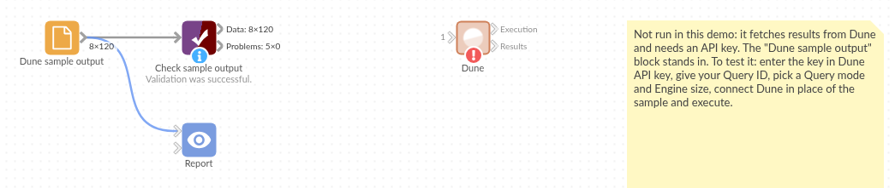

# Dune

*Omniscope custom block · Connectors*

**Someone has already written the SQL for the on-chain figure you need. Load any saved Dune query's result, every row, with numbers and dates ready to use, on demand or freshly executed.**

**Python** · requests, pandas · requests installed on first run if missing

## The problem it solves

Blockchain activity is public, but turning it into tables takes a data warehouse of decoded chain data and the SQL to query it. Dune has both, and its users publish many ready-made queries: trading volumes, token holders, protocol revenue.

This block brings one saved query's result into an Omniscope workflow: either the stored result of its last run, or a new run started and waited for. It reads every page and types the columns, so dates are dates and amounts are numbers.

- **120** rows in the sample result: **30** days for **4** chains, read in **3** pages
- **8** columns: a date, whole numbers, decimals, true/false, a 256-bit amount kept as text, and a list kept as JSON
- **1** missing value (one day's volume on one chain) left empty, not zero
- **1** record in the Execution output saying when the result was computed and when it expires

### How it works

- Enter your Dune API key and the query's ID (or paste its address).
- **Retrieve** reads the last stored result; **Execute** runs the query now and waits.
- The Results output has the rows; the Execution output says which run they came from.

## What goes in

Nothing from the workflow: the block reads from Dune. The demo uses an invented result for an invented query, "daily DEX trades by chain" (query ID 4100217), so it runs without an API key; `sample-data/placeholder.csv` holds the Results output for it.

## The options

| Option | Demo setting | What it does |
|---|---|---|
| Dune API key | (your key) | An API key from your Dune account's API settings. |
| Query ID | `4100217` | The query's number, or its address on dune.com. |
| Query mode | Retrieve latest query results | Retrieve the stored result, or Execute the query now. |
| Engine size | Medium | Execute only: Small, Medium or Large. |

## What comes out

### Results (first 6)

| day | chain | trades | volume_usd | is_weekend | top_pair | largest_trade_wei | venues |
|---|---|---|---|---|---|---|---|
| 2026-09-01 | ethereum | 94,277 | 241,530,218.14 | false | WETH-USDT | 72639847596670492302325 | ["aerodrome", "uniswap"] |
| 2026-09-01 | arbitrum | 81,435 | 250,196,476.99 | false | WETH-USDT | 36409462060795354744388 | ["curve", "sushiswap"] |
| 2026-09-01 | base | 101,212 | 260,062,577.55 | false | WETH-USDT | 23760718497346144041002 | ["curve", "aerodrome"] |
| 2026-09-01 | polygon | 46,228 | 117,070,269.39 | false | WETH-USDC | 10680431344000245538648 | ["curve", "uniswap"] |
| 2026-09-02 | ethereum | 98,076 | 180,794,911.95 | false | WETH-USDT | 59584623668896598024783 | ["sushiswap", "aerodrome"] |
| 2026-09-02 | arbitrum | 86,581 | 225,774,981.94 | false | WETH-USDC | 15727244418416956499933 | ["uniswap", "curve"] |

120 records in all. day is a date (UTC), trades a whole number, volume_usd a decimal, is_weekend true/false.

### Per chain (Aggregate on chain)

| chain | Days | Trades | Average trades, weekdays | Average trades, weekends |
|---|---|---|---|---|
| ethereum | 30 | 3,013,246 | 107,992 | 79,678 |
| base | 30 | 2,794,356 | 100,953 | 71,673 |
| arbitrum | 30 | 2,186,632 | 79,011 | 56,048 |
| polygon | 30 | 1,097,957 | 39,141 | 29,607 |

### Execution

| Execution ID | Query ID | State | Ended | Expires | Rows |
|---|---|---|---|---|---|
| 01K9ZQ4T7W2R8M5H3XJ6D1VYCE | 4100217 | QUERY_STATE_COMPLETED | 2026-10-01 06:00:41 | 2026-12-30 06:00:41 | 120 |

## Where it pays off

### Crypto funds and treasuries: Market activity next to positions

Daily volumes, prices or holder counts from published Dune queries, joined to your own holdings and trades.

### Protocol teams: Usage reporting

Your own Dune queries on your protocol's contracts, executed on a schedule and published as a report for the team or the community.

### Research: On-chain indicators

Load several queries' results and compare chains, tokens or venues over time, with dates and amounts typed for charting.

### Compliance: Evidence of a figure

The Execution output records which run a number came from and when it was computed, alongside the number itself.

*Use cases describe typical scenarios and are illustrative; the sample data is invented.*

## Why do this in Omniscope

- **Dune's figures beside your own.** The result is ordinary Omniscope records, so it joins to your positions, prices or customer data in the same workflow and feeds the Report's charts and filters directly.
- **A fresh result on a schedule, checked.** In Execute mode a scheduled run computes the query anew each time and waits for it; Validate data on the Results output stops the run if a day is missing or a total falls outside the expected range.
- **Typed by Dune's own column types.** Dates, whole numbers, decimals and true/false come out as such from the column types Dune reports, and the mapping is a short function in the block's Python script that you can change in the block editor.

## How it fits into an Omniscope workflow

**Dune** (Results) → Aggregate or Formula → Join (your own data) → Report

Use the Execution output to show in the Report when the figures were computed, or in a Validate data block to check that the result is recent.

## Try it

1. Open the demo project (`demo.iox` on the demo server, or import `demo.ioz` from this folder). It holds the Dune block without a key, and a File block with `placeholder.csv`: the 120 rows the block writes for the invented result.
2. The question: which chain trades most, and how much quieter are weekends?
3. Follow the File block into the rest of the workflow: trades per chain, weekdays against weekends.
4. To use real data: enter your API key and a query ID in the Dune block, run it, and connect its Results output where the File block was.

## Running in Omniscope

*The demo project's workflow: the placeholder data, the block, and a Validate data check on the output.*

<!--language-->
## Language and libraries

Python. It uses requests (Apache License 2.0) and pandas (BSD 3-Clause).

pandas is part of Omniscope's Python environment. requests is listed in the block's dependencies, so Omniscope installs it with pip on first run if it is missing.
<!--/language-->

## Tested

The block is covered by automated tests that run its script against a stand-in for Omniscope's Python API and an invented Dune result served in pages (no live calls): the latest result read across pages, the requests sent, the Execution record, an execution waited for, the engine size, failed, cancelled and expired executions, a partial result, a query ID given as an address, a refused key and a missing stored result, an empty result, unexpected values in typed columns, and 100,000 rows.
