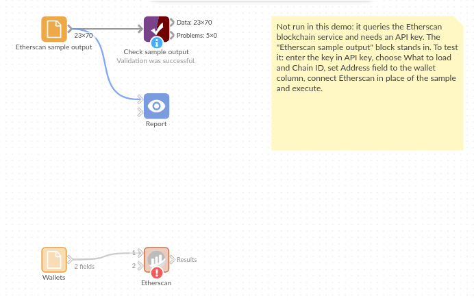

# Etherscan

*Omniscope custom block · Connectors*

**What does each of our wallets hold, and what went in and out of it? Balances and complete transaction lists for a field of addresses, on Ethereum or another chain Etherscan serves.**

**Python** · requests, pandas · requests installed on first run if missing

## The problem it solves

An organisation that holds crypto assets, or a team that monitors addresses, keeps a list of wallets. Checking each one on a block explorer by hand is slow, and the explorer shows one address at a time, with amounts in wei and times as Unix seconds.

This block takes the list as a field, asks Etherscan's API about every address, and writes the balances or the full transaction history as records: amounts in ether, times as dates, every transaction of every wallet in one table.

- **5** invented wallets in the sample, one of them with no transactions at all
- **70** transactions loaded for them, **2** of which failed on chain (isError = 1)
- **10,000** transactions per call at most; the block keeps asking until it has every one
- **20** addresses per balance call, paced to the free plan's 3 calls a second

### How it works

- Enter an Etherscan API key and choose the field of addresses.
- Choose **Balances** or **Transactions**; leave Chain ID at 1 for Ethereum.
- Values that are not addresses are skipped and counted in the block's message.

## What goes in

### Wallets

Five invented wallets with random addresses.

| Wallet | Address |
|---|---|
| Treasury | 0xeee65f53e9421ce50211670eae679f02e8d28a79 |
| Payroll | 0x023c39c200661fccd268a29a0d347301ef56e64d |
| Grants | 0xc3cd6089065c3146e80a9c222670bbe4f4c54977 |
| Event tickets | 0x656cf2d133187c8df95247f2866028de71159b42 |
| Cold storage | 0xb4ea410fb9102f29a422eb14ab2f2d0f0cc02223 |

The addresses are random; the demo uses invented Etherscan responses for them, so it runs without an API key.

## The options

| Option | Demo setting | What it does |
|---|---|---|
| API key | (your key) | Your Etherscan API key, from https://etherscan.io/myapikey. |
| What to load | Transactions | Balances: one record per address. Transactions: one record per transaction. |
| Chain ID | 1 | 1 is Ethereum; other chains by their ID (8453 Base, 42161 Arbitrum One...). |
| Address field | Address | The field with the addresses. |

## What comes out

### Transactions (first 6, some fields)

| Account | Time | Amount | from | to | isError |
|---|---|---|---|---|---|
| 0xeee6…8a79 | 2025-01-07 14:41:14 | 0.0 | 0xeee6…8a79 | 0xe9ea…3a20 | 0 |
| 0xeee6…8a79 | 2025-01-14 09:11:26 | 2.3 | 0xeee6…8a79 | 0x8ec1…0071 | 0 |
| 0xeee6…8a79 | 2025-01-20 08:24:45 | 0.0 | 0xeee6…8a79 | 0x1ead…01c3 | 0 |
| 0xeee6…8a79 | 2025-01-25 08:24:51 | 0.0 | 0xeee6…8a79 | 0x6a88…0337 | 0 |
| 0xeee6…8a79 | 2025-01-30 11:11:30 | 2.3 | 0xe9ea…3a20 | 0xeee6…8a79 | 0 |
| 0xeee6…8a79 | 2025-02-01 07:42:15 | 1.7 | 0xf252…86d0 | 0xeee6…8a79 | 0 |

Addresses shortened here. 70 records in all, 23 fields. Amount is in ether; transactions with Amount 0 are contract calls (here, token transfers). Time is in UTC.

### Per wallet (Aggregate on Account, joined to the wallet names)

| Wallet | Transactions | Ether moved |
|---|---|---|
| Treasury | 31 | 47.63 |
| Payroll | 24 | 26.18 |
| Grants | 12 | 10.02 |
| Cold storage | 3 | 0.00 |

Event tickets has no transactions, so it has no records. With **Balances** instead, the same five wallets give five records, from 0 (Event tickets) to 902.5 ether (Cold storage).

## Where it pays off

### Finance teams: Crypto holdings at month end

Balances of every company wallet on the reporting date, in ether, next to the price feed and the ledger.

### Audit and compliance: Transaction trail

Every transaction in and out of a set of addresses, with time, counterparty, amount and whether it failed, ready to filter and sample.

### Treasury operations: Flows between wallets

Which wallets pay which, how much, and how often: aggregate on from and to, or join the output to itself.

### Analysts: Activity of known addresses

Track a list of exchange, fund or project addresses over time, on Ethereum or another chain by chain ID.

*Use cases describe typical scenarios and are illustrative; the sample data is invented.*

## Why do this in Omniscope

- **Wallet names, ledgers and prices in the same workflow.** The output joins on Account to your own list of wallets and on Time to a price table, so holdings in pounds or dollars go straight into the Report, which the explorer's address page cannot do.
- **A month-end check that repeats itself.** Scheduled, the block reloads every transaction of every wallet, past the 10,000-a-call limit, so the totals are rebuilt from the full history each time; a wallet balance under a threshold can halt the run through Validate data.
- **Other calls in the same script.** Internal transactions and token transfers are the same kind of Etherscan call with a different action; the request code is a short function in the block's Python script, open in the block editor.

## How it fits into an Omniscope workflow

Wallet list (File or Database) → **Etherscan** → Join (back to the wallet list on Account) → Aggregate or Formula → Report

For balances in another currency, join the Balances output to a price table, or the Transactions output by date. A Record filter on isError = 1 lists the failed transactions.

## Try it

1. Open the demo project (`demo.iox` on the demo server, or import `demo.ioz` from this folder). It holds the wallet list, the Etherscan block without a key, and a File block with `placeholder.csv`: the 70 transactions the block writes for the invented responses.
2. The question: how much ether has each wallet moved, and which transactions failed?
3. Follow the File block into the rest of the workflow: transactions and ether moved per wallet.
4. To use real data: enter your API key in the Etherscan block, put your own addresses in the wallet list, run it, and connect its Results output where the File block was.

## Running in Omniscope

*The demo project's workflow: the wallet list, the block, the placeholder data and a Validate data check.*

<!--language-->
## Language and libraries

Python. It uses requests (Apache License 2.0) and pandas (BSD 3-Clause).

pandas is part of Omniscope's Python environment. requests is listed in the block's dependencies, so Omniscope installs it with pip on first run if it is missing.
<!--/language-->

## Tested

The block is covered by automated tests that run its script against a stand-in for Omniscope's Python API and invented Etherscan responses (no live calls): balances and transactions of the sample, the requests sent (API version 2, chain ID, batches of 20), another chain, values that are not addresses, a refused key, the rate limit, an HTTP error (the key is not shown), 23,456 transactions for one address read past the 10,000-a-call limit, empty input, and wrong field types.
