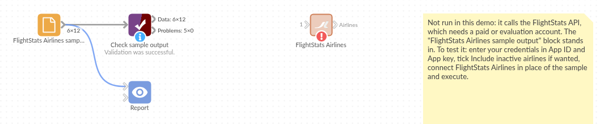

# FlightStats Airlines

*Omniscope custom block · Connectors · Flightstats*

**Carrier codes in your travel or freight data, but no airline names? Load the FlightStats airline list as a lookup table, with active and inactive airlines, in one request.**

**R** · httr, jsonlite · install httr and jsonlite on the server's R if missing

## The problem it solves

Bookings, expense claims and freight records often carry only a two-letter carrier code ("ZQ 214"). Reports need the airline's name, and older records may use codes of airlines that have since stopped flying.

This block loads FlightStats' list of airlines, one record per airline, ready to join on the code.

- **12** invented airlines in the sample answer, each with FlightStats, IATA and ICAO codes where it has them
- **2** more with **Include inactive airlines** ticked, flagged `active` = false
- **1** request per run, whatever the size of the list

**Service status.** FlightStats (Cirium) has said its legacy Flex APIs, which this block calls, will keep working until 31 December 2026; new integrations are directed to the newer Cirium Sky API, which this block does not call, and free trials are offered only for that. Check the provider's current terms before building on the block.

### How it works

- Enter the App ID and App key of a FlightStats (Cirium Flex) account.
- The block asks for the active airlines (or all of them) and writes one record each.
- Refused credentials stop the block with FlightStats' own message.

## What goes in

Nothing from the workflow: the block reads from FlightStats. The demo uses an invented answer listing fictional airlines, so it runs without an account; `sample-data/placeholder.csv` holds the block's output for it.

## The options

| Option | Demo setting | What it does |
|---|---|---|
| App ID | (your ID) | The application ID of your FlightStats account. |
| App key | (your key) | The application key; sent with the request, never written to the output. |
| Include inactive airlines | No | Also load airlines that no longer operate. |

## What comes out

### Airlines (first 6 of 12)

| fs | iata | icao | name | phoneNumber | active |
|---|---|---|---|---|---|
| ZQ | ZQ | ZQA | Kestrel Coastal Airways | +44 20 7946 0101 | true |
| XK | XK | XKN | Northmoor Air | +44 161 496 0102 | true |
| QV | QV | QVL | Valebridge Aviation | | true |
| J7 | J7 | JSV | Juniper Sky | +353 20 910 0103 | true |
| WY* | | WYF | Westry Freight | | true |
| H3 | H3 | | Harbourline Commuter | +44 113 496 0104 | true |

Westry Freight has no IATA code, so FlightStats gives it its own code with an asterisk; join on `fs` to catch it.

## Where it pays off

### Corporate travel: Spend by airline

Join airline names onto booking or expense records that carry only carrier codes, then total spend and trips per airline.

### Freight and logistics: Carrier lists

Name the carriers in air waybill or shipment data, including ICAO codes for cargo operators without an IATA code.

### Airports and ground handling: Operator reference

Keep a current list of operators, with their phone numbers, beside movement or handling records.

### Historical data: Retired carriers

With inactive airlines included, codes in older records still find a name.

*Use cases describe typical scenarios and are illustrative; the sample data is invented.*

## Why do this in Omniscope

- **One lookup for every report that shows a carrier.** The airline list joins straight onto bookings or shipments in the same workflow, and the names go into the Report's charts and filters without a separate reference file to keep up to date.
- **A refreshed list, checked.** Scheduled, the block reloads the list each run; a Validate data block after it can stop the run if the record count falls or a code you depend on disappears.
- **Two lists from one block.** The Include inactive option switches between the active list and the full one, and the request is a few lines of R in the block's editor if you need another FlightStats list.

## How it fits into an Omniscope workflow

**FlightStats Airlines** + Bookings (File) → Join (carrier code = `fs`) → Aggregate (by airline) → Report

## Try it

1. Open the demo project (`demo.iox` on the demo server, or import `demo.ioz` from this folder). It holds the FlightStats Airlines block, unconfigured, and a File block with `placeholder.csv`, the 12 airlines the block writes for the invented answer.
2. The question: which airline is behind each carrier code?
3. Follow the File block into the rest of the workflow, where the list is checked.
4. To use your own account: enter your App ID and App key in the block, run it, and connect its Airlines output where the File block was.

## Running in Omniscope

*The demo project's workflow: the placeholder data, the block, and a Validate data check on the output.*

<!--language-->
## Language and libraries

R. It uses the httr and jsonlite packages (both MIT licence).

Neither is part of base R: install them on the Omniscope server's R if they are missing (`install.packages(c("httr", "jsonlite"))`).
<!--/language-->

## Tested

The block is covered by automated tests that run its script against a stand-in for Omniscope's R API and invented FlightStats answers (no live calls): the active and full lists, the request sent (address and encoded credentials), refused credentials, an error answer, blank credentials, an empty list and 20,000 airlines.
