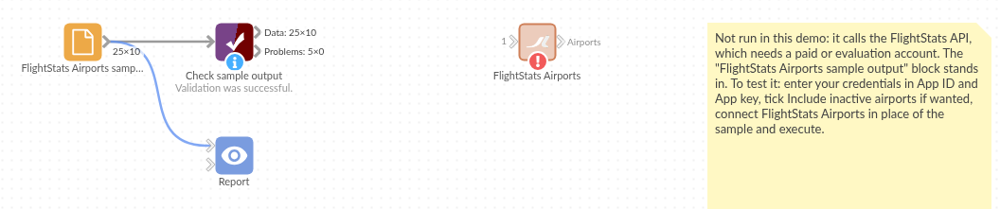

# FlightStats Airports

*Omniscope custom block · Connectors · Flightstats*

**Airport codes in your travel data, but no names, countries or positions? Load the FlightStats airport list as a lookup table, ready to join and to put on a map.**

**R** · httr, jsonlite · install httr and jsonlite on the server's R if missing

## The problem it solves

Trips and flights are recorded as airport codes ("NMR to JNP"). To report by country, draw routes on a map or work out local times, each code needs a name, a country, a position and a time zone.

This block loads FlightStats' list of airports, one record per airport, ready to join on the code.

- **10** invented airports in the sample answer, with codes, city, country, time zone, latitude, longitude and elevation
- **25** fields per airport, always present and in the same order, empty where FlightStats has no value
- **1** more with **Include inactive airports** ticked, flagged `active` = false

**Service status.** FlightStats (Cirium) has said its legacy Flex APIs, which this block calls, will keep working until 31 December 2026; new integrations are directed to the newer Cirium Sky API, which this block does not call, and free trials are offered only for that. Check the provider's current terms before building on the block.

### How it works

- Enter the App ID and App key of a FlightStats (Cirium Flex) account.
- The block asks for the active airports (or all of them) and writes one record each.
- Refused credentials stop the block with FlightStats' own message.

## What goes in

Nothing from the workflow: the block reads from FlightStats. The demo uses an invented answer listing fictional airports, so it runs without an account; `sample-data/placeholder.csv` holds the block's output for it.

## The options

| Option | Demo setting | What it does |
|---|---|---|
| App ID | (your ID) | The application ID of your FlightStats account. |
| App key | (your key) | The application key; sent with the request, never written to the output. |
| Include inactive airports | No | Also load airports that are no longer active. |

## What comes out

### Airports (first 6 of 10, some fields)

| fs | iata | name | city | countryCode | timeZoneRegionName | latitude | longitude | elevationFeet |
|---|---|---|---|---|---|---|---|---|
| KQB | KQB | Kestrel Bay Airport | Kestrel Bay | GB | Europe/London | 54.61234 | -3.20412 | 98 |
| NMR | NMR | Northmoor International | Northmoor | GB | Europe/London | 53.47121 | -2.31055 | 257 |
| VLB | VLB | Valebridge Airport | Valebridge | GB | Europe/London | 52.10342 | -1.88231 | 312 |
| JNP | JNP | Juniper Point Airport | Juniper Point | IE | Europe/Dublin | 53.30521 | -6.40118 | 210 |
| HBL | HBL | Harbourline Heliport | Harbourline | GB | Europe/London | 57.19813 | -2.07725 | 30 |
| LWX | LWX | Lowland Airport | Glenmuir | GB | Europe/London | 55.87102 | -4.43391 | 26 |

Thornfield Aerodrome has no IATA code; join on `fs`, which every airport has.

## Where it pays off

### Corporate travel: Trips by country

Join country and region onto trip records that carry airport codes, then count trips and spend per country.

### Route maps

Put departure and arrival airports on a map with their latitude and longitude, and draw the routes flown.

### Operations: Local times

Use `timeZoneRegionName` and `utcOffsetHours` to show event times in each airport's local time.

### Network planning: Airport size

Group airports by FlightStats' size class (1, largest, to 5) to compare the network served by each carrier.

*Use cases describe typical scenarios and are illustrative; the sample data is invented.*

## Why do this in Omniscope

- **From codes to a route map in one workflow.** The airport list joins onto flights or trips, and the latitude and longitude go straight to a map view in the Report, with no reference spreadsheet in between.
- **The same 25 fields every run.** Fields FlightStats leaves out of an answer are still created, empty, so a scheduled refresh never breaks the blocks after it; Validate data can confirm the record count and that the codes you rely on are there.
- **The request is in the block.** It is a few lines of R in the block's editor: add a field, or point it at another FlightStats list.

## How it fits into an Omniscope workflow

Flights or trips (File) + **FlightStats Airports** → Join (airport code = `fs`, once for departure, once for arrival) → Report (map of routes)

## Try it

1. Open the demo project (`demo.iox` on the demo server, or import `demo.ioz` from this folder). It holds the FlightStats Airports block, unconfigured, and a File block with `placeholder.csv`, the 10 airports the block writes for the invented answer.
2. The question: where are the airports in the data, and in which countries and time zones?
3. Follow the File block into the rest of the workflow, where the list is checked.
4. To use your own account: enter your App ID and App key in the block, run it, and connect its Airports output where the File block was.

## Running in Omniscope

*The demo project's workflow: the placeholder data, the block, and a Validate data check on the output.*

<!--language-->
## Language and libraries

R. It uses the httr and jsonlite packages (both MIT licence).

Neither is part of base R: install them on the Omniscope server's R if they are missing (`install.packages(c("httr", "jsonlite"))`).
<!--/language-->

## Tested

The block is covered by automated tests that run its script against a stand-in for Omniscope's R API and invented FlightStats answers (no live calls): the active and full lists, field order and types (numbers, local time as a date), the request sent (address and encoded credentials), refused credentials, an error answer, blank credentials, an empty list and 20,000 airports.
