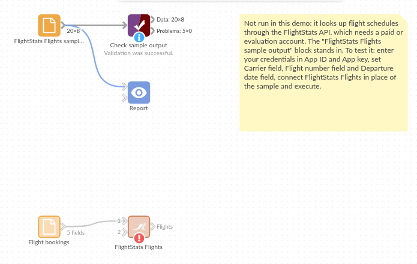

# FlightStats Flights

*Omniscope custom block · Connectors · Flightstats*

**A list of bookings with only flight numbers and dates? Look each flight up in the FlightStats schedules and add its airports, local departure and arrival times, aircraft and codeshares.**

**R** · httr, jsonlite · install httr and jsonlite on the server's R if missing

## The problem it solves

Travel bookings and expense claims usually record a flight as "ZQ 214 on 16 November". Questions such as "who is flying out of Northmoor on Monday morning?" or "how many trips need an overnight stay?" need the airports and times, which the booking does not carry.

This block looks up each flight in the FlightStats schedules for its day and adds the scheduled legs.

- **10** invented bookings, **8** distinct flights and days: two travellers on ZQ 214 make one request
- **8** scheduled legs come back: TF 77 stops on the way, so it has two
- **1** flight not in the schedules, **1** booking with no flight number skipped, both counted in the block's message

**Service status.** FlightStats (Cirium) has said its legacy Flex APIs, which this block calls, will keep working until 31 December 2026; new integrations are directed to the newer Cirium Sky API, which this block does not call, and free trials are offered only for that. Check the provider's current terms before building on the block.

### How it works

- Each input record gives a carrier code, a flight number and a departure date.
- Each distinct flight and day is requested once; flights not in the schedules are left out.
- Times are scheduled times in each airport's local time. They are not live status: a delay or cancellation does not show.

## What goes in

### Flight bookings

10 invented bookings on fictional airlines.

| Booking | Traveller | Carrier | Flight | Departure date |
|---|---|---|---|---|
| B-101 | A. Okafor | ZQ | 214 | 2026-11-16 |
| B-102 | P. Natarajan | ZQ | 214 | 2026-11-16 |
| B-104 | S. Whitfield | J7 | 1402 | 2026-11-18 |
| B-106 | M. Haddad | QV | 931 | 2026-11-19 |
| B-108 | R. Byrne | RB | | 2026-11-20 |
| B-110 | J. Mensah | TF | 77 | 2026-11-25 |

*10 rows in the sample file.*

## The options

| Option | Demo setting | What it does |
|---|---|---|
| App ID | (your ID) | The application ID of your FlightStats account. |
| App key | (your key) | The application key; sent with each request, never written to the output. |
| Carrier field | `Carrier` | The airline code: the "LH" in LH1234. |
| Flight number field | `Flight` | The number part: the "1234" in LH1234. |
| Departure date field | `Departure date` | The day the flight departs. |

## What comes out

### Flights (selected fields)

| Requested carrier | Requested flight number | Requested date | departureAirportFsCode | arrivalAirportFsCode | departureTime | arrivalTime | flightEquipmentIataCode | codeshares |
|---|---|---|---|---|---|---|---|---|
| ZQ | 214 | 2026-11-16 | KQB | NMR | 2026-11-16 07:10 | 2026-11-16 08:05 | AT7 | XK5214 |
| XK | 88 | 2026-11-17 | NMR | JNP | 2026-11-17 09:40 | 2026-11-17 10:55 | 320 | |
| J7 | 1402 | 2026-11-18 | JNP | VLB | 2026-11-18 13:20 | 2026-11-18 14:30 | E75 | XK1402, OY7402 |
| OY | 2210 | 2026-11-20 | ORB | NMR | 2026-11-20 08:30 | 2026-11-20 10:05 | 73H | |
| TF | 77 | 2026-11-25 | RBK | TFD | 2026-11-25 06:50 | 2026-11-25 07:25 | DH4 | |
| TF | 77 | 2026-11-25 | TFD | HBL | 2026-11-25 08:05 | 2026-11-25 09:35 | DH4 | |

8 records in all. QV 931 is not in the schedules for 19 November and B-108 has no flight number, so neither appears; the block's message says so. Join the output back to the bookings on the three Requested fields to see both travellers on ZQ 214.

## Where it pays off

### Corporate travel: Who is where

Add airports and times to bookings, then list who departs from or arrives at each airport on a given day, for duty of care or meeting planning.

### Expenses: Checking claims

Compare claimed travel times and airports with the schedule for the flight on that day.

### Events: Arrivals planning

Count delegates arriving at each airport by hour, from the flight numbers they registered, to plan transfers.

### Freight: Planned connections

Look up the scheduled legs of the flights shipments are booked on, with the aircraft type on each leg.

*Use cases describe typical scenarios and are illustrative; the sample data is invented.*

## Why do this in Omniscope

- **Bookings in, a travel report out.** The lookup sits between the bookings file and a join back on the Requested fields, so airports, times and the traveller's name reach the Report together; joining FlightStats Airports adds airport names and a map.
- **Repeat flights cost one request.** Bookings on the same flight and day share one request, and the block's message counts flights not found and records skipped; once joined back to the bookings, Validate data can halt a scheduled run when too many bookings found nothing.
- **Flat, typed fields from nested answers.** Lists of codeshares and service classes become text and times become dates, in plain R in the block's editor; change it there to keep, say, only the first leg of each flight.

## How it fits into an Omniscope workflow

Bookings (File) → **FlightStats Flights** → Join (back to Bookings on carrier, number and date) → Join (FlightStats Airports, for airport names) → Report

## Try it

1. Open the demo project (`demo.iox` on the demo server, or import `demo.ioz` from this folder). It holds the bookings, the FlightStats Flights block (no credentials, so it is not run) and a File block with `placeholder.csv`, the 8 legs the block writes for the invented answers.
2. The question: from which airport, and at what local time, does each traveller depart?
3. Follow the placeholder into the join with the bookings: both travellers on ZQ 214 get the same flight.
4. To use your own account: enter your App ID and App key in the block, run it, and connect its Flights output where the File block was.

## Running in Omniscope

*The demo project's workflow: the sample bookings, the block, the placeholder data and a Validate data check on the output.*

<!--language-->
## Language and libraries

R. It uses the httr and jsonlite packages (both MIT licence).

Neither is part of base R: install them on the Omniscope server's R if they are missing (`install.packages(c("httr", "jsonlite"))`).
<!--/language-->

## Tested

The block is covered by automated tests that run its script against a stand-in for Omniscope's R API and invented FlightStats answers (no live calls): the sample bookings (legs, local times, lists joined as text, codeshares), the request sent, one request per distinct flight and day, flights not found and records skipped, failed requests, refused credentials, lower-case carriers and numeric flight numbers, an empty input, wrong field types and missing choices, and 2,000 bookings.
