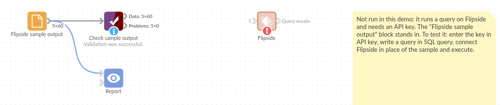

# Flipside

*Omniscope custom block · Connectors*

**Your own SQL over decoded blockchain data, run on Flipside and returned as records. Note: Flipside has wound down its public query tools, and the API may no longer accept queries.**

**Python** · flipside SDK, pandas · flipside installed on first run if missing

## The problem it solves

Raw blockchain data is hard to query: transactions, logs and token transfers have to be decoded and indexed first. Flipside offered that data as SQL tables for many chains, with an API to run queries from code.

This block sends a SQL query to Flipside, waits for the result and writes every row into the workflow.

**Service status.** Flipside closed its free Studio on 1 July 2025, its blockchain data business was sold in May 2026, and its SDK, which this block uses, was archived on GitHub on 2 July 2026. Whether the API still accepts queries could not be confirmed; if the block cannot reach Flipside or the key is refused, the service has most likely ended.

- **60** rows in the sample result: **30** days of activity on **2** chains
- **5** columns: the day, the chain, transactions, active addresses and the average fee
- **10,000** rows per page; every page is read
- **20** minutes at most for a query to run

### How it works

- Enter your Flipside API key and the SQL query.
- The block runs the query fresh each time (no cached result) and reads every page of the result.
- Flipside's error messages (SQL errors, rate limit, timeout) stop the block with Flipside's text.

## What goes in

Nothing from the workflow: the block runs a query on Flipside. The demo uses an invented result, so it runs without an API key; `sample-data/placeholder.csv` holds the block's output for it.

## The options

| Option | Demo setting | What it does |
|---|---|---|
| API key | (your key) | Your Flipside API key. |
| SQL query | a daily activity query | The SQL to run on Flipside's tables. |

## What comes out

### Query results (first 4)

| block_date | chain | tx_count | active_addresses | avg_fee_usd |
|---|---|---|---|---|
| 2026-05-01T00:00:00.000Z | ethereum | 1037389 | 348777 | 1.9649 |
| 2026-05-01T00:00:00.000Z | arbitrum | 2525334 | 761866 | 0.5336 |
| 2026-05-02T00:00:00.000Z | ethereum | 1256920 | 418147 | 1.1272 |
| 2026-05-02T00:00:00.000Z | arbitrum | 2355015 | 734137 | 1.1927 |

60 records in all. Dates come back as ISO text, as Flipside returns them.

### Per chain (Aggregate on chain)

| chain | Transactions | Active addresses (sum of daily) | Average fee (USD) |
|---|---|---|---|
| arbitrum | 65,863,023 | 21,227,284 | 0.7704 |
| ethereum | 34,960,393 | 11,240,153 | 1.5302 |

## Where it pays off

### Research: Chain activity

Daily transactions, active addresses and fees per chain, from one query, compared over time in a report.

### Protocol teams: Usage of your contracts

Calls, users and volumes of your own contracts, queried from decoded event tables.

### Funds: Flows of tokens you hold

Transfers in and out of exchanges or large holders, for the tokens in a portfolio.

### Analysts: Ad hoc questions

Any question that can be written as SQL over Flipside's tables, without running blockchain infrastructure.

*Use cases describe typical scenarios and are illustrative; the sample data is invented.*

## Why do this in Omniscope

- **Query results straight into the report.** The rows land as Omniscope records, so an Aggregate per chain and the Report's charts follow in the same workflow, next to any data of your own.
- **A fresh result on every scheduled run.** The block asks Flipside for a new result each time rather than a cached one, so the scheduler can refresh the Report daily with yesterday's activity included.
- **The SQL lives in the block.** The query is an option of the block and the SDK calls are a short Python script; pointing it at another SQL service is a change in the script (unlock the block's design first), which matters now that Flipside's service is winding down.

## How it fits into an Omniscope workflow

**Flipside** → Field Organiser (block_date as a date) → Aggregate → Report

## Try it

1. Open the demo project (`demo.iox` on the demo server, or import `demo.ioz` from this folder). It holds the Flipside block without a key, and a File block with `placeholder.csv`: the 60 rows the block writes for the invented result.
2. The question: which chain had more activity, and which charged higher fees?
3. Follow the File block into the rest of the workflow: totals and average fee per chain.
4. If you still have Flipside access: enter your API key and query in the Flipside block, run it, and connect its Query results output where the File block was.

## Running in Omniscope

*The demo project's workflow: the placeholder data, the block, and a Validate data check on the output.*

<!--language-->
## Language and libraries

Python. It uses the flipside SDK (MIT licence; archived by Flipside in July 2026) and pandas (BSD 3-Clause).

pandas is part of Omniscope's Python environment. flipside is listed in the block's dependencies, so Omniscope installs it with pip on first run if it is missing.
<!--/language-->

## Tested

The block is covered by automated tests that run its script against a stand-in for Omniscope's Python API and a stand-in for the Flipside SDK with an invented result (no live calls): the sample result, the first page read once, 25,000 rows over three pages, records without Flipside's row number, a query with no rows, each kind of Flipside error, an unreachable service, and a missing key or query.
