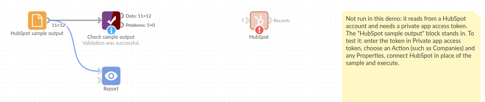

# HubSpot

*Omniscope custom block · Connectors*

**Who are the customers, which deals are open, and which contacts belong to which company? HubSpot's CRM records in a workflow, every page, with dates as dates.**

**Python** · requests, pandas · requests installed on first run if missing

## The problem it solves

HubSpot's own reports cover HubSpot's data. Questions that also need orders, invoices or support tickets (which customers bought this year, which companies have open deals but unpaid invoices) need the CRM records outside HubSpot, refreshed, not a one-off export.

This block calls HubSpot's APIs with a private app's token, reads every page, and writes one record per company, contact, lead, deal, list, form, form submission or association.

- **12** invented companies read from **2** pages, combined into one output
- **4** chosen properties (name, domain, industry, city) as `properties.*` fields
- **3** contact-to-company links read as associations, one record per link
- **2** timestamps per record, `createdAt` and `updatedAt`, as dates

### How it works

- Paste the access token of a HubSpot private app with read scopes (HubSpot no longer lets accounts create new private apps; see the README).
- Choose an action; for companies, contacts, leads, deals and searches, list the properties you need (or leave it empty for HubSpot's defaults).
- For associations, give the two object types (`contacts`, `companies`, `deals`...) and, optionally, the IDs to start from.

## What goes in

Nothing from the workflow: the block reads from HubSpot. The demo uses invented responses for a garden supplies wholesaler's customers, so it runs without a HubSpot account; `sample-data/placeholder.csv` holds the Records output for the Companies action with four properties.

## The options

| Option | Demo setting | What it does |
|---|---|---|
| Private app access token | (empty) | A private app's token with read scopes. |
| Action | Companies | What to load: companies, contacts, leads, deals, lists, forms, form submissions, a search, or associations. |
| Search text or form ID | (empty) | The text for a search, or the form for Form submissions. |
| Properties | `name, domain, industry, city` | The properties to load; empty for HubSpot's defaults. |
| From object, To object | `contacts`, `companies` | For associations: which links to read. |
| From object IDs | (empty) | For associations: the records to start from; empty for all. |

## What comes out

### Companies (first 6, some fields)

| id | properties.name | properties.industry | properties.city | createdAt |
|---|---|---|---|---|
| 9001 | Fernhill Garden Centre | Retail | Leeds | 2024-01-03 09:10 |
| 9002 | Marsh Lane Hardware | Retail | York | 2024-02-04 09:11 |
| 9003 | Brookside Allotment Society | Non-profit | Harrogate | 2024-03-05 09:12 |
| 9004 | Willow Bank Landscapes | Construction | Bradford | 2024-04-06 09:13 |
| 9005 | Oakfield Nurseries | Agriculture | Wakefield | 2024-05-07 09:14 |
| 9006 | Greenway Estates | Real estate | Leeds | 2024-06-08 09:15 |

12 records in all. HubSpot also returns `properties.createdate`, `properties.hs_lastmodifieddate` and `properties.hs_object_id` with every record; the two dates come out as dates too.

### Associations, contacts to companies

| contacts_id | companies_id | association_type |
|---|---|---|
| 501 | 9001 | contact_to_company |
| 503 | 9003 | contact_to_company |
| 503 | 9008 | contact_to_company |

Contact 503 is linked to two companies, so it has two records.

## Where it pays off

### Sales: Pipeline with the money in it

Load deals with amount, stage and close date, and join them to invoices from the finance system to see which won deals are paid.

### Marketing: Form leads to customers

Load form submissions and contacts, and follow each lead from the form to its lifecycle stage.

### Account management: Contacts per company

Use the associations to count contacts per company, and find companies with no contact at all.

### Data quality: CRM clean-up

Load companies with domain and city, and find duplicates or missing values before a mailing.

*Use cases describe typical scenarios and are illustrative; the sample data is invented.*

## Why do this in Omniscope

- **CRM records meet the rest of the business.** In one workflow the companies join the order history from a database on domain or ID, and the Report shows revenue per industry next to the open deals, which neither system can show alone.
- **Rebuilt from HubSpot on every run.** Scheduled, the block re-reads every page, so the counts per lifecycle stage come from HubSpot's current records rather than last month's export.
- **Choose the properties, or change the call.** The Properties option asks for any property, custom ones included, and the API calls are a Python script that you can edit once the block's design is unlocked: point an action at another HubSpot object, such as tickets, by changing one line.

## How it fits into an Omniscope workflow

**HubSpot** (Companies) → Join (orders from a Database block, on domain) → Aggregate (revenue per industry) → Report

Use a second HubSpot block with the Associations action to link contacts to companies, and join on `companies_id`.

## Try it

1. Open the demo project (`demo.iox` on the demo server, or import `demo.ioz` from this folder). It holds the HubSpot block, without a token, and a File block with `placeholder.csv`, the 12 companies the block writes for the invented responses.
2. The question: how many customers are there per industry and city?
3. Follow the File block into the rest of the workflow: companies per industry (2 retail, 2 non-profit, and 8 other industries with one each).
4. To use your own HubSpot: enter the token of a private app with the `crm.objects.companies.read` scope (see the README on HubSpot access), run the block, and connect its Records output where the File block was.

## Running in Omniscope

*The demo project's workflow: the placeholder data, the block, and a Validate data check on the output.*

<!--language-->
## Language and libraries

Python. It uses requests (Apache License 2.0) and pandas (BSD 3-Clause).

pandas is part of Omniscope's Python environment. requests is listed in the block's dependencies, so Omniscope installs it with pip on first run if it is missing.
<!--/language-->

## Tested

The block is covered by automated tests that run its script against a stand-in for Omniscope's Python API and invented HubSpot responses (no live calls): companies over two pages, the properties sent, contact and company searches, associations from capitalised object names and from given IDs, lists and forms without nested values, form submissions, no records, refused tokens and scopes, a rate-limited call, and 20,000 companies over 200 pages.
