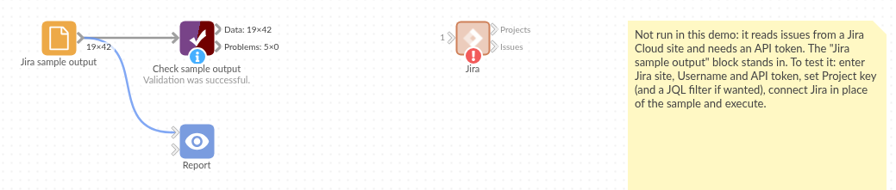

# Jira

*Omniscope custom block · Connectors*

**What is open, who has it, and how long did the rest take? Jira issues as records, with dates as dates and people by name, refreshed on every run.**

**Python** · requests, pandas · requests installed on first run if missing

## The problem it solves

Jira answers "what is in this sprint" well, but questions across projects and over time (how many bugs were opened and closed each week, how long issues sit in review, who has the most open work) need the issues as data. Exports are one-off files that are out of date the next day, and the raw API answer is nested JSON a page at a time.

This block asks Jira for the issues of a project or a JQL search, follows every page, and writes one record per issue with the fields people report on.

- **42** invented issues in the sample responses, read across **2** pages
- **19** fields per issue, with Created, Updated, Due date and Resolved as dates
- **14** issues done, by status category, ready to count by week or assignee
- **3** projects in the Projects output, with key, type and category

### How it works

- Enter the Jira site, your Atlassian e-mail address and an API token.
- Give a project key, a JQL filter, or both: `project = "SHOP" AND (status != Done)`.
- Status, priority, issue type and people come out by name; labels, components and fix versions joined with commas; custom fields by id under **Extra fields**.

## What goes in

Nothing from the workflow: the block reads from Jira. The demo uses invented responses for a fictional web shop project, so it runs without a Jira site; `sample-data/placeholder.csv` holds the Issues output for them.

## The options

| Option | Demo setting | What it does |
|---|---|---|
| Jira site | `your-company` | The site: the part before `.atlassian.net`, or the whole address. |
| Username | `analyst@example.com` | Your Atlassian e-mail address. |
| API token | (a token) | From https://id.atlassian.com/manage-profile/security/api-tokens. |
| Project key | `SHOP` | The project whose issues to load. Empty: projects only, or the JQL filter alone. |
| JQL filter | (empty) | Any JQL condition, combined with the project key; may end with `ORDER BY`. |
| Extra fields | (empty) | Field ids to add, such as `customfield_10016` for story points on many sites. |

## What comes out

### Issues (first 6, some fields)

| Key | Issue type | Summary | Status | Status category | Assignee | Created | Resolved | Components |
|---|---|---|---|---|---|---|---|---|
| SHOP-2 | Story | Basket total ignores voucher after page refresh | Done | Done | Priya Natarajan | 2025-09-01 08:15 | 2025-10-01 15:00 | Checkout |
| SHOP-3 | Bug | Add postcode lookup to delivery form | In Progress | In Progress | Tom Okafor | 2025-09-03 09:15 | | Search |
| SHOP-4 | Task | Search results slow for long queries | In Review | In Progress | Elena Rossi | 2025-09-05 10:15 | | Accounts |
| SHOP-5 | Story | Password reset e-mail goes to spam | Done | Done | Sam Whitfield | 2025-09-07 11:15 | 2025-10-04 15:00 | Mobile app |
| SHOP-6 | Bug | Show stock level on product page | To Do | To Do | | 2025-09-09 12:15 | | Checkout |
| SHOP-7 | Task | Mobile app crashes on order history | In Progress | In Progress | Priya Natarajan | 2025-09-11 13:15 | | Search |

42 records in all. Times are in UTC (Jira's +01:00 times are converted). SHOP-6 has no assignee, so the field is empty.

### Projects

| Project ID | Project key | Project name | Project type | Category | Team-managed |
|---|---|---|---|---|---|
| 10001 | SHOP | Web Shop | software | Customer facing | false |
| 10002 | APP | Mobile App | software | | true |
| 10003 | OPS | Operations Desk | service_desk | Internal | false |

## Where it pays off

### Software teams: Bug trends

Count bugs opened and resolved per week and per component, and see whether the backlog is growing.

### Service desks: Time to resolve

From Created and Resolved, work out how long requests take by priority and request type, and which ones are overdue against their due date.

### Delivery managers: Work in progress by person

Open issues per assignee and status, across several projects in one JQL filter, to spot overloaded people and stalled reviews.

### Product: Release contents

Group issues by fix version and issue type to list what each release contains, with the stories still open.

*Use cases describe typical scenarios and are illustrative; the sample data is invented.*

## Why do this in Omniscope

- **Issues next to the rest of your data.** The issue records can be joined in the same workflow to a staff list, a customer table or time sheets, which Jira's own reports cannot see, and go straight into the Report's charts and filters.
- **The same counts every refresh.** Scheduled, the block reloads every page of the project each time, so weekly bug counts are rebuilt from the full issue list rather than an export someone forgot to update.
- **Your own fields.** Extra fields adds story points or any other custom field by id, and the list of fields and how each is read is plain Python in the block: a team that wants only the latest sprint of an issue, not all of them, can unlock the block's design and change that in the script.

## How it fits into an Omniscope workflow

**Jira** → Field Organiser or Formula (days to resolve: Resolved minus Created) → Aggregate (per week, component or assignee) → Report

Use the Projects output to pick the project keys, or join it to the Issues output on Project key for project names and categories.

## Try it

1. Open the demo project (`demo.iox` on the demo server, or import `demo.ioz` from this folder). It holds the Jira block, unconfigured, and a File block with `placeholder.csv`, the 42 issues the block writes for the invented responses.
2. The question: how many issues are open per component, and how long did the done ones take?
3. Follow the File block into the rest of the workflow: issues per status category, and days from Created to Resolved.
4. To use your own Jira: enter your site, e-mail address, API token and a project key in the Jira block, run it, and connect its Issues output where the File block was.

## Running in Omniscope

*The demo project's workflow: the placeholder data, the block, and a Validate data check on the output.*

<!--language-->
## Language and libraries

Python. It uses requests (Apache License 2.0) and pandas (BSD 3-Clause).

pandas is part of Omniscope's Python environment. requests is listed in the block's dependencies, so Omniscope installs it with pip on first run if it is missing.
<!--/language-->

## Tested

The block is covered by automated tests that run its script against a stand-in for Omniscope's Python API and invented Jira responses (no live calls): both pages read, the requests sent (endpoint, JQL, fields, page token, sign-in), the site given as an address, JQL with and without a project, extra fields, projects only, an empty project key, a project with no issues, refused credentials, and 20,000 issues over 200 pages.
