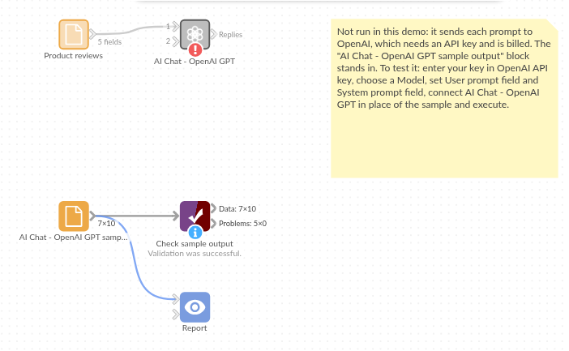

# AI Chat - OpenAI GPT

*Omniscope custom block · Connectors*

**Hundreds of product reviews, and the question is what they are about? One GPT reply per review, added beside the stars, ready to count.**

**Python** · openai, pandas · openai installed on first run

## The problem it solves

Star ratings say how happy customers are, not why. The reason is in the review text, and nobody reads a thousand reviews a month closely enough to count the reasons.

This block sends each review to an OpenAI model with one instruction, "name the main topic in two to four words", and writes the topic beside the review, so topics can be counted against the stars.

- **10** invented reviews in, **10** records out, in the same order
- **10** topics, such as "delivery damage" and "sizing", each beside its review's stars
- **Stars** kept as a number, ready to average per topic

### How it works

- Paste an OpenAI API key, and keep the default model (gpt-6-luna) or enter another.
- Choose the field with each record's prompt, and the field with the instructions (the system prompt).
- The block sends one request per record, 4 at a time by default, and adds **Response** and **Truncated** to each record.

## What goes in

### Product reviews

10 invented reviews from an outdoor equipment shop.

| Review | Product | Stars | Text |
|---|---|---|---|
| R-201 | Trail headlamp | 5 | Brilliant beam and it lasted a whole weekend of night walks on one charge. |
| R-202 | Trail headlamp | 2 | The strap stretched after a week and now it slips down my forehead. |
| R-203 | Insulated flask | 4 | Keeps tea hot all day, though the lid is fiddly with gloves on. |
| R-204 | Insulated flask | 1 | Arrived dented and the box was soaked. Took nine days to come. |
| R-205 | Folding stove | 5 | Packs down tiny and boils half a litre in about three minutes. |
| R-206 | Folding stove | 3 | Works fine but the instructions are confusing and miss a step. |

*10 rows in the sample file. The Instruction field holds the same text on every row: "Name the main topic of this product review in two to four words, for example 'battery life' or 'delivery speed'. Reply with the topic only, in lower case."*

## The options

| Option | Demo setting | What it does |
|---|---|---|
| OpenAI API key | (your key) | A secret key from the OpenAI platform. |
| Model | `gpt-6-luna` | The OpenAI model ID. |
| User prompt field | `Text` | The review text sent for each record. |
| System prompt field | `Instruction` | The instruction: name the main topic in two to four words. |
| Temperature | (empty) | The model's default; current GPT models accept no other while reasoning. |
| Maximum response length (tokens) | (empty) | No limit beyond the model's own. |
| Requests at a time | `4` | How many requests are sent at once. |

## What comes out

### Replies (selected fields)

| Review | Product | Stars | Response | Truncated |
|---|---|---|---|---|
| R-201 | Trail headlamp | 5 | battery life | false |
| R-202 | Trail headlamp | 2 | strap durability | false |
| R-203 | Insulated flask | 4 | lid design | false |
| R-204 | Insulated flask | 1 | delivery damage | false |
| R-205 | Folding stove | 5 | size and speed | false |
| R-206 | Folding stove | 3 | instructions | false |
| R-207 | Rain jacket | 4 | waterproofing | false |
| R-208 | Rain jacket | 2 | sizing | false |
| R-209 | Trekking poles | 5 | build quality | false |
| R-210 | Trekking poles | 3 | price | false |

10 records in all, with every input field kept.

## Where it pays off

### Retail and e-commerce: Why reviews are low

Topic per review, averaged against stars, shows which problems drag ratings down.

### Product teams: Feature requests

Pull the feature asked for out of feedback forms, and count requests per feature.

### HR and internal surveys: Open comments

Turn "anything else?" answers into a short list of themes per department.

### Marketing: Campaign replies

Classify replies to a campaign as interested, not interested or out of office.

*Use cases describe typical scenarios and are illustrative; the sample data is invented.*

## Why do this in Omniscope

- **Topics against stars, in one workflow.** The topic is added to the review record, so an Aggregate block can give the number of reviews and the average stars per topic, and the Report can show which topics sit behind the one- and two-star reviews.
- **Every new batch handled the same way.** Scheduled weekly on the new reviews, the block applies the same instruction to each one, and an empty Response, or one longer than four words, fails a Validate data check and stops the run.
- **A request you can tune.** After unlocking the block's design the request function can be edited: for simple labelling, adding `reasoning_effort="none"` to it makes current GPT models answer without reasoning first, and lets the Temperature option take effect.

## How it fits into an Omniscope workflow

Reviews (File or database) → Filter (last week's reviews) → **AI Chat - OpenAI GPT** → Validate data (Response not empty) → Aggregate (reviews and average Stars per Response) → Report

Filter the input to new reviews first: every run sends every record with a prompt again.

## Try it

1. Open the demo project (`demo.iox` on the demo server, or import `demo.ioz` from this folder). It holds the AI Chat - OpenAI GPT block (unconfigured: no API key), and a File block with `placeholder.csv`: the sample records with the replies the block writes for them.
2. The question: what are the low-rated reviews about?
3. Follow the File block into the rest of the workflow: reviews per topic with their stars; the two two-star reviews are about strap durability and sizing.
4. To use it with your own data: enter an OpenAI API key in the AI Chat - OpenAI GPT block, connect your records and choose the prompt and instruction fields, run it, and connect its Replies output where the File block was.

## Running in Omniscope

*The demo project's workflow: the placeholder data, the block, and a Validate data check on the output.*

<!--language-->
## Language and libraries

Python. It uses the openai package (Apache License 2.0), OpenAI's Python SDK, and pandas (BSD 3-Clause).

pandas is part of Omniscope's Python environment. openai is listed in the block's dependencies, so Omniscope installs it with pip on first run if it is missing.
<!--/language-->

## Tested

The block is covered by automated tests that run its script against a stand-in for Omniscope's Python API and invented OpenAI replies (no live calls): the sample data, the request sent (model, system prompt, temperature and maximum length only when set), an optional system prompt, empty and missing prompts, numbers and dates as prompts, the input's fields kept, an existing Response field, empty input, replies cut short, failed requests (a refused key and an unknown model), option checks, and 400 records sent several at a time. With the real openai package installed, further tests let it build the HTTP requests and read the canned replies.
