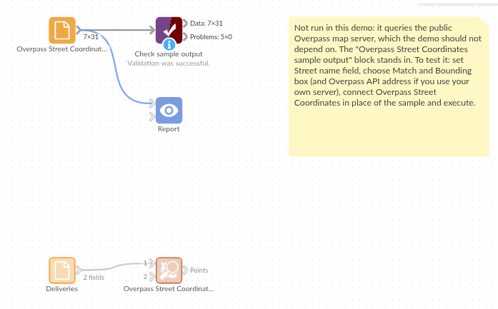

# Overpass Street Coordinates

*Omniscope custom block · Connectors*

**Where exactly does this street run? Every point along the streets named in your data, from OpenStreetMap, ready to draw, measure or match.**

**Python** · requests, pandas · requests installed on first run if missing

## The problem it solves

Records often name a street without saying where it is: deliveries, roadworks, complaints, survey sites. A single geocoded point per street hides its length and shape, and a long street may run across several districts.

This block looks each street name up in OpenStreetMap through the Overpass API and writes the points along every matching street, so the street can be drawn as a line, its length measured, or other records matched to it.

- **6** street names in the sample deliveries, one of them on two deliveries
- **31** points on **7** OpenStreetMap ways for the **5** names found
- **1** name with no matching street, reported in the block's message
- **2** ways each for High Street and Mill Street: a street split at a junction, or two streets of the same name in the box, comes back as separate ways

### How it works

- Choose the field with the street names, and enter a bounding box around the area.
- Each distinct name is one request to the Overpass API; streets are ways with a `highway` tag.
- **Exact name** matches the whole name; **Name contains** also finds longer names, in any case.

## What goes in

### Deliveries

Eight invented deliveries, each with the street it went to.

| Delivery | Street |
|---|---|
| D-101 | High Street |
| D-102 | Station Road |
| D-103 | Church Lane |
| D-104 | High Street |
| D-105 | Mill Street |
| D-106 | Park Avenue |
| D-107 | Kingfisher Way |
| D-108 | |

The demo uses invented Overpass answers (invented geometry, inside a box around central Leeds), so it runs without calling the public server.

## The options

| Option | Demo setting | What it does |
|---|---|---|
| Street name field | Street | The field with the street names. |
| Match | Exact name | Exact name, or Name contains (any case). |
| Bounding box | 53.77, -1.58, 53.83, -1.50 | South, west, north, east: only streets inside it. |
| Overpass API address | (default) | The public Overpass server, or your own. |

## What comes out

### Points (first 8)

| Street | Street name | Way ID | Point | Node ID | Latitude | Longitude |
|---|---|---|---|---|---|---|
| High Street | High Street | 40069428 | 1 | 3110400030 | 53.804964 | -1.525408 |
| High Street | High Street | 40069428 | 2 | 3110400286 | 53.805693 | -1.524110 |
| High Street | High Street | 40069428 | 3 | 3110400402 | 53.806363 | -1.522758 |
| High Street | High Street | 40069428 | 4 | 3110400792 | 53.807016 | -1.521437 |
| High Street | High Street | 40069428 | 5 | 3110400806 | 53.807759 | -1.520169 |
| High Street | High Street | 40080348 | 1 | 3110400949 | 53.788601 | -1.553172 |
| High Street | High Street | 40080348 | 2 | 3110401085 | 53.789692 | -1.552445 |
| High Street | High Street | 40080348 | 3 | 3110401300 | 53.790568 | -1.551562 |

### Per street (Aggregate on Street)

| Street | Ways | Points |
|---|---|---|
| High Street | 2 | 9 |
| Station Road | 1 | 7 |
| Mill Street | 2 | 6 |
| Park Avenue | 1 | 5 |
| Church Lane | 1 | 4 |

31 records in all. Kingfisher Way has no match and the empty street was skipped; joining the deliveries to the points on Street gives each delivery its street's points (High Street's twice, once per delivery).

## Where it pays off

### Logistics: Delivery streets on a map

Draw the streets of a day's deliveries as lines rather than single pins, and see which drivers' rounds overlap.

### Local government: Roadworks and complaints

Map reported issues by street name onto the street's full length, and sum them per street or per stretch of way.

### Utilities and telecoms: Network along streets

Estimate cable or pipe lengths from the points of each street, using the distance between consecutive points.

### Research: Street-level surveys

Turn a list of surveyed streets into coordinates for spatial analysis, with the OpenStreetMap IDs kept for reference.

*Use cases describe typical scenarios and are illustrative; the sample data is invented.*

## Why do this in Omniscope

- **Street names in, a map layer out.** The points join back to the records that named the street, and Latitude and Longitude go straight into a Map view in the Report, with Way ID and Point to draw each street as a line.
- **Street lengths with core blocks.** Join the points to themselves on Way ID and Point + 1 to pair each point with the next, a Formula with `LAT_LON_DISTANCE` gives each segment's length, and an Aggregate per street sums them, all in the same workflow.
- **The query is yours to change.** The Overpass query is one line in the block's Python script: open it in the block editor to look up other kinds of way (railways, rivers, cycle routes) or other tags.

## How it fits into an Omniscope workflow

Records with street names (File or Database) → **Overpass Street Coordinates** → Join (back to the records on the street field) → Report (Map view)

For lengths, pair each point with the next one on the same way (a Formula for Point + 1, then a Join on Way ID and that field), take `LAT_LON_DISTANCE` between the two, and Aggregate per street. Credit OpenStreetMap where you publish the map.

## Try it

1. Open the demo project (`demo.iox` on the demo server, or import `demo.ioz` from this folder). It holds the deliveries, the block (not run), and a File block with `placeholder.csv`: the 31 points the block writes for the invented answers.
2. The question: where do the streets of these deliveries run, and which delivery's street was not found?
3. Follow the File block into the rest of the workflow: points per street, and the join back to the deliveries.
4. To use real data: put your own street names in the input, set a bounding box around your area, run the block, and connect its Points output where the File block was.

## Running in Omniscope

*The demo project's workflow: the deliveries, the block, the placeholder data and a Validate data check.*

<!--language-->
## Language and libraries

Python. It uses requests (Apache License 2.0) and pandas (BSD 3-Clause).

pandas is part of Omniscope's Python environment. requests is listed in the block's dependencies, so Omniscope installs it with pip on first run if it is missing. Map data © OpenStreetMap contributors, under the Open Database Licence.
<!--/language-->

## Tested

The block is covered by automated tests that run its script against a stand-in for Omniscope's Python API and an invented Overpass server that reads the block's query (no live calls): the sample streets, the request sent (one per name, a descriptive User-Agent, the bounding box), streets only, Name contains, exact and case-sensitive matching, names with quotes and brackets, the bounding box and bad boxes, a busy server, a refused or timed-out query, another server address, an input field named like an output field, empty input and missing values, wrong field types, and 5,000 records with 2,001 distinct names.
