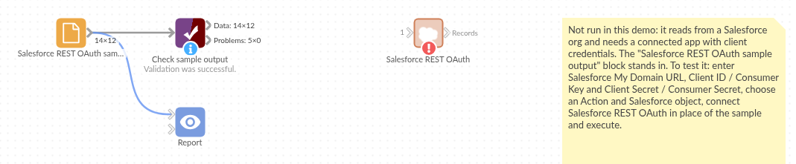

# Salesforce REST OAuth

*Omniscope custom block · Connectors*

**Every account, contact or opportunity your integration user can see, with all their readable fields and dates as dates, from a Salesforce org that only allows OAuth sign-in.**

**Python** · requests, pandas · requests installed on first run if missing

## The problem it solves

Salesforce holds the customer side of many businesses, but reporting that also needs orders, invoices or support data has to take the records out. Salesforce is retiring username-and-password API sign-in, so connections increasingly need OAuth, and a query needs the field API names, which few people outside the Salesforce admin team know.

This block signs in with an External Client App's client credentials, asks Salesforce which fields the integration user can read, and loads every record of the object with all those fields, across every page.

- **12** invented accounts read from **2** pages
- **14** fields found by Describe and loaded, without naming one
- **2** fields left out: the compound BillingAddress (its parts are loaded) and a deprecated field
- **2** date fields typed as dates: CreatedDate and LastActivityDate

### How it works

- Enter the My Domain URL, Consumer Key and Consumer Secret of an External Client App with the client credentials flow.
- Simple mode: choose the object. Query Builder: object, fields, WHERE, ORDER BY. Custom SOQL: any query.
- The REST API version is the newest the org offers, unless you give one.

## What goes in

Nothing from the workflow: the block reads from Salesforce. The demo uses invented responses for a garden supplies wholesaler's accounts, so it runs without a Salesforce org; `sample-data/placeholder.csv` holds the Records output for them.

## The options

| Option | Demo setting | What it does |
|---|---|---|
| Salesforce My Domain URL | `https://your-company.my.salesforce.com` | The org to sign in to. |
| Client ID, Client Secret | (empty) | The External Client App's Consumer Key and Secret. |
| Action | Load data | Load records, or list objects, or describe an object's fields. |
| Load mode | Simple - Load object | Simple, Query Builder or Custom SOQL. |
| Salesforce object | Accounts | For Simple mode, one of 14 common objects. |
| Include deleted/archived records | No | Yes adds Recycle Bin and archived records. |
| Maximum records | 100000 | Stop after this many; 0 for all. |
| Advanced options | (defaults) | Object, fields, WHERE, ORDER BY, SOQL, API version, timeout. |

## What comes out

### Records (first 6, some fields)

| Name | Type | Industry | BillingCity | AnnualRevenue | CreatedDate | LastActivityDate |
|---|---|---|---|---|---|---|
| Fernhill Garden Centre | Customer - Direct | Retail | Leeds | 2400000 | 2024-01-01 09:30 | 2025-01-10 |
| Marsh Lane Hardware | Customer - Direct | Retail | York | 860000 | 2024-02-02 09:30 | 2025-02-11 |
| Brookside Allotment Society | Customer - Channel | Not For Profit | Harrogate | | 2024-03-03 09:30 | 2025-03-12 |
| Willow Bank Landscapes | Prospect | Construction | Bradford | 1300000 | 2024-04-04 09:30 | |
| Oakfield Nurseries | Customer - Direct | Agriculture | Wakefield | 3100000 | 2024-05-05 09:30 | 2025-05-14 |
| Greenway Estates | Prospect | Real Estate | Leeds | 9800000 | 2024-06-06 09:30 | 2025-06-15 |

12 records in all: 5 direct customers, 2 channel customers, 3 prospects and 2 others. Empty AnnualRevenue and LastActivityDate are missing in Salesforce, not zero.

### Custom SOQL through relationships

`SELECT Id, LastName, Owner.Name, Account.Name FROM Contact` gives the fields `Id`, `LastName`, `Owner.Name`, `Account.Name`; a contact with no owner has an empty `Owner.Name`.

## Where it pays off

### Sales operations: Pipeline beside revenue

Load opportunities with stage, amount and close date, and join them to invoices from the finance system to compare forecast with what was billed.

### Customer success: Accounts and support

Join accounts to support tickets from another system on the account name or ID, and see which large customers have the most open issues.

### Data quality: Finding gaps

Load all account fields and count empty industries, missing billing cities or accounts with no activity in a year.

### Audit: What was deleted

With deleted records included, list the records removed this month and who owned them.

*Use cases describe typical scenarios and are illustrative; the sample data is invented.*

## Why do this in Omniscope

- **Salesforce data next to the rest.** In one workflow the accounts join the order database and the support desk's tickets, and the Report shows revenue and open issues per account type, which Salesforce's own reports cannot reach.
- **Fields found again on every run.** Simple mode asks Salesforce for the readable fields each time, so a custom field an admin adds appears in the next scheduled run without editing the block; the dates come out typed the same way every run.
- **Relationships and history the core block leaves out.** `Owner.Name`-style lookups, deleted records and the schema actions are here because the block is a script; unlock the block's design and open the script to add an object to the Simple list.

## How it fits into an Omniscope workflow

**Salesforce REST OAuth** (Accounts) → Join (orders from a Database block, on account ID) → Aggregate (revenue per Type and Industry) → Report

Use the Describe fields action once to find the API names of custom fields, then Query Builder to load only those.

## Try it

1. Open the demo project (`demo.iox` on the demo server, or import `demo.ioz` from this folder). It holds the Salesforce block, without credentials, and a File block with `placeholder.csv`, the 12 accounts the block writes for the invented responses.
2. The question: how many accounts of each type are there, and which have had no activity?
3. Follow the File block into the rest of the workflow: accounts per Type (5, 3, 2, 2) and the three with no LastActivityDate.
4. To use your own org: set up an External Client App as the README describes, enter its details in the block, run it, and connect its Records output where the File block was.

## Running in Omniscope

*The demo project's workflow: the placeholder data, the block, and a Validate data check on the output.*

<!--language-->
## Language and libraries

Python. It uses requests (Apache License 2.0) and pandas (BSD 3-Clause).

pandas is part of Omniscope's Python environment. requests is listed in the block's dependencies, so Omniscope installs it with pip on first run if it is missing.
<!--/language-->

## Tested

The block is covered by automated tests that run its script against a stand-in for Omniscope's Python API and invented Salesforce responses (no live calls): Simple mode over two pages with dates typed from Describe, every request it sends (token, version, Describe, query, next page), Query Builder with deleted records, Custom SOQL through relationships, no records, the record limit, the schema actions, refused credentials and bad options, a temporary error retried, and 40,000 records over 20 pages.
