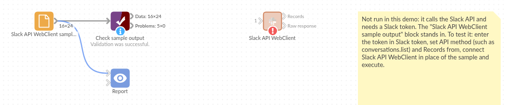

# Slack API WebClient

*Omniscope custom block · Connectors*

**Which channels are busiest, who is in them, what was said? Any Slack Web API method, with every page of the answer turned into records.**

**Python** · requests, pandas · requests installed on first run if missing

## The problem it solves

A Slack workspace holds useful operational data: how many channels there are and how big, which are archived or private, who belongs where, how active a support channel is. Slack shows these one channel at a time; the Web API has them all, as JSON in pages of up to a few hundred items, each page pointing to the next with a cursor.

This block makes the call, follows the cursor to the last page, and writes the list as records with nested values flattened into fields.

- **24** invented channels from **2** pages of `conversations.list`, combined into one output
- **16** fields per channel, including `num_members`, `is_private`, `is_archived` and `topic.value`
- **1,430** channel memberships in all, ready to sum or chart
- **1** call for chat.postMessage, with the posted message as one record

### How it works

- Enter a token, the method name and its arguments as JSON (Query Params for GET, JSON Payload for POST).
- The list in the answer (or the one named in **Records from**) becomes the Records output; an answer with no list becomes one record.
- Slack's errors stop the block with Slack's message, such as `missing_scope (the token needs the channels:read scope)`.

## What goes in

Nothing from the workflow: the block calls Slack. The demo uses an invented `conversations.list` answer for a small company's workspace, so it runs without a Slack token; `sample-data/placeholder.csv` holds the Records output for it.

## The options

| Option | Demo setting | What it does |
|---|---|---|
| Slack token | (empty) | A bot or user token with the scopes the method needs. |
| API method | `conversations.list` | Any Slack Web API method. |
| HTTP method | GET | GET reads (Query Params); POST changes something (JSON Payload). |
| Query Params (GET) | `{}` | The method's arguments, such as `{"types": "public_channel,private_channel"}`. |
| JSON Payload (POST) | (not used) | The arguments for a POST, such as a channel and a message text. |
| Records from | (empty) | The list to use; empty takes the first list in the answer (`channels`). |
| Follow pages | ticked | Follows Slack's cursor to the last page. |

## What comes out

### Records (first 6 channels, some fields)

| id | name | is_private | is_archived | num_members | topic.value | purpose.value |
|---|---|---|---|---|---|---|
| C01000EXAMPLE | general | false | false | 212 | | Talk about general |
| C01001EXAMPLE | random | false | false | 198 | About #random | Talk about random |
| C01002EXAMPLE | sales-uk | false | false | 14 | About #sales-uk | Talk about sales uk |
| C01003EXAMPLE | sales-europe | false | false | 11 | | Talk about sales europe |
| C01004EXAMPLE | support | false | false | 37 | About #support | Talk about support |
| C01005EXAMPLE | support-escalations | false | false | 9 | About #support-escalations | Talk about support escalations |

24 records in all, from two pages. `#office-leeds` is archived with no members; `#finance` and `#hiring` are private. `previous_names` (a list in Slack's answer) is JSON text: `["sales"]` for `#sales-uk`.

### Raw response

Two records, one per page, each holding that page's full JSON answer in `Text Response`.

## Where it pays off

### Workspace administrators: Channel housekeeping

List every channel with its size, creation time and archive state, and find empty or duplicate channels to tidy up.

### Support teams: Channel activity

Load a support channel's messages with `conversations.history` and count questions per day, or replies per person.

### Operations: Notifications from a workflow

Post a summary to a channel with `chat.postMessage` at the end of a scheduled workflow, after a Validate data block confirms there is something to say.

### Internal communications: Membership

With `conversations.members` and `users.list`, see who is in which channels, and who has not joined an announcement channel.

*Use cases describe typical scenarios and are illustrative; the sample data is invented.*

## Why do this in Omniscope

- **Channel data beside staff data.** In one workflow the channel members join the HR or team list, and the Report shows channel coverage by department, which Slack's own admin pages cannot.
- **A weekly channel census without copy-paste.** Scheduled, the block re-reads every page each run, so channel counts and sizes are rebuilt from Slack, and Validate data can halt the run before a chat.postMessage block posts a summary built on an empty answer.
- **Any method, and a script you can change.** New Slack methods work by typing their name, and the paging and flattening are plain Python you can edit: change how a message's replies or files are flattened if the default doesn't suit.

## How it fits into an Omniscope workflow

**Slack API WebClient** (conversations.list) → Record Filter (not archived) → Join (owners list) → Report

Use one block per method: one for channels, another for members (`conversations.members`, with the channel id in Query Params), and join them on the channel id.

## Try it

1. Open the demo project (`demo.iox` on the demo server, or import `demo.ioz` from this folder). It holds the Slack block, without a token, and a File block with `placeholder.csv`, the 24 channels the block writes for the invented answer.
2. The question: which channels are largest, and which are archived or empty?
3. Follow the File block into the rest of the workflow: channels by `num_members`, and the archived ones.
4. To use your own workspace: create a Slack app with the `channels:read` scope, enter its token in the block, run it, and connect its Records output where the File block was.

## Running in Omniscope

*The demo project's workflow: the placeholder data, the block, and a Validate data check on the output.*

<!--language-->
## Language and libraries

Python. It uses requests (Apache License 2.0) and pandas (BSD 3-Clause).

pandas is part of Omniscope's Python environment. requests is listed in the block's dependencies, so Omniscope installs it with pip on first run if it is missing.
<!--/language-->

## Tested

The block is covered by automated tests that run its script against a stand-in for Omniscope's Python API and invented Slack answers (no live calls): two pages combined, the requests sent for GET and POST (address, arguments, cursor, token header), an answer without a list, a chosen list and the first page only, a list of plain values, an empty list, Slack's error answers, bad JSON in the options, a rate-limited call, and 100 pages of 200 channels.
