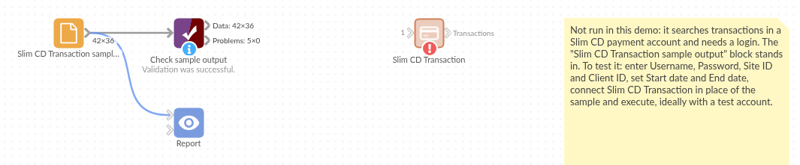

# Slim CD Transaction

*Omniscope custom block · Connectors*

**What did the card terminal take this month, by card type, clerk and day? Slim CD gateway transactions as typed records, searched with the gateway's own filters.**

**Python** · requests, pandas · requests installed on first run if missing

## The problem it solves

A shop or service business taking cards through Slim CD sees its transactions in the gateway's web screens, one search at a time. Reconciling them with the till, the accounts or the bank, or reporting takings by day and card type, needs them as data.

This block runs a Slim CD transaction search with the gateway's own filters and writes the result as records: dates as dates, amounts as numbers, ZIP codes kept as text.

- **36** invented transactions of a fictional shop, 1 to 17 October 2026
- **33** approved and **3** declined; **4** of the approved are returns
- **2,883.95** net card takings: 3,580.51 in sales less 696.56 in returns
- **1** search request per run, and **1** record with the count when you only want to know how many

### How it works

- Enter the Slim CD username, password and Site ID, and a date range.
- Add filters if you want (customer, amount, transaction type, clerk); empty ones are not sent.
- Tick Record count only to check the size of a search first.

## What goes in

Nothing from the workflow: the block reads from Slim CD. The demo uses an invented reply, so it runs without a Slim CD account; `sample-data/placeholder.csv` holds the block's output for it.

## The options

| Option | Demo setting | What it does |
|---|---|---|
| Username, Password, Site ID | (your account) | Your Slim CD credentials and site. |
| Start date, End date | 2026-10-01, 2026-10-31 | The days to search. |
| Treat all output fields as text | unticked | Unticked: dates, amounts and IDs typed. |
| Record count only | unticked | One record with the count instead. |
| Max records, Reverse order | (empty), unticked | Limit and order the result. |
| Filters | (empty) | Name, e-mail, amount, transaction type, clerk and others. |

## What comes out

### Transactions (first 5, some fields)

| gateid | transactiondate | transtype | approved | cardtype | amount | firstname | lastname | zip | clerkname |
|---|---|---|---|---|---|---|---|---|---|
| 1840221000 | 2026-10-01 17:24 | SALE | Y | MC | 231.18 | Grace | Okoro | 02903 | Dana |
| 1840221007 | 2026-10-01 20:58 | SALE | Y | MC | 63.90 | Noah | Becker | 02139-4307 | Dana |
| 1840221014 | 2026-10-02 13:18 | SALE | Y | DISC | 112.03 | Liam | Novak | 06103 | Marcus |
| 1840221021 | 2026-10-02 17:01 | SALE | Y | VISA | 60.80 | Liam | Novak | 06103 | Marcus |
| 1840221028 | 2026-10-03 09:52 | RETURN | Y | AMEX | 175.88 | Liam | Novak | 06103 | Dana |

36 records in all, 42 fields. ZIP codes keep their leading zeros and ZIP+4 form.

### Approved transactions by type (Record filter on approved = Y, Aggregate on transtype)

| transtype | Transactions | Amount |
|---|---|---|
| SALE | 29 | 3,580.51 |
| RETURN | 4 | 696.56 |

## Where it pays off

### Retail and hospitality: Daily takings

Card takings per day, clerk and card type, net of returns, next to the till's own figures.

### Finance: Reconciliation

Match gateway transactions to bank deposits by batch number and date, and list the ones that do not match.

### Operations: Declines and voids

Declined and voided transactions by clerk, card type and time of day, to spot terminal or training problems.

### Customer service: Find a payment

Search by customer name, e-mail or amount to answer a payment query, with the full gateway record.

*Use cases describe typical scenarios and are illustrative; the sample data is invented.*

## Why do this in Omniscope

- **Gateway, till and bank in one workflow.** The transactions join to till exports and bank statements on batch, date and amount, so the reconciliation and the takings report come from one place.
- **The same fields every run.** The block writes the same typed fields whether a search finds 0, 1 or thousands of transactions, so a scheduled daily run can feed a Validate data check (no declines above a threshold, takings within range) without breaking on a quiet day.
- **Your own filters and fields.** Filters are options; the list of fields and how each is typed is a short block of Python in the block's script, which you can open and change in the block editor.

## How it fits into an Omniscope workflow

**Slim CD Transaction** → Record filter (approved = Y) → Formula (net amount: returns negative) → Aggregate (per day, clerk or card type) → Report

For reconciliation, join to the bank's deposit records on batch number and date.

## Try it

1. Open the demo project (`demo.iox` on the demo server, or import `demo.ioz` from this folder). It holds the Slim CD block without credentials, and a File block with `placeholder.csv`: the 36 transactions the block writes for the invented reply.
2. The question: what were the net card takings, and how many payments were declined?
3. Follow the File block into the rest of the workflow: approved transactions by type, and the declines.
4. To use your own account: enter your username, password and Site ID in the Slim CD block, set the dates, run it, and connect its Transactions output where the File block was.

## Running in Omniscope

*The demo project's workflow: the placeholder data, the block, and a Validate data check on the output.*

<!--language-->
## Language and libraries

Python. It uses requests (Apache License 2.0) and pandas (BSD 3-Clause).

pandas is part of Omniscope's Python environment. requests is listed in the block's dependencies, so Omniscope installs it with pip on first run if it is missing.
<!--/language-->

## Tested

The block is covered by automated tests that run its script against a stand-in for Omniscope's Python API and an invented Slim CD reply (no live calls): the sample transactions and their types, the request sent (only the options that are set), ZIP codes, the all-text option with missing values, a search with no transactions, a single transaction, a refused login, record count only, HTTP and connection errors (the password is not shown), an answer that is not JSON, option checks, and 20,000 transactions.
