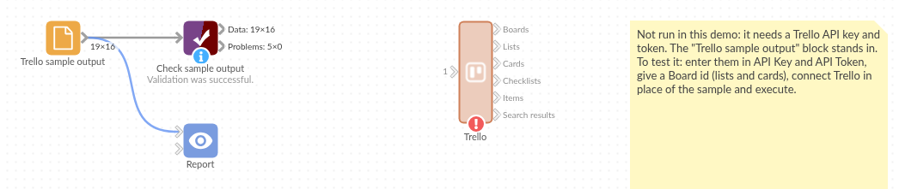

# Trello

*Omniscope custom block · Connectors*

**How many cards sit in each list, which are overdue, and how far are their checklists? A Trello board as records, with labels, due dates and list names, refreshed on every run.**

**Python** · requests, pandas · requests installed on first run if missing

## The problem it solves

A Trello board shows where each card is today, but not how many cards each stage holds across several boards, which due dates have passed, or how that changes week to week. Copying cards into a spreadsheet by hand is out of date by the next stand-up.

This block reads a board's lists and cards (or a workspace's boards, a card's checklists, a search) and writes one record per card with its list name, labels, due date and checklist progress.

- **16** cards on the invented content calendar board, across **5** lists
- **5** cards overdue as at 15 April 2025 (due date passed, not marked complete)
- **3** cards with two labels each, written as `Blog, Social`
- **4** cards with checklists, each with how many items it has and how many are checked

### How it works

- Enter a Trello API key and token, then the ids for what you want: workspace (boards), board (lists and all its cards), list, card (checklists), checklist (items), or a search.
- Each output is loaded only when its option is set; empty options are ignored.
- The key and token are sent in a request header, never in the address.

## What goes in

Nothing from the workflow: the block reads from Trello. The demo uses invented responses for a content calendar board of a garden supplies wholesaler, so it runs without a Trello account; `sample-data/placeholder.csv` holds the Cards output for them.

## The options

| Option | Demo setting | What it does |
|---|---|---|
| API Key, API Token | (empty) | From a Trello Power-Up's API key page. |
| Workspace id (boards) | (empty) | Loads the workspace's boards. |
| Board id (lists and cards) | the board's short code | Loads the lists and every open card on the board, with list names. |
| List id (cards of one list) | (empty) | Loads one list's cards instead of the whole board's. |
| Card id, Checklist id | (empty) | Load a card's checklists, or a checklist's items. |
| Search cards | (empty) | Finds up to 1,000 cards by text, in Trello's search syntax. |

## What comes out

### Cards (selected, some fields)

| name | listName | labels | due | dueComplete | checkItems | checkItemsChecked |
|---|---|---|---|---|---|---|
| Spring product update post | Published | Blog | 2025-03-04 09:00 | true | 4 | 4 |
| Customer story: Fernhill Garden Centre | Published | Blog, Social | 2025-03-11 09:00 | true | 0 | 0 |
| Webinar follow-up e-mail | Scheduled | Newsletter, Webinar | 2025-04-03 09:00 | false | 4 | 2 |
| Price list refresh announcement | Writing | Blog, red | 2025-04-14 09:00 | false | 0 | 0 |
| Trade show stand photos | Writing | Social | | false | 0 | 0 |
| Refresh the FAQ page | To plan | | | false | 0 | 0 |

16 records in all. "red" is a label with a colour but no name. Cards with no due date have an empty `due`.

### Cards per list

| listName | Cards |
|---|---|
| To plan | 5 |
| Writing | 4 |
| Published | 3 |
| Design | 2 |
| Scheduled | 2 |

## Where it pays off

### Marketing teams: Content pipeline

Count posts, newsletters and webinars per stage and label, and list the pieces whose publication date has passed.

### Recruitment: Candidate stages

On a board with one list per hiring stage, see how many candidates each stage holds and how long cards have been inactive.

### Small projects: Checklist progress

Use the checklist counts to show how complete each card is, and which cards have unchecked items close to their due date.

### Several boards: One view

Load the boards of a workspace, then each board's cards, and append them for a single report across teams.

*Use cases describe typical scenarios and are illustrative; the sample data is invented.*

## Why do this in Omniscope

- **From board to report in one workflow.** The cards feed an Aggregate per list and a Report on overdue work in the same project, and the Report's filters work on list, label and due date like any other field.
- **The stage counts rebuild themselves.** A scheduled run reloads the board, so the cards-per-list table is recounted from Trello each time instead of from a copied spreadsheet.
- **More than one board, or more fields.** The script is open in the block editor: add a Trello field to the card list (such as `idChecklists` or `subscribed`), or loop over several board ids, without waiting for a new version.

## How it fits into an Omniscope workflow

**Trello** (Cards) → Formula (Overdue: due before today and not dueComplete) → Aggregate (per listName and label) → Report

Join the Lists output on `idList` for list positions (`pos`) to sort the lists in board order.

## Try it

1. Open the demo project (`demo.iox` on the demo server, or import `demo.ioz` from this folder). It holds the Trello block, unconfigured, and a File block with `placeholder.csv`, the 16 cards the block writes for the sample board.
2. The question: how many cards are in each list, and which are overdue?
3. Follow the File block into the rest of the workflow: cards per list (5, 4, 3, 2, 2), and the cards whose due date has passed and are not complete.
4. To use your own board: enter an API key, token and a board id in the Trello block, run it, and connect its Cards output where the File block was.

## Running in Omniscope

*The demo project's workflow: the placeholder data, the block, and a Validate data check on the output.*

<!--language-->
## Language and libraries

Python. It uses requests (Apache License 2.0) and pandas (BSD 3-Clause).

pandas is part of Omniscope's Python environment. requests is listed in the block's dependencies, so Omniscope installs it with pip on first run if it is missing.
<!--/language-->

## Tested

The block is covered by automated tests that run its script against a stand-in for Omniscope's Python API and invented Trello responses (no live calls): a board's lists and cards, every output at once, the key and token sent in a header, an encoded search, the fields asked for, empty options, an empty board, a refused key, an unknown id, nothing chosen, and a board of 20,000 cards.
