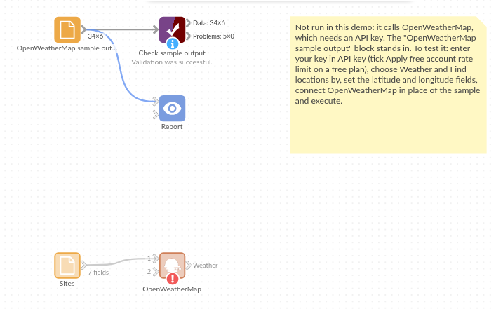

# OpenWeatherMap

*Omniscope custom block · Connectors · Weather*

**Which sites are wet, windy or freezing right now, and what is coming this week? The weather for every location in your data, as records you can join, filter and chart.**

**R** · httr, jsonlite, data.table · install them on the server's R if missing

## The problem it solves

A delivery company, a chain of stores or an events team has a list of locations and wants the weather beside them: to explain a dip in footfall, to warn drivers, or to plan staff for the week. Weather websites answer one place at a time, and copying figures into a spreadsheet is out of date within the hour.

This block takes the locations straight from the workflow and returns the weather for each one as records.

- **6** invented depot and store sites, looked up by latitude and longitude
- **1** site with no address yet, skipped and counted in the block's message
- **31** weather fields per site, the same on every run: rain, snow and gusts are empty when there are none
- **240** forecast records for the same sites: 40 three-hour steps each over 5 days

### How it works

- Each record's location becomes one call to OpenWeatherMap's current weather or 5-day forecast; a location that appears several times is asked for once.
- The answer is written with OpenWeatherMap's field names (`main.temp`, `wind.speed`, `rain.1h`), times converted to UTC date-times, then the input's location fields and the identifying field.
- With a free key, the block waits 1.1 seconds between calls, keeping under 60 calls a minute.

## What goes in

### Sites

7 invented sites; one has no address yet.

| Site ID | Site | City | Country | Latitude | Longitude |
|---|---|---|---|---|---|
| S01 | Northgate depot | Leeds | GB | 53.79648 | -1.54785 |
| S02 | Harbourside store | Bristol | GB | 51.45523 | -2.59665 |
| S03 | Clyde yard | Glasgow | GB | 55.86424 | -4.25181 |
| S04 | Bayview warehouse | Cardiff | GB | 51.48158 | -3.17909 |
| S07 | New site (address to follow) | | | | |

*7 rows in the sample file.*

## The options

| Option | Demo setting | What it does |
|---|---|---|
| API key | (your key) | Your OpenWeatherMap API key; the free plan is enough. |
| Apply free account rate limit | Ticked | Keeps under 60 calls a minute. |
| Weather | Current weather | Or 5-day forecast: 40 records per location. |
| Find locations by | Latitude and longitude | Or city (with state and country code), or postcode and country code. |
| Units | Celsius | Or Fahrenheit or Kelvin. |
| Field to identify records | `Site ID` | Copied into each record as `index`, for joining back. |
| Latitude field / Longitude field | `Latitude` / `Longitude` | The coordinates. |

## What comes out

### Weather (current weather, some fields)

| index | name | weather.description | main.temp | main.feels_like | wind.speed | wind.gust | rain.1h | snow.1h | dt (UTC) |
|---|---|---|---|---|---|---|---|---|---|
| S01 | Leeds | light rain | 11.9 | 10.41 | 1.93 | 3.09 | 0.42 | | 2026-11-06 11:58 |
| S02 | Bristol | broken clouds | 6.93 | 4.17 | 3.56 | | | | 2026-11-06 11:56 |
| S03 | Glasgow | clear sky | 3.85 | 1.44 | 3.78 | 6.05 | | | 2026-11-06 11:54 |
| S04 | Cardiff | mist | 3.97 | 1.3 | 7.23 | | | | 2026-11-06 11:52 |
| S05 | Norwich | light snow | 0.28 | -2.05 | 4.04 | | | 0.18 | 2026-11-06 11:50 |
| S06 | Belfast | broken clouds | 6.05 | 3.55 | 6.78 | | | | 2026-11-06 11:48 |

6 records, one per located site, each with 34 fields: the 31 weather fields, then `latitude`, `longitude` and `index`. The block's message: "Weather for 6 of 7 input records. 1 had no location and was skipped." Values are from invented answers.

### The forecast

With Weather set to 5-day forecast, the same sites give 240 records: `dt_txt` from 2026-11-06 15:00 every 3 hours, with `main.temp`, `pop` (probability of precipitation), `rain.3h`, `snow.3h` and the condition in `main` and `description`.

## Where it pays off

### Logistics: Driver warnings

Flag depots with snow, gusts over a threshold or poor visibility before the morning shift, from the current weather at each depot.

### Retail: Footfall and weather

Store the weather beside daily sales for each store and see how rain or cold changes takings, store by store.

### Events and facilities: Planning the week

From the 5-day forecast, list the sites and days with a high chance of rain or temperatures near freezing, for staffing, gritting or covers.

### Energy and buildings: Heating demand

Compare forecast temperatures across sites to anticipate heating load.

*Use cases describe typical scenarios and are illustrative; the sample data is invented.*

## Why do this in Omniscope

- **Weather beside the site list you already keep.** The block reads the site file or database in the workflow and writes `index` back, so a Join brings the weather onto each site's own records and the Report maps or filters them without a separate download.
- **A scheduled weather snapshot.** Scheduled every hour, the workflow asks for every site again with no download or copy-paste; because the fields are the same whatever the weather, a Validate data block can check that every site came back and `main.temp` is in range, and writing each run's output to a database table builds the history for the sales comparison.
- **The R script is yours to change.** The output fields are one list in the script: add a field OpenWeatherMap returns, a feels-like warning, or switch the city search to OpenWeatherMap's Geocoding API in the block editor.

## How it fits into an Omniscope workflow

Sites (File or Database) → **OpenWeatherMap** → Join (on Site ID = index) → Formula (warning flags) → Report (map and table)

For addresses without coordinates, put the core Geocode block before this one and search by latitude and longitude.

## Try it

1. Open the demo project (`demo.iox` on the demo server, or import `demo.ioz` from this folder). It holds the OpenWeatherMap block, without an API key, and a File block with `placeholder.csv`, the 6 records the block writes for the invented answers.
2. The question: which sites have rain, snow or strong gusts now?
3. Follow the File block into the rest of the workflow: S01 Leeds has rain, S05 Norwich snow, S03 Glasgow the strongest gust.
4. To use live weather: enter your API key in the OpenWeatherMap block, connect `sites.csv` (or your own sites) to it, run it, and connect its Weather output where the File block was.
5. Change Weather to 5-day forecast and run again: 40 records per site.

## Running in Omniscope

*The demo project's workflow: the placeholder data, the block, and a Validate data check on the output.*

<!--language-->
## Language and libraries

R. It uses httr (MIT licence), jsonlite (MIT) and data.table (MPL-2.0).

None is part of base R: install them on the Omniscope server's R if they are missing (`install.packages(c("httr", "jsonlite", "data.table"))`).
<!--/language-->

## Tested

The block is covered by automated tests that run its script against a stand-in for Omniscope's R API and invented OpenWeatherMap answers (no live calls): current weather and forecast for the sample sites, the requests sent (coordinates, city names with spaces, postcodes, units, missing parts left out), one record per location with two weather conditions, times in UTC whatever the server's time zone, the same fields whatever the weather, one call per distinct location, a refused key, the call limit with retry, the rate limit, missing field choices, empty and missing input, and 2,000 records.
