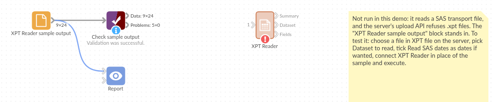

# XPT Reader

*Omniscope custom block · Connectors*

**Clinical trial or survey data delivered as SAS transport files? Read any dataset in the file, with SAS dates as dates and the labels alongside, without SAS.**

**Python** · pandas, numpy · nothing extra to install

## The problem it solves

Clinical trial data is exchanged as SAS transport files: the SDTM and ADaM datasets of a study, one or several per file, each with SAS names such as `TRTSDT`, labels such as "Date of first dose", and dates stored as a number of days since 1 January 1960. Without SAS, the data sits in a format most tools cannot open, and the dates read as numbers like 23776.

This block reads the file on the Omniscope server, lists what it holds, and writes the chosen dataset as records, dates included.

- **2** datasets in the sample file: subject-level data (ADSL) and vital signs (VS)
- **24** subjects and **138** blood pressure readings, read without SAS
- **2** date fields recognised from their SAS formats (`DATE9.`, `YYMMDD10.`) and read as dates
- **15** fields listed with their labels, types, lengths and formats

### How it works

- Choose the file and, if it holds several datasets, the one to read; empty reads the first.
- SAS missing values (`.` and the special `.A` to `.Z`) become empty values; text loses its trailing spaces.
- Numbers formatted as SAS dates or date-times become Date fields; untick **Read SAS dates as dates** to keep the numbers.

## What goes in

### Trial sample (`trial-sample.xpt`)

An invented SAS transport file for a fictional study DEMO-01 with three arms, written in the XPORT version 5 layout. It holds two datasets:

| Dataset Name | Label | Records | Fields |
|---|---|---|---|
| ADSL | Subject-level analysis data | 24 | STUDYID, USUBJID, SITE, SEX, AGE, ARM, TRTSDT, WEIGHTBL, SAFFL |
| VS | Vital signs | 138 | USUBJID, VISIT, VSTESTCD, VSSTRESN, VSSTRESU, VSDT |

## The options

| Option | Example setting | What it does |
|---|---|---|
| XPT file | `trial-sample.xpt` | The SAS transport file on the Omniscope server. |
| Dataset to read | (empty) | The dataset's name, upper or lower case. Empty: the first dataset (ADSL). |
| Read SAS dates as dates | ticked | Numbers with a SAS date or datetime format become dates. |

## What comes out

### Dataset: ADSL (first 7 records)

| STUDYID | USUBJID | SITE | SEX | AGE | ARM | TRTSDT | WEIGHTBL | SAFFL |
|---|---|---|---|---|---|---|---|---|
| DEMO-01 | DEMO-01-101 | Leeds | F | 33 | Placebo | 2025-02-04 | 72.5 | Y |
| DEMO-01 | DEMO-01-102 | Bristol | M | 28 | Low dose | 2025-02-06 | 94.7 | Y |
| DEMO-01 | DEMO-01-103 | Glasgow | F | 47 | High dose | 2025-02-09 | 82.3 | Y |
| DEMO-01 | DEMO-01-104 | Cardiff | M | 37 | Placebo | 2025-02-14 | 53.9 | Y |
| DEMO-01 | DEMO-01-105 | Leeds | F | 50 | Low dose | 2025-02-16 | 55.6 | Y |
| DEMO-01 | DEMO-01-106 | Bristol | M | 59 | High dose | 2025-02-18 | | Y |
| DEMO-01 | DEMO-01-107 | Glasgow | F | 31 | Placebo | 2025-02-23 | 101.3 | Y |

24 records in all, 8 per arm. DEMO-01-106 has no baseline weight (a SAS missing value), and DEMO-01-124, randomised but never treated, has no date of first dose.

### Fields (ADSL, some)

| Dataset Name | Position | Field | Label | Type | Length | Format | Read as |
|---|---|---|---|---|---|---|---|
| ADSL | 5 | AGE | Age (years) | Number | 8 | | Number |
| ADSL | 6 | ARM | Planned treatment arm | Text | 9 | | Text |
| ADSL | 7 | TRTSDT | Date of first dose | Number | 8 | DATE9. | Date |
| ADSL | 8 | WEIGHTBL | Baseline weight (kg) | Number | 8 | 8.1 | Number |

15 records, one per field of both datasets. The **Summary** output has one record per dataset, as in "What goes in", with the created and modified dates from the file.

## Where it pays off

### Clinical research: Study data review

Load ADSL and the findings datasets of a study to check enrolment by site and arm, missing baseline values and visit dates, before the formal analysis.

### Regulatory submissions: Checking a data package

List every dataset and field in the transport files of a submission, with labels and formats, and compare them with the data definition.

### Public statistics: Survey microdata

Read survey files published in SAS transport format, such as health and nutrition survey extracts, and join their datasets on the respondent number.

### Data migration: Retiring SAS jobs

Read the transport files an old SAS process exports, so the reporting that follows can move into an Omniscope workflow.

*Use cases describe typical scenarios and are illustrative; the sample data is invented.*

## Why do this in Omniscope

- **From the transport file to the trial report.** ADSL feeds a Join with the vital signs dataset (read by a second XPT Reader with Dataset to read VS) and on into charts of blood pressure by arm and visit, in one workflow from the file to the Report.
- **The same reading each time a new data cut arrives.** Replace the file and run again: dates, missing values and labels are read the same way, and Validate data can confirm the record count and that every treated subject has a date of first dose.
- **The data dictionary comes with the data.** The Fields output gives each field's SAS label and format, so the Report can show "Date of first dose" rather than TRTSDT, and the reader is a script you can open after unlocking the block's design, for example to read times of day as times.

## How it fits into an Omniscope workflow

**XPT Reader** (ADSL) → Join (on USUBJID, with a second XPT Reader for VS) → Aggregate (mean blood pressure by arm and visit) → Report

The Fields output can feed a Field Organiser or a table in the Report that explains each field.

## Try it

1. Open the demo project (`demo.iox` on the demo server, or import `demo.ioz` from this folder). It holds the XPT Reader, unconfigured, and a File block with `placeholder.csv`: the 24 records of the Dataset output when the block reads the sample file `trial-sample.xpt`.
2. The question: are the three arms balanced, and who is missing a baseline value?
3. Follow the File block into the rest of the workflow: 24 subjects, 8 per arm, TRTSDT as dates, no baseline weight for 2 subjects.
4. To read the sample or your own file: copy `sample-data/trial-sample.xpt` (or your .xpt file) to a folder on your Omniscope server, choose it in **XPT file**, run the block and connect its Dataset output where the File block was. The Summary and Fields outputs then list 2 datasets and 15 fields; set **Dataset to read** to `VS` for the 138 readings.

## Running in Omniscope

*The demo project's workflow: the placeholder data, the block, and a Validate data check on the output.*

<!--language-->
## Language and libraries

Python, with pandas (BSD 3-Clause) and numpy (BSD 3-Clause).

Both are part of Omniscope's Python environment. The transport format is read by the block's own code, so nothing is installed on first run.
<!--/language-->

## Tested

The block is covered by automated tests that run its script against a stand-in for Omniscope's Python API: the sample file (both datasets, labels, formats, dates, missing values), agreement with pandas' own reader on the first dataset, a file written by another XPORT library, dataset names in lower case or left empty, an unknown dataset, dates kept as numbers, datetime formats and special missing values, very short records, a dataset with no records, files that are not version 5 transport files, and 100,000 records.
