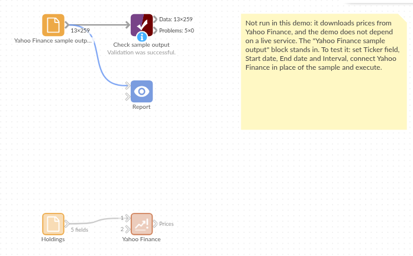

# Yahoo Finance

*Omniscope custom block · Connectors*

**What have our holdings done this quarter? Daily, weekly or monthly prices for every ticker in your data, each attached to the records that hold it.**

**Python** · yfinance, pandas · yfinance installed on first run if missing

## The problem it solves

A list of holdings, a watch list or a set of competitors' shares says nothing about how the prices moved. Copying price tables from a website for each ticker is slow, and mixing exchanges brings different time zones and currencies.

This block takes the tickers from a field, downloads each one's history once, and writes one record per period for every input record: the holding's own fields next to the open, high, low and close, volume, dividends and splits.

- **5** invented holdings in the sample, in **2** accounts, on **3** exchanges (New York, London, Frankfurt)
- **259** price records for the **4** holdings whose ticker has prices: **64** trading days in New York, **65** in London, **66** in Frankfurt
- **1** ticker with no prices (MRBY), reported in the block's message
- **1** dividend (9.8 pence, Hollindrew Foods, 13 August) on its own day

### How it works

- Choose the field with the ticker symbols, as Yahoo Finance writes them (VOD.L, BMW.DE, ^FTSE).
- Enter the start date, and the end date or nothing for up to today, and choose the interval.
- Each distinct ticker is downloaded once; every input record with it gets its prices.

## What goes in

### Holdings

Five invented holdings of fictional companies.

| Holding | Account | Ticker | Company | Shares |
|---|---|---|---|---|
| H-1 | Pension | QLMK | Quillmark Instruments | 120 |
| H-2 | Pension | HLDW.L | Hollindrew Foods | 2500 |
| H-3 | Pension | LGRW.DE | Lindgrau Werke | 300 |
| H-4 | Savings | QLMK | Quillmark Instruments | 40 |
| H-5 | Savings | MRBY | Marrowby Shipping | 75 |

The companies and their prices are invented; the demo uses invented price histories, so it runs without a connection to Yahoo Finance.

## The options

| Option | Demo setting | What it does |
|---|---|---|
| Ticker field | Ticker | The field with the ticker symbols. |
| Start date | 2026-07-01 | The first day (included). |
| End date | 2026-10-01 | The day after the last one (not included); empty for up to today. |
| Interval | 1 day | One record per day, week, month, or shorter interval. |

## What comes out

### Prices (first 4)

| Holding | Account | Ticker | Company | Shares | Date | Open | High | Low | Close | Volume | Dividends | Stock Splits |
|---|---|---|---|---|---|---|---|---|---|---|---|---|
| H-1 | Pension | QLMK | Quillmark Instruments | 120 | 2026-07-01 | 84.51 | 86.56 | 84.00 | 86.10 | 1906590 | 0 | 0 |
| H-1 | Pension | QLMK | Quillmark Instruments | 120 | 2026-07-02 | 86.29 | 87.00 | 84.16 | 84.21 | 1949881 | 0 | 0 |
| H-1 | Pension | QLMK | Quillmark Instruments | 120 | 2026-07-06 | 84.68 | 87.57 | 84.14 | 85.57 | 3035565 | 0 | 0 |
| H-1 | Pension | QLMK | Quillmark Instruments | 120 | 2026-07-07 | 85.96 | 86.49 | 84.71 | 84.82 | 2514713 | 0 | 0 |

259 records in all. The Date is each exchange's own trading day, so New York, London and Frankfurt closes on the same day line up, and each exchange's holidays are simply absent: no New York bar on 3 July (Independence Day observed) or 7 September (Labor Day), no London bar on 31 August (summer bank holiday).

### The quarter per holding (Aggregate on Holding, first and last Close)

| Holding | Ticker | Shares | First close | Last close | Change | Value at last close |
|---|---|---|---|---|---|---|
| H-1 | QLMK | 120 | 86.10 | 82.95 | -3.7% | 9,954.00 |
| H-2 | HLDW.L | 2500 | 412.01 | 417.82 | +1.4% | 1,044,550 (pence) |
| H-3 | LGRW.DE | 300 | 58.16 | 72.02 | +23.8% | 21,606.00 |
| H-4 | QLMK | 40 | 86.10 | 82.95 | -3.7% | 3,318.00 |

Prices are in each exchange's currency: dollars, pence and euros here. H-5 (MRBY) has no prices and no records.

## Where it pays off

### Personal and family finance: Portfolio over time

Value each holding every day from the number of shares and the close, and total it per account.

### Investor relations: Our share against peers

Daily closes for your own share and a set of peers or an index, rebased to 100 at the start of the period.

### Treasury: Exchange rates

Symbols such as GBPUSD=X give exchange-rate histories, to convert prices or invoices at each day's rate.

### Analysts: Dividend and split history

The Dividends and Stock Splits fields list each payment and split on its date, per ticker.

*Use cases describe typical scenarios and are illustrative; the sample data is invented.*

## Why do this in Omniscope

- **Prices land on your own records.** Every holding keeps its account, share count and any other field next to its prices, so a Formula gives the daily value and an Aggregate the total per account, and the Report charts it without a lookup step.
- **The same history every refresh.** Scheduled with an empty end date, the workflow fetches up to today each time; a Validate data block can stop the run when a ticker returns no prices, instead of a report quietly missing a holding.
- **One date across exchanges.** Daily bars carry each exchange's own trading day, so New York, London and Frankfurt closes on the same day join on Date; the date handling is a short function in the block's Python script, which you reach by unlocking the design, if you need exchange-local times instead.

## How it fits into an Omniscope workflow

Holdings (File or Database) → **Yahoo Finance** → Formula (value = Shares × Close) → Aggregate (per account and Date) → Report

For a single currency, run a second Yahoo Finance block on exchange-rate symbols and join on Date.

## Try it

1. Open the demo project (`demo.iox` on the demo server, or import `demo.ioz` from this folder). It holds the holdings, the Yahoo Finance block (not run), and a File block with `placeholder.csv`: the 259 records the block writes for the invented histories.
2. The question: how did each holding do over the quarter?
3. Follow the File block into the rest of the workflow: first and last close per holding, and the change.
4. To use real data: put your own tickers in the holdings, run the Yahoo Finance block, and connect its Prices output where the File block was.

## Running in Omniscope

*The demo project's workflow: the holdings, the block, the placeholder data and a Validate data check.*

<!--language-->
## Language and libraries

Python. It uses yfinance (Apache License 2.0) and pandas (BSD 3-Clause).

pandas is part of Omniscope's Python environment. yfinance is listed in the block's dependencies, so Omniscope installs it with pip on first run if it is missing. yfinance is an open-source project, not affiliated with Yahoo; its documentation says Yahoo Finance data is intended for personal use.
<!--/language-->

## Tested

The block is covered by automated tests that run its script against a stand-in for Omniscope's Python API and a stand-in for yfinance with invented price histories (no live calls): the sample holdings, exchanges in three time zones with their own holidays, one download per ticker, symbols in lower case or with spaces, weekly and hourly intervals, an empty end date, bad dates, tickers with no prices, empty input, an input field named like a price field, a refused request and other errors, wrong field types, and 3,000 records.
