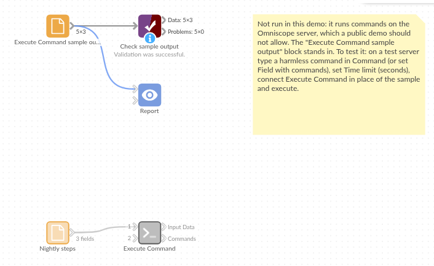

# Execute Command

*Omniscope custom block · Code & AI*

**A command-line step in the middle of a workflow: run a script or a tool before the data is read or after it is written, and see what it printed.**

**Python** · pandas · nothing extra to install

## The problem it solves

Some steps of a data job live outside Omniscope: a script that fetches or unzips the day's file, a tool that converts a format, a copy to a shared folder after the export is written. Run by hand or by a separate scheduled task, they drift out of step with the workflow, and when one fails nobody sees why.

The block runs those commands as a step of the workflow and records what each one did.

- **3** commands run from a list in a file, **1** empty line skipped
- **0** failures: each with exit code 0 and its output in a field
- a failing command **stops the block** with the end of its error output in the message, unless you choose to carry on

### How it works

- Enter one command, or choose a field holding one command per record.
- Commands run one after another without a shell, as the user Omniscope runs as, each with a time limit.
- The input records pass through unchanged; the second output lists each command with its exit code, output, errors and, if it failed, why.

**Before you use it, read the security section of the README**: anyone who can edit a project can run any program on the server through this block, and commands taken from a field are only as safe as the data they come from.

## What goes in

### Nightly steps

An invented list of four steps, three of them harmless Python commands and one not filled in yet.

| Step | Description | Command |
|---|---|---|
| 1 | Check the Python version | `python --version` |
| 2 | Print a greeting | `python -c "print('Hello from the server')"` |
| 3 | Add two numbers | `python -c "print(2 + 2)"` |
| 4 | Not filled in yet | |

*4 rows in the sample file.*

## The options

| Option | Demo setting | What it does |
|---|---|---|
| Command | (empty) | One command to run; not used when a field is chosen. |
| Field with commands | Command | One command per record. |
| Carry on after a failed command | unticked | Stop at the first failure (unticked) or record it and go on (ticked). |
| Run through cmd /c (Windows) | unticked | Puts `cmd /c` in front of each command, for Windows shell commands. |
| Time limit (seconds) | 600 | Stop a command that runs longer than this. |

## What comes out

### Input data

The four steps, unchanged.

### Commands

| cmd | code | stdout | stderr | error |
|---|---|---|---|---|
| `python --version` | 0 | Python 3.11.2 | | |
| `python -c "print('Hello from the server')"` | 0 | Hello from the server | | |
| `python -c "print(2 + 2)"` | 0 | 4 | | |

Step 4 has no command, so it is skipped and counted in the block's message. The Python version is whatever the machine running the block has.

## Where it pays off

### Data preparation: Scripts as part of the job

Run a script that downloads, unzips or converts the day's files as one step of the scheduled workflow, with its result recorded.

### File handling: Copy, move or archive

Copy files to a shared or archive folder (`cmd /c copy ...` on Windows, `cp ...` elsewhere), one record per file in a list.

### Operations: Steps listed as data

Keep a list of maintenance commands in a file that only administrators can change, and run them in order, with a record of each result.

### Integration: A tool with no block

Call a command-line tool, such as a converter or an in-house utility, and use what it prints in later blocks.

*Use cases describe typical scenarios and are illustrative; the sample data is invented.*

## Why do this in Omniscope

- **The command is a step of the workflow.** Blocks connected after it run only once its commands have finished, and the whole job runs from one scheduled workflow instead of a workflow plus separate scripts run by hand.
- **Failures stop the workflow, with the reason.** A non-zero exit code stops the block with the end of the command's error output, so the blocks after it don't carry on as if it had worked; or tick "Carry on" and filter the Commands output on its error field.
- **Results kept as data.** Each command's exit code and output is a record, ready to be checked like any other data, and a Report can show when each step last ran and what it said.

## How it fits into an Omniscope workflow

Command list (File) → **Execute Command** (Field with commands) → Commands: Validate data (error is empty) → Report

Feed it the records it should pass on, or the list of commands. Blocks after it run once the commands have finished, so a Validate data block on the Commands output can stop the rest of the workflow when a step fails.

## Try it

1. Open the demo project (`demo.iox` on the demo server, or import `demo.ioz` from this folder). The demo server does not run commands, so the demo shows the block, not configured, next to a File block holding the Commands output above.
2. The question: can a workflow run a command-line step and check that it worked?
3. On your own server, add Execute Command, enter `python --version` (or another harmless command your server has) and run it.
4. Look at the Commands output: the exit code 0 and the version it printed.
5. Change the command to a program that doesn't exist and run again: the block stops with "Program not found" in its message.

## Running in Omniscope

*The demo project's workflow: the sample data, the block, and a Validate data check on its output.*

<!--language-->
## Language and libraries

Python. It uses pandas, and Python's own `subprocess` and `shlex` modules to run the commands.

pandas is part of Omniscope's Python environment. It needs nothing else installed.
<!--/language-->

## Tested

The block is covered by automated tests that run its script against a stand-in for Omniscope's Python API, using only the Python interpreter as the command: one command with the input passed through, no input, the sample commands from a field, failed commands (stopping, and carrying on), a program that doesn't exist, output that isn't UTF-8, the time limit, quoted arguments with no shell, the command line used on Windows and with `cmd /c` (checked without running it), set-up mistakes, empty input, and 20 commands with 200,000 records passed through.
