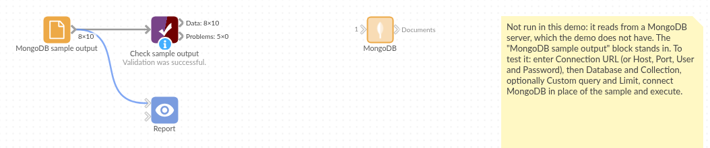

# MongoDB

*Omniscope custom block · Inputs*

**Application data in MongoDB, and the report needs it as a table? Read a collection, or the documents matching a query, one record per document, with nested parts kept as JSON.**

**Python** · pandas, pymongo · pymongo installed on first run

## The problem it solves

Web and mobile applications often keep their data in MongoDB: users, orders, enrolments, events, each a document with nested parts. Reporting on it means getting the documents out as rows, with the identifiers, decimals and dates in forms a report can use.

This block reads the collection (or the documents matching a query) and outputs one record per document.

- **10** enrolment documents in the invented demo collection, with up to 8 top-level keys
- `_id` ObjectIds as text, fees (Decimal128) as numbers: **£98,951.50** in all
- nested `address` and `modules` as JSON text; **1** document without an address left empty
- **1** document with the text "unknown" in `age`: the field becomes text so the value is kept

### How it works

- Connects with a connection URL, or host and port with an optional user; an unreachable server stops it after 20 seconds.
- Reads every document, or those matching the JSON query, up to the limit.
- Top-level keys become fields; objects and arrays become JSON text; ObjectId and similar values become text; a key mixing numbers and text becomes text.

## What goes in

### Enrolments (a MongoDB collection)

Invented enrolment documents for a college, for example:

```json
{
  "_id": ObjectId("6650a1b2c3d4e5f6a7b8c900"),
  "name": "Amira Haddad", "age": 19, "course": "Data Science",
  "fees": NumberDecimal("9250.00"),
  "enrolled": ISODate("2025-09-22T09:00:00Z"),
  "address": {"town": "Leeds", "postcode": "LS2"},
  "modules": ["Statistics 1", "Python for analysts"]
}
```

*10 documents in the invented collection `college.enrolments`.*

## The options

| Option | Demo setting | What it does |
|---|---|---|
| Connection URL | empty | A full connection string; when given, used instead of the settings below. |
| Host, Port | `127.0.0.1`, `27017` | Where the server is. |
| User, Password, Authentication database | empty | Sign-in, if the server needs it (`admin` when the database is empty). |
| Database, Collection | `college`, `enrolments` | What to read. |
| Whole collection | ticked | Read every document; untick to use the custom query. |
| Custom query | `{"address.town": "Leeds"}` (when unticked) | A MongoDB filter in JSON. |
| Limit | empty | The most documents to read. |

## What comes out

### Documents (selected)

| _id | name | age | course | fees | enrolled | address | modules |
|---|---|---|---|---|---|---|---|
| 6650a1b2c3d4e5f6a7b8c900 | Amira Haddad | 19 | Data Science | 9250.0 | 2025-09-22 09:00:00 | {"town": "Leeds", "postcode": "LS2"} | ["Statistics 1", "Python for analysts"] |
| 6650a1b2c3d4e5f6a7b8c905 | Farid Aziz | unknown | Data Science | 11400.5 | 2025-09-22 09:05:00 | {"town": "Bradford", "postcode": "BD7"} | ["Databases"] |
| 6650a1b2c3d4e5f6a7b8c906 | Grace Liu | 19 | Geography | 9250.0 | 2025-09-23 09:06:00 | {"town": "York", "postcode": "YO10"} | [] |
| 6650a1b2c3d4e5f6a7b8c907 | Harry Dunn | 23 | Data Science | 11400.5 | 2025-09-24 09:07:00 | | ["Statistics 1", "Machine learning"] |

10 records. With the custom query `{"address.town": "Leeds"}` and "Whole collection" unticked: 4 records (Amira Haddad, Chloe Evans, Erin Walsh, Jamal Reid).

## Where it pays off

### Product analytics: Users and events

Read user or event documents from an application's database and report sign-ups and activity.

### E-commerce: Orders with nested lines

Read order documents, then expand the nested lines with the JSON blocks to report products and baskets.

### Education and membership: Enrolments

Report enrolments per course and fees per town from a student records collection, as in the demo.

### Operations: Device and log documents

Pick up readings or logs written to MongoDB by devices and services, filtered by a query.

*Use cases describe typical scenarios and are illustrative; the sample data is invented.*

## Why do this in Omniscope

- **Documents to report in one workflow**: the collection's records go through the JSON blocks, joins and aggregations into the report, so fees per course come from the live collection.
- **The same read on every run**: the query, the type clean-up and the handling of mixed keys run identically each time it is scheduled, so a key that turns up with text in a new document arrives as a text field rather than breaking the run.
- **A query, not a dump**: the JSON filter and the limit are sent to MongoDB, so only the documents the report needs travel.
- **Room to grow**: the code is about 110 lines of Python; add a projection, a sort or an aggregation pipeline where a plain filter isn't enough.

## How it fits into an Omniscope workflow

**MongoDB** (college.enrolments) → JSON Expand fields (address) → Aggregate (fees by course and town) → Report

Expand the JSON text fields before using their parts; the `_id` text is a stable key for joins.

## Try it

1. Open the demo project (`demo.iox` on the demo server, or import `demo.ioz` from this folder). It holds the block, not connected to any server, and a File block with `placeholder.csv`: the block's output for the invented collection. The rest of the workflow runs from the File block.
2. The question: how much in fees comes from each course?
3. Look at the File block's output: 10 records, address and modules as JSON text, age as text because of the "unknown".
4. To read your own collection: enter a connection URL (or host, port and sign-in), the database and the collection, and run it. Then connect it in place of the File block.
5. Untick "Whole collection" and enter a custom query such as `{"course": "Economics"}`: only those documents arrive.

## Running in Omniscope



*The demo project's workflow: the block, its sample output in a File block, and a Validate data check on it.*

<!--language-->
## Language and libraries

Python. It uses pandas and pymongo.

pandas is part of Omniscope's Python environment. pymongo (Apache License 2.0) is listed in the manifest's dependencies; Omniscope installs it on first run if it is missing.
<!--/language-->

## Tested

The block is covered by automated tests that run its script against a stand-in for Omniscope's Python API and a stand-in for MongoDB's driver that serves canned documents with ObjectId, Decimal128, dates, objects and arrays (no call reaches a server): the whole collection, a custom query and a limit, a field kept numeric, an emptied connection URL, sign-in without an authentication database, an empty collection, bad queries and settings, a timed-out server, and 100,000 documents.
