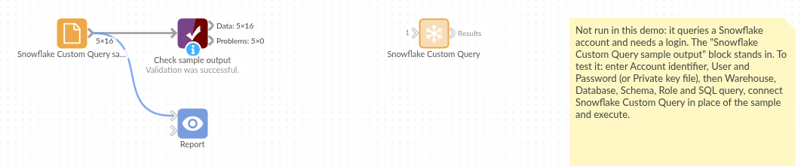

# Snowflake Custom Query

*Omniscope custom block · Inputs*

**A Snowflake query whose result you need in a workflow? Run it from a short Python script, signed in with a password or a key pair, and get typed fields back.**

**Python** · pandas, snowflake-connector-python · Snowflake connector installed on first run

## The problem it solves

A team's numbers live in Snowflake, and the report needs a summary query: tickets per team per week, sales per region. Sometimes it helps to have that query in a small Python script beside the workflow, signed in with the service user's key pair, rather than in a database connection set up elsewhere.

This block runs the query and outputs its result.

- **16** records back: 4 support teams × 4 weeks of an invented tickets table, summarised by Snowflake
- **1,404** tickets in all; Onboarding the busiest team (464) and the slowest to close (about 22 hours on average)
- last-update times from three time zones arrive as one UTC date field

### How it works

- Signs in with Snowflake's connector, by password or by key pair, with the warehouse, database, schema and role you set (or the user's defaults).
- Runs the query and reads the whole result.
- NUMBER with decimals becomes decimal numbers, TIMESTAMP_TZ and _LTZ become UTC dates, TIME becomes text; duplicate column names get `_2`.

## What goes in

### A Snowflake query

```sql
SELECT TEAM, WEEK_START, COUNT(*) AS TICKETS,
       ROUND(AVG(HOURS_TO_CLOSE), 2) AS AVG_HOURS_TO_CLOSE,
       MAX(UPDATED_AT) AS LAST_UPDATED
FROM SUPPORT.PUBLIC.TICKETS
WHERE WEEK_START >= '2026-02-02'
GROUP BY TEAM, WEEK_START
ORDER BY WEEK_START
```

*Run against an invented support-tickets table.*

## The options

| Option | Demo setting | What it does |
|---|---|---|
| Account identifier | (yours) | The account, from your Snowflake address. |
| User | (yours) | The user to sign in as. |
| Password, or Private key file and Private key password | (yours) | Password sign-in, or key-pair sign-in with a key file on the server. |
| Warehouse | `COMPUTE_WH` | Runs the query; empty for the user's default. |
| Database, Schema, Role | `SUPPORT`, empty, empty | Context for unqualified names; empty for the user's defaults. |
| SQL query | the query above | The query to run. |

## What comes out

### Results (first rows)

| TEAM | WEEK_START | TICKETS | AVG_HOURS_TO_CLOSE | LAST_UPDATED |
|---|---|---|---|---|
| Billing | 2026-02-02 | 63 | 18.96 | 2026-02-02 17:10:00 UTC |
| Onboarding | 2026-02-02 | 115 | 21.87 | 2026-02-02 16:11:00 UTC |
| Technical | 2026-02-02 | 67 | 19.66 | 2026-02-02 22:12:00 UTC |
| Account changes | 2026-02-02 | 39 | 29.46 | 2026-02-02 17:13:00 UTC |

16 records. AVG_HOURS_TO_CLOSE is a decimal number (Snowflake NUMBER with 2 decimals); LAST_UPDATED came back with offsets +01:00 and -05:00 among others and is now all UTC (Technical's 17:12 at -05:00 is 22:12 UTC).

## Where it pays off

### Customer service: Weekly ticket summaries

Count tickets and time to close per team and week, and publish them as a service report.

### Sales and finance: Summaries from the warehouse

Run the summary query in Snowflake and report only the totals.

### Data teams: Service-user access

Sign in as a service user with a key pair where the account blocks password sign-in.

### Prototyping: A query beside its Python

Keep a query and some Python post-processing together while the workflow takes shape.

*Use cases describe typical scenarios and are illustrative; the sample data is invented.*

## Why do this in Omniscope

- **Query to report in one workflow**: the Snowflake result feeds the chart and table blocks directly, so the weekly ticket report is rebuilt from the warehouse, not pasted in.
- **Scheduled and checkable**: the scheduler reruns the query, the time zones are put into UTC the same way each run, and a missing team or week can stop the run at a Validate data step.
- **Editable code**: about 110 lines of Python, so you can add `ALTER SESSION` settings, a query tag or a pre-query statement that a fixed connection doesn't offer.

## How it fits into an Omniscope workflow

**Snowflake Custom Query** (tickets per team and week) → Report (tickets by week, time to close by team)

Name tables in full (`DATABASE.SCHEMA.TABLE`) unless you set the database and schema.

## Try it

1. Open the demo project (`demo.iox` on the demo server, or import `demo.ioz` from this folder). It holds the block, not connected to any Snowflake account, and a File block with `placeholder.csv`: the block's output for the query above on invented data. The rest of the workflow runs from the File block.
2. The question: which team takes longest to close tickets, and is it getting better?
3. Look at the File block's output: 16 records, LAST_UPDATED in UTC.
4. To query your own account: enter the account identifier, the user, a password or a private key file, and a query, and run it. Then connect it in place of the File block.

## Running in Omniscope



*The demo project's workflow: the block, its sample output in a File block, and a Validate data check on it.*

<!--language-->
## Language and libraries

Python. It uses pandas and snowflake-connector-python.

pandas is part of Omniscope's Python environment. snowflake-connector-python (Apache License 2.0) is listed in the manifest's dependencies; Omniscope installs it on first run if it is missing.
<!--/language-->

## Tested

The block is covered by automated tests that run its script against a stand-in for Omniscope's Python API and a stand-in for Snowflake's connector that returns the Python types the real one does (no call reaches Snowflake): the sample query and its connection settings, a failing query, an empty result, key-pair sign-in with schema and role, duplicate column names, TIME and all-missing fields, a statement with no result set, missing settings and a failed sign-in, and 200,000 rows.
