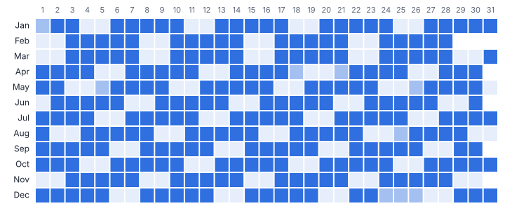
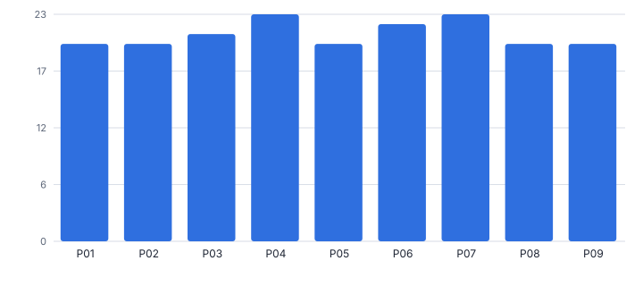
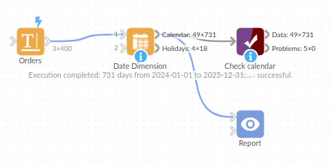

# Date Dimension

*Omniscope custom block · Inputs*

**A complete calendar table in one block: calendar and ISO weeks, fiscal periods for any year start, UK or US public holidays, and working-day counts.**

**Python** · pandas, numpy · nothing extra to install

## The problem it solves

Almost every reporting model needs a date table: fiscal periods that start in April, ISO weeks, bank holidays, working days in the month, last working day flags. Building one by hand means generating rows and writing a dozen formulas, and bank holidays are usually typed in once and then forgotten.

This block generates the whole table, 49 fields per day, with holidays calculated from the published rules (including substitute days and announced one-off changes), ready to join to any fact table on the date.

- **731** days generated for the years in the order file
- **49** fields per day
- **18** holidays and closures in the range
- **1** option to move the fiscal year start

### How it works

- Either type a start and end date, or connect data and choose its date field: the range covers those dates, rounded out to whole years.
- Choose the fiscal year start month and how fiscal years are named, the holiday region, the weekend, and any extra closure days.
- Optionally give a reference date (or TODAY) for days, months and years relative to it, for rolling report filters.
- Outputs: the calendar (one row per day) and the list of holidays in the range.

## What goes in

### Orders (optional input, used for the date range)

400 invented orders, February 2024 to December 2025.

| Order ID | Order Date | Value |
|---|---|---|
| SO1373 | 2024-02-12 | 475.52 |
| SO1041 | 2024-02-13 | 187.17 |
| SO1084 | 2024-02-15 | 114.21 |
| SO1240 | 2024-02-17 | 191.43 |
| SO1333 | 2024-02-18 | 374.09 |

*400 rows in the sample file.*

## The options

| Option | Demo setting | What it does |
|---|---|---|
| Or take the range from this field (optional) | `Order Date` | With data connected, the calendar covers this field's earliest to latest date. |
| Fiscal year starts in month | `4` | 1 = January, 4 = April. |
| Fiscal year named by | `Both years (FY 2025/26)` | How the fiscal year is named in the output. |
| Public holidays | `England and Wales` | Which public holidays are marked and left out of working days. |
| Extra holidays | `2024-12-24=Office closed, 2025-12-24=Office closed` | Comma-separated, for example: 2025-12-24=Christmas Eve, 2025-12-31=Office closed |
| Reference date (optional) | `2025-11-05` | A date or TODAY, for the relative fields. |
| Round the range out to whole years | `On` | Extends a range taken from a field to 1 January and 31 December. |
| Weekend | `Saturday and Sunday` | Days that are not working days. |

## What comes out

### Calendar (Christmas 2025, selected fields)

| Date | Day Name | ISO Year Week | Fiscal Year Month | Fiscal Quarter | Is Working Day | Holiday Name | Working Day Of Month | Working Days Left In Month | Next Working Day | Days From Reference |
|---|---|---|---|---|---|---|---|---|---|---|
| 2025-12-22 | Monday | 2025-W52 | FY 2025/26 P09 | 3 | Yes |  | 16 | 4 | 2025-12-22 | 47 |
| 2025-12-23 | Tuesday | 2025-W52 | FY 2025/26 P09 | 3 | Yes |  | 17 | 3 | 2025-12-23 | 48 |
| 2025-12-24 | Wednesday | 2025-W52 | FY 2025/26 P09 | 3 | No | Office closed |  | 3 | 2025-12-29 | 49 |
| 2025-12-25 | Thursday | 2025-W52 | FY 2025/26 P09 | 3 | No | Christmas Day |  | 3 | 2025-12-29 | 50 |
| 2025-12-26 | Friday | 2025-W52 | FY 2025/26 P09 | 3 | No | Boxing Day |  | 3 | 2025-12-29 | 51 |
| 2025-12-27 | Saturday | 2025-W52 | FY 2025/26 P09 | 3 | No |  |  | 3 | 2025-12-29 | 52 |
| 2025-12-28 | Sunday | 2025-W52 | FY 2025/26 P09 | 3 | No |  |  | 3 | 2025-12-29 | 53 |
| 2025-12-29 | Monday | 2026-W01 | FY 2025/26 P09 | 3 | Yes |  | 18 | 2 | 2025-12-29 | 54 |
| 2025-12-30 | Tuesday | 2026-W01 | FY 2025/26 P09 | 3 | Yes |  | 19 | 1 | 2025-12-30 | 55 |
| 2025-12-31 | Wednesday | 2026-W01 | FY 2025/26 P09 | 3 | Yes |  | 20 | 0 | 2025-12-31 | 56 |

### Holidays

| Date | Holiday Name | Day Name | Year |
|---|---|---|---|
| 2024-01-01 | New Year's Day | Monday | 2024 |
| 2024-03-29 | Good Friday | Friday | 2024 |
| 2024-04-01 | Easter Monday | Monday | 2024 |
| 2024-05-06 | Early May bank holiday | Monday | 2024 |
| 2024-05-27 | Spring bank holiday | Monday | 2024 |
| 2024-08-26 | Summer bank holiday | Monday | 2024 |
| 2024-12-24 | Office closed | Tuesday | 2024 |
| 2024-12-25 | Christmas Day | Wednesday | 2024 |
| 2024-12-26 | Boxing Day | Thursday | 2024 |
| 2025-01-01 | New Year's Day | Wednesday | 2025 |
| 2025-04-18 | Good Friday | Friday | 2025 |
| 2025-04-21 | Easter Monday | Monday | 2025 |
| 2025-05-05 | Early May bank holiday | Monday | 2025 |
| 2025-05-26 | Spring bank holiday | Monday | 2025 |
| 2025-08-25 | Summer bank holiday | Monday | 2025 |
| 2025-12-24 | Office closed | Wednesday | 2025 |
| 2025-12-25 | Christmas Day | Thursday | 2025 |
| 2025-12-26 | Boxing Day | Friday | 2025 |

*The calendar output drawn as a grid: each row is a month of 2025, each cell a day.*

*Working days per fiscal period vary from month to month: the denominator for daily run rates and targets.*

## Where it pays off

### Finance: Fiscal reporting

Join transactions to fiscal periods and quarters for an April (or any) year start, and compare like-for-like working days.

### Retail and hospitality: Trading calendars

Flag bank holidays and closure days to explain sales spikes and dips, and compare weeks by ISO week number.

### Operations and HR: Capacity and SLAs

Working days in and left in the month for capacity plans, and next working day for due dates.

### Any reporting model: Report filters

Days and months from today for rolling filters such as last 30 days or the last three full months.

*Use cases describe typical scenarios and are illustrative.*

## Why do this in Omniscope

- **A calendar sized to the data.** With the range taken from the fact data's date field and rounded out to whole years, next year's first orders extend the calendar on the next run, and with the reference date set to TODAY the relative fields recount each time.
- **Holidays calculated, not typed.** Easter and substitute-day rules work out the bank holidays for each year, including announced one-off changes; the tests check England and Wales and Scotland holidays and the working-day counts.
- **Your own closures and regions.** Extra closure days are an option, and each region's holiday rules are a function in the code, so another country's can follow the same pattern.

## How it fits into an Omniscope workflow

Fact data (orders, transactions) → **Date Dimension** → Join (on date) → Report

Point the block at the fact data's date field so the calendar always covers the data, or give a fixed range.

Join the calendar to the facts on the date; fiscal and working-day fields then work in any Report view.

Because the calendar is generated inside the workflow and joined on the date, it always spans the fact data's dates, and fiscal and working-day fields can be used in any view without a separately maintained table.

## In one step

The whole calendar table, holidays calculated rather than typed in.

## Try it

1. Open the demo project (`demo.iox` on the demo server, or import `demo.ioz` from this folder): an invented order file feeding the Date Dimension block.
2. The question: how do we get fiscal periods, bank holidays and working days into every report without maintaining a spreadsheet?
3. Open the block: range from the Order Date field, fiscal year from April named FY 2025/26, England and Wales holidays plus two closure days. Run it.
4. Look at Christmas 2025 in the calendar output: holidays, the closure day, next working day and working days left in the month.
5. Join it to the orders and chart sales by fiscal period; moving the fiscal year start is a single option.

## Running in Omniscope

*The demo project's workflow: the sample data, the block, and a Validate data check on its output.*

<!--language-->
## Language and libraries

Python. It uses pandas and numpy, plus the Python standard library (datetime).

pandas and numpy are part of Omniscope's Docker Python image, and the block was run in both host mode and Docker mode on an Omniscope server, with the same results. It needs nothing else installed.
<!--/language-->

## Tested

Run on an Omniscope server, the demo workflow finished without errors (731 records in Calendar and 18 in Holidays). Automated tests also cover normal data, empty input, wrong types and large input.
