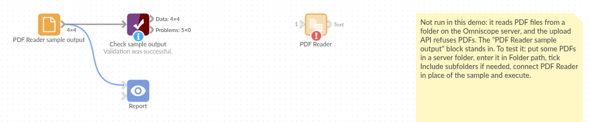

# PDF Reader

*Omniscope custom block · Inputs*

**A folder of PDF invoices, statements or reports? Get the text of every page as records, with the file and page it came from, ready to search and pick apart.**

**R** · pdftools · install pdftools (and Poppler) on the server if missing

## The problem it solves

Supplier invoices and statements arrive as PDF files in a shared folder. Someone opens each one to type the invoice number and total into a spreadsheet, and nobody can search across them.

This block reads every PDF in the folder and writes one record per page with the file name, the page number and the page's text. From there, a formula can pull out the invoice number and total, and a search finds every document that mentions a customer or a product.

- **3** PDF files in the sample folder, **4** pages of text
- **1** two-page statement, kept as 2 records with Page 1 and 2 of Pages 2
- **1** older invoice in a subfolder, read when Include subfolders is ticked

### How it works

- Every file whose name ends in .pdf is read, in name order; the option can also name a single file.
- One record per page: File, Page, Pages and Extracted text, laid out roughly as on the page.
- Damaged or password-protected files are skipped and named in the block's message.

## What goes in

### invoices/ (a folder of PDF files)

Invented documents for one customer, Fernhill Garden Centre.

| File | Pages | What it is |
|---|---|---|
| INV-4471 Harbourside Packaging.pdf | 1 | Invoice: boxes and tape, total due £544.80 |
| INV-4502 Kestrel Logistics.pdf | 1 | Invoice: pallet deliveries, total due £390.60 |
| Statement March 2025 Pennine Office Supplies.pdf | 2 | Statement of account, closing balance £211.20 |
| archive/INV-4390 Harbourside Packaging.pdf | 1 | An older invoice, total due £168.00 |

## The options

| Option | Example setting | What it does |
|---|---|---|
| Folder path | `invoices` | The folder of PDF files to read, or a single PDF file. |
| Include subfolders | no | Tick to read `archive/` too. |
| Extract to TXT files | no | Tick to save each PDF's text as a .txt file beside it. |

## What comes out

### Text

| File | Page | Pages | Extracted text (start) |
|---|---|---|---|
| INV-4471 Harbourside Packaging.pdf | 1 | 1 | Harbourside Packaging Ltd · INVOICE · Invoice number: INV-4471 · Invoice date: 03/03/2025 ... |
| INV-4502 Kestrel Logistics.pdf | 1 | 1 | Kestrel Logistics Midlands Ltd · INVOICE · Invoice number: INV-4502 ... |
| Statement March 2025 Pennine Office Supplies.pdf | 1 | 2 | Pennine Office Supplies Ltd · STATEMENT OF ACCOUNT · Statement date: 31/03/2025 ... |
| Statement March 2025 Pennine Office Supplies.pdf | 2 | 2 | Pennine Office Supplies Ltd · STATEMENT OF ACCOUNT · Page 2 of 2 ... |

*4 records. The text keeps its line breaks (shown here as ·). The block's message: "3 PDF files, 4 pages."*

## Where it pays off

### Accounts payable: Invoice capture

Read a folder of supplier invoices and pull out the invoice number, date and total with formulas, ready to match against purchase orders.

### Compliance and legal: Searching documents

Find every contract, policy or letter that mentions a name, a clause or a product, and which page it is on.

### Reporting: Published reports

Bring the text of monthly or annual reports into a workflow to track how often topics come up.

*Use cases describe typical scenarios and are illustrative; the sample data is invented.*

## Why do this in Omniscope

- **From PDF folder to invoice table in one workflow.** The pages feed straight into formulas that pick out the invoice number and total, then into a join with purchase orders and a report, rebuilt from whatever is in the folder on each run.
- **Missed documents are visible.** Pages counts every page of every file read, and the block's message names any file it had to skip, so a record-count rule in Validate data catches a folder that came out short.
- **It is a short R script.** The block's script lists the files and calls pdftools; open it in the block editor to read other properties pdftools offers (document metadata, word positions), or to change which files are read.

## How it fits into an Omniscope workflow

**PDF Reader** (invoices folder) → Formula (invoice number, total due, from Extracted text) → Join (purchase orders) → Report

A Record Filter on Page = 1 keeps only first pages, where invoice headers usually sit.

## Try it

1. Open the demo project (`demo.iox` on the demo server, or import `demo.ioz` from this folder). It holds the PDF Reader, unconfigured, and a File block with `placeholder.csv`: the 4 records of the Text output when the block reads the sample folder `invoices`.
2. The question: what does each supplier say is due?
3. Follow the File block: 4 records, the statement as two pages. The Formula takes the amount after "Total due: £" or "Closing balance: £" from each first or last page.
4. To read the sample or your own files: copy `sample-data/invoices/` (or your folder of PDFs) to your Omniscope server, choose it in **Folder path**, run the block and connect its Text output where the File block was.
5. Tick **Include subfolders** and run again: 5 records, with the archived invoice as `archive/INV-4390 Harbourside Packaging.pdf`.

## Running in Omniscope

*The demo project's workflow: the placeholder data, the block, a formula picking out the amounts, and a Validate data check.*

<!--language-->
## Language and libraries

R. It uses the pdftools package (MIT licence), which uses the Poppler PDF library (GPL).

pdftools is not part of base R: install it on the Omniscope server's R if it is missing (`install.packages("pdftools")`). On Linux, Poppler's C++ library is needed first (`libpoppler-cpp-dev` on Debian and Ubuntu); the block's Docker settings list it for Docker mode.
<!--/language-->

## Tested

The block is covered by automated tests that run its script against a stand-in for Omniscope's R API: the sample folder with and without subfolders, a single file, file name matching, damaged and password-protected files, pages with no text, writing .txt files (and a folder that can't be written to), an empty folder, missing or wrong paths, and a 300-page PDF.
