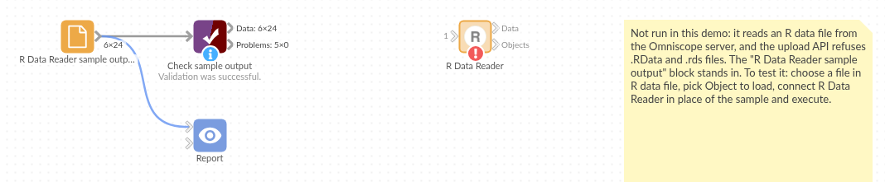

# R Data Reader

*Omniscope custom block · Inputs · R*

**Results saved from R as .rds or .RData? Read the data frame straight into a workflow, row names and all, and see what else the file holds.**

**R** · base R only · nothing to install

## The problem it solves

A statistician keeps the cleaned survey responses in an .RData file next to the store list and a note about the survey wave. Getting the responses into a dashboard usually means opening R, writing a CSV and remembering to do it again after every update; on the way, factor levels become plain numbers in some tools and the store codes kept as row names disappear.

This block opens the file itself. It loads the first data frame saved in it (or the object you name), turns factors into text and dates into date-times, keeps meaningful row names as a field, and lists every object in the file on a second output.

- **3** objects in the sample file: a note, the survey responses and the stores
- **24** survey responses loaded by default, with the store as text and the visit date as a date
- **4** stores loaded by name, with their store codes kept as a **Row name** field

### How it works

- A .rds file holds one object, which is loaded. In an .rda or .RData file the first data frame or matrix in the order saved is loaded, unless you name another object.
- Factors become text, `Date` values become date-times at midnight UTC, list fields become comma-joined text.
- Row names other than 1, 2, 3... become a first field, **Row name**.

## What goes in

### store-survey.RData

An invented file saved from R with `save(survey_note, responses, stores, ...)`.

| Object | Class | What it holds |
|---|---|---|
| survey_note | character | "Customer survey, spring wave. ..." |
| responses | data.frame | 24 responses: Response, Store (a factor), Visited (a Date), Score, Spend, Recommend |
| stores | data.frame | 4 stores, with the store codes as row names: Town, Opened, Floorspace |

`stores.rds` holds the stores on their own.

## The options

| Option | Example setting | What it does |
|---|---|---|
| R data file | `store-survey.RData` | The .rds, .rda or .RData file to read. |
| Object to load | *(empty)* | The object to load from an .rda or .RData file. Empty: the first data frame or matrix. |

## What comes out

### Data (first rows)

| Response | Store | Visited | Score | Spend | Recommend |
|---|---|---|---|---|---|
| R-001 | BRI | 2025-04-07 | 9 | 42.50 | true |
| R-002 | BRI | 2025-04-08 | 7 | 18.00 | true |
| R-003 | BRI | 2025-04-10 | 8 | 63.20 | true |
| R-007 | LDS | 2025-04-07 | 5 | 22.10 | false |

*24 records; one Score and one Recommend value are missing in the file and stay empty.*

### Objects

| Object | Class | Records | Fields | Readable | Loaded |
|---|---|---|---|---|---|
| survey_note | character | 1 | 1 | true | false |
| responses | data.frame | 24 | 6 | true | true |
| stores | data.frame | 4 | 4 | true | false |

### Data with Object to load = `stores`

| Row name | Town | Opened | Floorspace |
|---|---|---|---|
| BRI | Bristol | 2016 | 1450 |
| LDS | Leeds | 2019 | 2100 |
| NWC | Newcastle | 2021 | 1800 |
| OXF | Oxford | 2018 | 1200 |

## Where it pays off

### Research and statistics: Model inputs and outputs

Bring the cleaned data a statistician prepared in R, or the predictions a model wrote out, into a report without an export step.

### Public data: Published R datasets

Many public datasets and package examples are distributed as .rda or .rds files; read them as they are.

### Teams using R and Omniscope: Hand-over files

When one team works in R and another in Omniscope, the .RData file can be the hand-over, read by the workflow on each run.

*Use cases describe typical scenarios and are illustrative; the sample data is invented.*

## Why do this in Omniscope

- **The R hand-over stays live.** The block reads the .RData file where R saved it, so after the statistician saves a new version, the next run of the workflow carries the new responses through to the report, with no CSV export in between.
- **Lost structure is visible.** The Objects output lists every object, its class and size on each run, and a Validate data block on it can stop the workflow if the expected data frame is missing or empty.
- **The conversion rules are plain R.** How factors, dates, row names and lists are turned into fields is a short function in the block's script; change it there if your files need other rules (keeping dates as dates in a local time zone, say).

## How it fits into an Omniscope workflow

**R Data Reader** (store-survey.RData, responses) → Join (with stores, from a second R Data Reader on `stores`) → Aggregate (by Town) → Report

The Data output feeds any block; the Objects output is a quick check of what the file contains, and is worth keeping on a Validate data block when the file comes from someone else.

## Try it

1. Open the demo project (`demo.iox` on the demo server, or import `demo.ioz` from this folder). It holds the R Data Reader, unconfigured, and a File block with `placeholder.csv`: the 24 records of the Data output when the block reads the sample file `store-survey.RData`.
2. The question: what is the average score and spend per store?
3. Follow the File block into the rest of the workflow: 24 responses, Store as text and Visited as a date.
4. To read the sample or your own file: copy `sample-data/store-survey.RData` (or your .rds, .rda or .RData file) to a folder on your Omniscope server, choose it in **R data file**, run the block and connect its Data output where the File block was. The Objects output then lists three objects, the responses marked as loaded.
5. Type `stores` in **Object to load** and run again: 4 stores, with the codes in the Row name field.

## Running in Omniscope

*The demo project's workflow: the placeholder data, the block, and a Validate data check on the output.*

<!--language-->
## Language and libraries

R. It uses only base R (the `tools` package is part of R).
<!--/language-->

## Tested

The block is covered by automated tests that run its script against a stand-in for Omniscope's R API: the sample .RData and .rds files, the default object choice, a named object, row names, factors and dates, vectors, matrices and lists, list fields and repeated field names, an empty data frame, objects that are not tables, a missing object, missing, unsupported and unreadable files, and a 200,000-record file.
