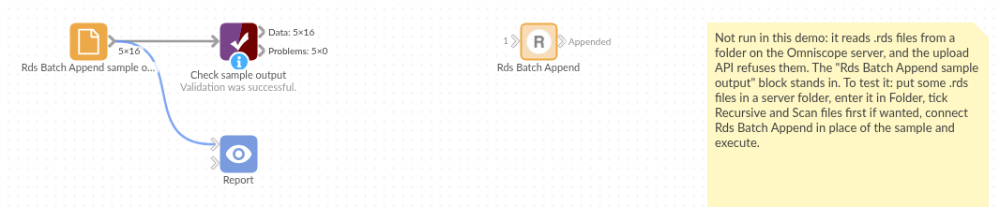

# Rds Batch Append

*Omniscope custom block · Inputs · R*

**A folder of .rds files saved from R, one per month or region? Append them all into one table, with the fields lined up even when the files don't quite agree.**

**R** · data.table · install data.table on the server's R if missing

## The problem it solves

A reporting job in R saves each month's branch sales as its own .rds file. Over time the files drift: a new branch opens, a Returns field is added, and one month's order counts are saved as decimals rather than whole numbers. Reading the files one by one and stacking them by hand breaks on exactly those differences.

This block reads the whole folder and appends the files. By default it first collects every field from every file, so the output has them all: months before Returns existed get empty values, and order counts become decimals throughout.

- **3** monthly files, **16** records appended
- **1** field (Returns) found only in the latest file, empty for the **10** earlier records
- **1** branch (Lincoln) that appears only from March

### How it works

- Every file in the folder whose name ends in .rds is read, in name order; tick Recursive for subfolders. Or the paths come from a field of an input.
- With **Scan files first** (the default), all files are read once to collect their fields, then appended. Without it, the first file sets the fields and the Schema options say whether to warn, stop or carry on when a later file differs.
- Factors become text and dates become date-times; **Add source field** records each record's file.

## What goes in

### monthly-sales/ (a folder of .rds files)

Three invented monthly extracts of branch sales.

| File | Records | Fields |
|---|---|---|
| sales-2025-01.rds | 5 | Branch (factor), Month (Date), Orders (whole numbers), Revenue |
| sales-2025-02.rds | 5 | the same |
| sales-2025-03.rds | 6 | Branch, Month, Orders (decimals), Revenue, **Returns**; a new branch, Lincoln |

## The options

| Option | Example setting | What it does |
|---|---|---|
| Folder | `monthly-sales` | The folder to read every .rds file from. |
| Recursive | yes | Include subfolders. |
| Scan files first | yes | Collect every file's fields first, so the output has them all. |
| Additional fields / Missing fields | Stop with an error | Only used without scanning: what to do when a file has extra or fewer fields than the first. |
| Incorrect field type | Stop with an error | What to do when a field's type differs, other than whole numbers becoming decimals. |
| Add source field | no | Tick to add each record's file path. |

## What comes out

### Appended (selected rows)

| Branch | Month | Orders | Revenue | Returns |
|---|---|---|---|---|
| Bath | 2025-01-01 | 412 | 18540.20 | |
| Norwich | 2025-01-01 | 341 | 14388.10 | |
| Bath | 2025-02-01 | 388 | 17320.55 | |
| Bath | 2025-03-01 | 430 | 19275.00 | 12 |
| Lincoln | 2025-03-01 | 64 | 2650.00 | 0 |

*16 records: Orders 4,486 in all, Revenue 191,305.30; Returns empty on the 10 January and February records.*

Untick **Scan files first** and run again: the January file sets the fields, and the March file stops the block, because it has an extra field (Returns) and decimals where January had whole numbers. Set **Additional fields** to *Display warning* and **Incorrect field type** to *Display warning and convert*, and it runs, leaving Returns out and listing both differences in the block's message.

## Where it pays off

### Reporting: History from periodic extracts

Turn a folder of daily or monthly .rds snapshots, saved by a scheduled R job, into one history table for trends.

### Research: Results from many runs

Append the results of simulation or model runs saved one file per run, with a source field saying which run each record came from.

### Regional teams: One file per region

Combine files saved separately by each region or site, where some regions record extra fields.

*Use cases describe typical scenarios and are illustrative; the sample data is invented.*

## Why do this in Omniscope

- **New files are picked up on the next run.** The block reads whatever .rds files are in the folder when the workflow runs, so a scheduled run after R saves next month's file carries it through to the report with nothing to change.
- **Drift between files is caught, not hidden.** Without scanning, the Schema options can stop the workflow when a file arrives with different fields or types; with scanning, a new field simply appears in the output, empty for the older files.
- **The lining-up rules are in the script.** Which types widen, how text becomes a date and what the source field holds are short functions in the block's R script, open to change in the block editor.

## How it fits into an Omniscope workflow

**Rds Batch Append** (folder of monthly .rds files) → Aggregate (by Branch and Month) → Report

To read a chosen set of files instead of a whole folder, put the paths in a Text Input or a File block and connect it to the block's input, choosing the field in **Path field**.

## Try it

1. Open the demo project (`demo.iox` on the demo server, or import `demo.ioz` from this folder). It holds the block, unconfigured, and a File block with `placeholder.csv`: the 16 records of the Appended output when the block reads the sample folder `monthly-sales` with the settings above.
2. The question: how did each branch's revenue move over the quarter?
3. Follow the File block into the rest of the workflow: 16 records, with Returns filled only for March.
4. To read the sample or your own files: copy `sample-data/monthly-sales/` (or your folder of .rds files) to your Omniscope server, choose it in **Folder**, run the block and connect its Appended output where the File block was. Tick **Add source field** and run again: a Source field shows each record's file.
5. Untick **Scan files first** and run: the block stops on the March file's extra field. Change the two Schema options to the warning choices and run again: 16 records without Returns, and the warnings in the block's message.

## Running in Omniscope

*The demo project's workflow: the placeholder data, the block, and a Validate data check on the output.*

<!--language-->
## Language and libraries

R. It uses the data.table package (Mozilla Public License 2.0).

data.table is not part of base R: install it on the Omniscope server's R if it is missing (`install.packages("data.table")`).
<!--/language-->

## Tested

The block is covered by automated tests that run its script against a stand-in for Omniscope's R API: the sample folder, whole numbers and decimals in different files, logical fields, the choice of files (extension in any case, subfolders), each Schema choice without scanning, type conversion including text dates, the source field, paths from an input, an empty file, a missing folder, an empty folder, unreadable files and files that hold no data frame, and 100 files of 2,000 records.
