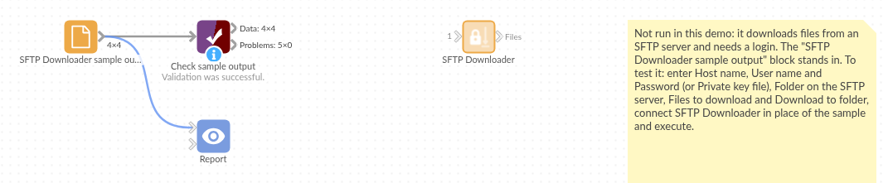

# SFTP Downloader

*Omniscope custom block · Inputs*

**Files dropped on an SFTP server every night? Fetch the ones you need on each run, check you are talking to the right server, and hand them to Append files.**

**Python** · paramiko, pandas · paramiko installed on first run if missing

## The problem it solves

Daily sales from a franchise partner, statements from a bank, payroll from a bureau: plenty of data still arrives as files on an SFTP server. Someone downloads them with a desktop client and copies them to where the reporting can see them, or the reports wait until they do.

This block signs in to the server, downloads the files that match from one folder, and lists them with their paths so the rest of the workflow can load them.

- **4** files downloaded from `/outgoing`: three days of sales and the store list
- **1** sub-folder (`archive`) and **1** text file left alone, by the `csv` filter
- extensions matched whatever their case (`stores.CSV`)
- the server's **host key** checked against the fingerprint in the options

### How it works

- Enter the server, port, user name and a password or private key, and the folder.
- Say which files to take: extensions or patterns such as `csv, xlsx` or `daily-*.csv`; empty takes every file.
- Paste the server's fingerprint into **Host key** so a different server is refused; without it, the final message shows the fingerprint it saw.

## What goes in

Nothing from the workflow: the block reads from the SFTP server. The demo uses an invented folder of a fictional garden supplies wholesaler: three daily sales files, a store list, a README and an archive folder. `sample-data/placeholder.csv` holds the block's output for it.

## The options

| Option | Demo setting | What it does |
|---|---|---|
| User name | `reports` | The account to sign in with. |
| Password | (a password) | The password, or a private key's passphrase. |
| Private key file | (empty) | A private key file on the Omniscope server, instead of or as well as the password. |
| Host name | `sftp.example.com` | The SFTP server. |
| Port | `22` | Usually 22. |
| Host key | `SHA256:...` | The server's fingerprint; a different key stops the block. Empty: any key is accepted. |
| Folder on the SFTP server | `/outgoing` | The folder to download from. |
| Files to download | `csv` | Extensions or patterns, comma-separated, not case-sensitive. |
| Download to folder | `/data/omniscope/downloads/sftp` | Where the files go on the Omniscope server. Empty: the block's working folder. |

## What comes out

### Files

| File path | File name | Size (bytes) | Modified |
|---|---|---|---|
| /data/omniscope/downloads/sftp/daily-sales-2025-03-03.csv | daily-sales-2025-03-03.csv | 182 | 2025-03-03 02:00:00 |
| /data/omniscope/downloads/sftp/daily-sales-2025-03-04.csv | daily-sales-2025-03-04.csv | 182 | 2025-03-04 02:00:00 |
| /data/omniscope/downloads/sftp/daily-sales-2025-03-05.csv | daily-sales-2025-03-05.csv | 182 | 2025-03-05 02:00:00 |
| /data/omniscope/downloads/sftp/stores.CSV | stores.CSV | 100 | 2025-01-10 09:30:00 |

4 records. The README.txt and the archive folder are not downloaded.

## Where it pays off

### Retail and franchises: Partner sales files

Load the nightly sales files that partners or franchisees drop on an SFTP server, into the same Report as your own sales.

### Finance: Bank and payment statements

Fetch statement and settlement files from a bank's or payment provider's SFTP service for reconciliation.

### HR and payroll: Bureau extracts

Pick up payroll and headcount extracts from a bureau, with the server's key checked each time.

### Legacy systems: Scheduled exports

Collect the files an older system exports to an SFTP folder, instead of copying them by hand.

*Use cases describe typical scenarios and are illustrative; the sample data is invented.*

## Why do this in Omniscope

- **From the SFTP folder to the Report in one workflow.** The file list feeds Append files, then the cleaning, joins and charts, so the sales a partner dropped overnight are in the morning's Report without anyone opening an SFTP client.
- **Scheduled, with checks.** Run on a schedule, the block fetches the same folder the same way each time, and a check on the Modified field can stop the run when no new file has arrived rather than publishing yesterday's figures.
- **Sign-in and file choice are options.** Key-based sign-in, file patterns, a choice of download folder and a host-key check are options; the transfer itself is a short paramiko script in the block editor, for a team that needs, say, to delete or move files after downloading.

## How it fits into an Omniscope workflow

**SFTP Downloader** → Append files (file paths from the upstream block: File path) → Field Organiser → Join (store list) → Report

Use Filter on Modified, before Append files, to load only the files of the last few days.

## Try it

1. Open the demo project (`demo.iox` on the demo server, or import `demo.ioz` from this folder). It holds the SFTP Downloader with an example server (not run) and a File block with `placeholder.csv`, the list the block gives for the invented folder.
2. The question: which files arrived, and when?
3. Follow the File block into the rest of the workflow: 4 files, three of them daily sales.
4. To use your own server: enter its details, user name and password or key, paste its fingerprint into Host key, run the block, and connect its output where the File block was, then on to an Append files block.

## Running in Omniscope

*The demo project's workflow: the placeholder data, the block, and a Validate data check on the output.*

<!--language-->
## Language and libraries

Python, with paramiko (LGPL 2.1) and pandas (BSD 3-Clause).

pandas is part of Omniscope's Python environment. paramiko is listed in the block's dependencies, so Omniscope installs it with pip on first run if it is missing.
<!--/language-->

## Tested

The block is covered by automated tests that run its script against a stand-in for Omniscope's Python API and a stand-in for the SFTP connection (no server is contacted): the files listed and downloaded, extensions and patterns, sub-folders skipped, the host key as a fingerprint or a known_hosts line and a mismatching key, a refused sign-in, an unreachable server and a missing folder, a private key file, missing options, an empty result, the default download folder, and 3,000 files.
