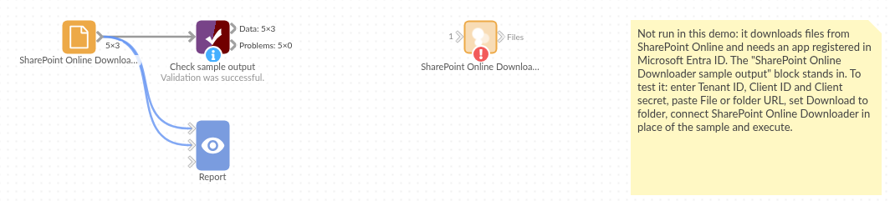

# SharePoint Online Downloader

*Omniscope custom block · Inputs*

**The budget lives in a SharePoint folder that people keep updating? Download the latest files on every run, signed in as an app, and load them with Append files.**

**Python** · requests, pandas · requests installed on first run if missing

## The problem it solves

Departments keep their working spreadsheets in SharePoint or Teams: the budget, the headcount plan, the supplier list. Reports built on copies of those files go out of date as soon as someone edits the original, and mapping SharePoint as a network drive on the server means a drive per site, signed in as a person.

This block signs in as a registered app, downloads the file or every file in a folder, and lists them for the rest of the workflow to load.

- **3** files downloaded from a Reports folder of an invented Finance site, read over **2** pages of results
- **1** sub-folder (Archive) skipped
- the folder's address pasted **as the browser shows it**, with spaces and all
- each file's **Modified** time from SharePoint, to check how fresh it is

### How it works

- Register an app in Microsoft Entra ID with the Microsoft Graph application permission Sites.Read.All (or Sites.Selected), and create a client secret.
- Enter the tenant ID, client ID and secret, and paste the address of the file or folder.
- Connect the output to Append files, using the **File path** field.

## What goes in

Nothing from the workflow: the block reads from SharePoint Online. The demo uses invented Microsoft Graph responses for a fictional company's Finance site, with three CSV files in `Shared Documents/Reports`; `sample-data/placeholder.csv` holds the block's output for them.

## The options

| Option | Demo setting | What it does |
|---|---|---|
| Tenant ID | `contoso.onmicrosoft.com` | Your Microsoft Entra tenant, as an ID or a domain. |
| Client ID | `11111111-2222-3333-4444-555555555555` | The registered app's application (client) ID. |
| Client secret | (a secret) | A client secret value of the app. |
| File or folder URL | `https://contoso.sharepoint.com/sites/Finance/Shared Documents/Reports` | A file or folder in a document library, as shown in the browser. |
| Download to folder | `/data/omniscope/downloads/sharepoint` | Where the files go on the Omniscope server. Empty: the block's working folder. |

## What comes out

### Files

| File path | File name | Size (bytes) | Modified | SharePoint URL |
|---|---|---|---|---|
| /data/omniscope/downloads/sharepoint/budget-2025.csv | budget-2025.csv | 201 | 2025-03-10 08:12:45 | https://contoso.sharepoint.com/sites/Finance/Shared%20Documents/Reports/budget-2025.csv |
| /data/omniscope/downloads/sharepoint/headcount.csv | headcount.csv | 70 | 2025-03-11 16:40:02 | https://contoso.sharepoint.com/sites/Finance/Shared%20Documents/Reports/headcount.csv |
| /data/omniscope/downloads/sharepoint/suppliers.csv | suppliers.csv | 138 | 2025-02-27 11:05:30 | https://contoso.sharepoint.com/sites/Finance/Shared%20Documents/Reports/suppliers.csv |

3 records, sorted by name; the Archive sub-folder is not entered.

## Where it pays off

### Finance: Budgets and forecasts kept in SharePoint

Load the latest budget workbook from the finance site on each run, and report actuals against it.

### HR: Headcount and vacancy plans

Pick up the headcount sheet a team maintains in Teams, without anyone copying it to the server by hand.

### Procurement: Supplier and price lists

Download supplier lists and price files kept in a shared library, and join them to purchase data.

### Operations: Files from many contributors

Load every file people drop in a shared folder, such as weekly returns from each site, with Append files.

*Use cases describe typical scenarios and are illustrative; the sample data is invented.*

## Why do this in Omniscope

- **The spreadsheet people edit, in the Report people read.** The downloaded files go straight into Append files, the joins and the charts of the same workflow, so the Report follows the SharePoint copy rather than an export from last month.
- **Unattended and repeatable.** The app sign-in needs no person's password or multi-factor prompt, so the workflow can be scheduled; each run downloads the folder the same way, and it can be stopped, via Validate data on the Modified field, when a file has not been updated.
- **A folder, not only a file.** The original block took one file; this one also takes a folder and follows Graph's pages, and the calls are a short requests script in the block editor, for teams that want, say, sub-folders as well.

## How it fits into an Omniscope workflow

**SharePoint Online Downloader** → Append files (file paths from the upstream block: File path) → Field Organiser → Join (actuals) → Report

For one file, a File block reading the path in the File path field works as well as Append files.

## Try it

1. Open the demo project (`demo.iox` on the demo server, or import `demo.ioz` from this folder). It holds the SharePoint Online Downloader with example settings (not run) and a File block with `placeholder.csv`, the list the block gives for the invented Finance folder.
2. The question: which files are in the Reports folder, and when were they last changed?
3. Follow the File block into the rest of the workflow: 3 files, the newest changed on 11 March.
4. To use your own SharePoint: register the app, enter its tenant ID, client ID and secret and the address of your folder, run the block, and connect its output where the File block was, then on to Append files.

## Running in Omniscope

*The demo project's workflow: the placeholder data, the block, and a Validate data check on the output.*

<!--language-->
## Language and libraries

Python, with requests (Apache License 2.0) and pandas (BSD 3-Clause).

pandas is part of Omniscope's Python environment. requests is listed in the block's dependencies, so Omniscope installs it with pip on first run if it is missing.
<!--/language-->

## Tested

The block is covered by automated tests that run its script against a stand-in for Omniscope's Python API and invented Microsoft Graph responses (no live calls): the sign-in request, a single file, a folder over two pages with a sub-folder skipped, addresses copied from the Office web apps and sharing links, a refused sign-in, a missing permission, an unknown file, an address outside the document libraries, missing options, an empty folder, and 2,000 files.
