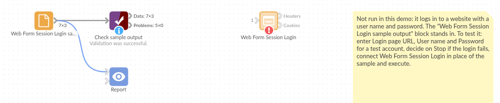

# Web Form Session Login

*Omniscope custom block · Inputs*

**A portal with no API, only a login page? Log in the way a browser does, keep the session cookies, and see every redirect and header on the way.**

**Python** · requests, Beautiful Soup 4, pandas · requests and beautifulsoup4 installed on first run if missing

## The problem it solves

Supplier portals, carrier tracking sites and older internal applications often offer their data only after a login through a web form: there is no API key, the form carries a hidden token, and the session lives in a cookie set during a chain of redirects. Fetching their CSV exports automatically means doing that login first.

This block loads the login page, fills in and submits the form, follows the redirects, and outputs the session cookies and every header it received.

- **1** login form found on a page that also has a newsletter sign-up form
- **1** hidden anti-forgery token sent back with the user name and password
- **1** redirect after the login followed, with the new session cookie
- **3** cookies in the session afterwards, one with an expiry date

### How it works

- Enter the login page's address, the user name and the password.
- The block picks the form with a password field and the likeliest user name or e-mail field, and keeps the hidden fields and the submit button's value.
- A wrong password usually shows the form again: the block notices and stops with a message, unless **Stop if the login fails** is unticked.

## What goes in

Nothing from the workflow: the block talks to the website. The demo uses an invented supplier portal, the one the tests log in to; `sample-data/placeholder.csv` holds the Cookies output of a successful login.

## The options

| Option | Demo setting | What it does |
|---|---|---|
| Login page URL | `https://portal.example.com/login` | The page with the login form. |
| User name | `analyst@example.com` | Typed into the user name or e-mail field. |
| Password | (a password) | Typed into the password field. |
| Stop if the login fails | ticked | Stop on an error status or a password field still shown after the login. |

## What comes out

### Cookies

| Cookie name | Cookie value | Domain | Path | Secure | Expires | Additional attributes |
|---|---|---|---|---|---|---|
| csrf | tok-4b9f2e | portal.example.com | / | False | | {"HttpOnly": null} |
| portal_session | s-7f31 | portal.example.com | / | False | | {"HttpOnly": null} |
| remember_me | yes | portal.example.com | / | False | 2099-04-01 12:00:00 | {} |

### Headers (the login and its redirect, some fields)

| Stage | Hop | Request URL | Status code | Redirect location | Header name | Header value |
|---|---|---|---|---|---|---|
| POST login | 0 | https://portal.example.com/session | 303 | /dashboard | Set-Cookie | portal_session=s-7f31; Path=/; HttpOnly |
| POST login | 0 | https://portal.example.com/session | 303 | /dashboard | Set-Cookie | remember_me=yes; Path=/; Expires=Wed, 01 Apr 2099 12:00:00 GMT |
| POST login | 1 | https://portal.example.com/dashboard | 200 | | Content-Type | text/html; charset=utf-8 |

Every header of every response is a record, so the Headers output shows exactly where a login goes wrong.

## Where it pays off

### Supply chain: Supplier and carrier portals

Log in to a portal that offers order or shipment exports only to signed-in users, then fetch the export with the session cookie.

### Internal systems: Older web applications

Read reports from an internal application that predates APIs and single sign-on.

### Integration work: Diagnosing a login

See each redirect, status and Set-Cookie header of a login that works in a browser but not from a script.

### Monitoring: Checking that a login still works

Run the login on a schedule and stop with a message when it fails, as an early warning that a portal has changed.

*Use cases describe typical scenarios and are illustrative; the sample data is invented.*

## Why do this in Omniscope

- **The login and the download in one workflow.** The Cookies output, joined into a Cookie header (`name=value; name=value`), is what the File or Batch HTTP block sends to fetch the portal's export, and the data goes on to the Report in the same run.
- **A failed login stops the run.** A wrong password, a locked account or a changed login page stops the block with a message rather than letting the next block download the login page as if it were data; scheduled, that is the signal to update the password.
- **A login you can inspect and adapt.** Every header of every hop is in the Headers output, and the form handling is a readable script that you can open by unlocking the block's design, for a portal with an unusual field to fill in.

## How it fits into an Omniscope workflow

**Web Form Session Login** (Cookies) → Cookie header (`name=value; ...`, one text) → Batch HTTP (the export address, with the Cookie header) → Report

Keep the cookie values out of published Reports: they are a live session.

## Try it

1. Open the demo project (`demo.iox` on the demo server, or import `demo.ioz` from this folder). It holds the Web Form Session Login block with an example address (not run) and a File block with `placeholder.csv`, the cookies of a successful login to the invented portal.
2. The question: which cookie carries the session, and how long will it last?
3. Follow the File block into the rest of the workflow: 3 cookies, the session one with no expiry date.
4. To use it for real: enter your portal's login page, user name and password, run the block, and look at the Headers output if the login stops with a message.

## Running in Omniscope

*The demo project's workflow: the placeholder data, the block, and a Validate data check on the output.*

<!--language-->
## Language and libraries

Python, with requests (Apache License 2.0), Beautiful Soup 4 (MIT) and pandas (BSD 3-Clause).

pandas is part of Omniscope's Python environment. requests and beautifulsoup4 are listed in the block's dependencies, so Omniscope installs them with pip on first run if they are missing.
<!--/language-->

## Tested

The block is covered by automated tests that log in to a small fake portal running on the test machine (no outside site is contacted): the cookies and headers of a successful login, the right form chosen when the page has a second form, the hidden token and submit button sent, a wrong password, an error status after the login, a login page behind a redirect, a missing page, a server error and a refused connection, missing options, cookie expiry dates, and 20 logins in a row.
