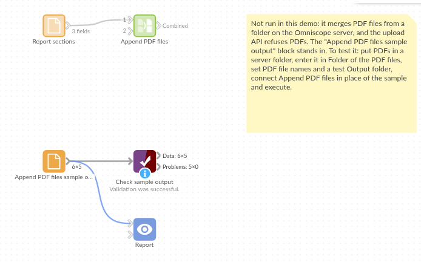

# Append PDF files

*Omniscope custom block · Outputs*

**A pack made of separate PDFs? One file, in the order you choose, with a bookmark for each section and the page each one starts on.**

**Python** · pypdf, pandas · pypdf installed on first run if missing

## The problem it solves

A monthly board pack, a customer statement run or a tender response is often assembled from separate PDF files: a cover, a section per team, an appendix. Putting them together by hand each month means opening a PDF editor, getting the order right and adding bookmarks again.

This block reads the list of files from its input, combines them in record order and writes one PDF, with a bookmark per section.

- **5** section PDFs from a fictional company's board pack combined into **1** file
- **8** pages in the combined file, in the order of the section list
- **4** bookmarks, one per titled section; the appendix has no title, so no bookmark
- **First page** of each section in the output, for a contents page or a check

### How it works

- Connect a list of files (a File block, a folder listing or the output of a PDF-printing block) and choose the field with the file names or paths.
- Choose the folder of the files (empty if the field holds full paths), and optionally a field of bookmark titles.
- The combined file goes to the output folder (empty: the folder of the files) under the file name you give.

## What goes in

### Report sections (`report-sections.csv`)

The list of the 5 invented section PDFs, in the order they should appear. The PDFs themselves are in `sample-data/pdfs/`.

| Section | File name | Bookmark |
|---|---|---|
| 1 | 01-cover.pdf | Cover |
| 2 | 02-trading-summary.pdf | Trading summary |
| 3 | 03-cash-flow.pdf | Cash flow |
| 4 | 04-risks.pdf | Risks and actions |
| 5 | 05-appendix.pdf | |

## The options

| Option | Example setting | What it does |
|---|---|---|
| Folder of the PDF files | the `pdfs` folder | Where the files are; a file chosen inside it also works. Empty if the names are full paths. |
| PDF file names | `File name` | One file name or full path per record. |
| Bookmark titles | `Bookmark` | Optional: a bookmark per file; empty titles get none. |
| Output folder | (empty) | Where to write the combined file. Empty: the folder of the PDF files. |
| Combined PDF file name | `board-pack.pdf` | The combined file's name; `.pdf` is added if missing. |

## What comes out

### Combined

| Section | File name | Bookmark | Combined PDF | Pages | First page |
|---|---|---|---|---|---|
| 1 | 01-cover.pdf | Cover | /reports/pdfs/board-pack.pdf | 1 | 1 |
| 2 | 02-trading-summary.pdf | Trading summary | /reports/pdfs/board-pack.pdf | 2 | 2 |
| 3 | 03-cash-flow.pdf | Cash flow | /reports/pdfs/board-pack.pdf | 1 | 4 |
| 4 | 04-risks.pdf | Risks and actions | /reports/pdfs/board-pack.pdf | 3 | 5 |
| 5 | 05-appendix.pdf | | /reports/pdfs/board-pack.pdf | 1 | 8 |

5 records (the path depends on where the files are), and `board-pack.pdf` with 8 pages and the bookmarks Cover, Trading summary, Cash flow, and Risks and actions.

## Where it pays off

### Finance: Board and management packs

Combine the sections each team produces into one pack, in a fixed order, every month.

### Customer service: Statement and document bundles

Join a customer's statement, invoices and terms into one file to send, from a list built in the workflow.

### Reporting: Printed Report tabs

Combine the PDFs printed from several Report tabs, or one per region, into a single document with a bookmark per tab.

### Bids and compliance: Submission documents

Assemble a tender response or an audit file from separate documents, in the order the checklist requires.

*Use cases describe typical scenarios and are illustrative; the sample data is invented.*

## Why do this in Omniscope

- **The pack is built where the numbers are.** Report tab to PDF prints the sections from the project's own Report, and this block joins them straight after, so the pack and the dashboard come from the same data.
- **A section list instead of a manual step.** The order and the bookmarks come from records, so a Sort or a Filter changes the pack; scheduled, it is rebuilt the same way each month, and the page count can be checked with Validate data before the file goes out.
- **Stops rather than sending half a pack.** A missing, damaged or password-protected file stops the block with its name before anything is written; and the script is plain pypdf, open in the block editor, for anyone who needs page numbers or a cover added.

## How it fits into an Omniscope workflow

Section list (File, or Report tab to PDF) → Sort (section order) → **Append PDF files** → Validate data (page count) → email or file delivery

The Combined PDF field gives the path of the file for the next block.

## Try it

1. Open the demo project (`demo.iox` on the demo server, or import `demo.ioz` from this folder). It holds a File block with the section list feeding Append PDF files, with the PDF file names and Bookmark titles fields chosen but no folder, so it is not run; and a File block with `placeholder.csv`: the 5 records of the Combined output when the block combines the sample PDFs.
2. The question: can the board pack be put together in the right order, with bookmarks, without a PDF editor?
3. Follow the File block into the rest of the workflow: First page 1, 2, 4, 5 and 8, and the combined file's path in Combined PDF.
4. To combine the sample or your own files: copy `sample-data/pdfs/` (or your PDFs) to a folder on your Omniscope server, choose it in **Folder of the PDF files** and run the block. It writes `board-pack.pdf`, 8 pages with 4 bookmarks, into that folder (or the **Output folder**); connect its Combined output where the File block was.

## Running in Omniscope

*The demo project's workflow: the placeholder data, the block, and a Validate data check on the output.*

<!--language-->
## Language and libraries

Python, with pypdf (BSD 3-Clause) and pandas (BSD 3-Clause).

pandas is part of Omniscope's Python environment. pypdf is listed in the block's dependencies, so Omniscope installs it with pip on first run if it is missing; the server needs access to the Python package index for that, or pypdf installed beforehand.
<!--/language-->

## Tested

The block is covered by automated tests that run its script against a stand-in for Omniscope's Python API, on the sample PDFs: the page order, page counts and first pages, bookmarks with and without titles, numbers as titles, bookmarks already in a file, record order, a file chosen instead of the folder, full paths, missing files and file names, a file that is not a PDF, a password-protected file, empty input, missing options, and 400 files.
