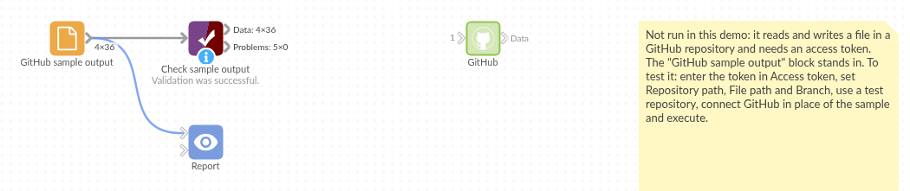

# GitHub

*Omniscope custom block · Outputs*

**A reference table kept in a GitHub repository, read straight into the workflow; or the workflow's result committed back, one versioned commit per run.**

**Python** · requests, pandas · requests installed on first run if missing

## The problem it solves

Teams keep small, carefully reviewed tables in GitHub: targets, mappings, price lists, open datasets. Reading them into a workflow by hand means downloading a file that is out of date as soon as someone merges a change. And publishing a workflow's result to a repository (a dataset others build on, or a file a website reads) usually means a manual upload with no record of what changed when.

This block reads the file through GitHub's API on each run, or writes the input as one commit on a branch, with a message, and reports the commit it made.

- **36** invented monthly sales records read from `data/monthly-sales.csv` in **1** request
- **7** requests to write (default branch, branch head, its tree, the file, the new tree, the commit, the branch update), each checked in the tests
- **1** commit per run, on the default branch unless another is named
- **0** other files touched: the commit replaces only the chosen file

### How it works

- Read: enter `owner/repository` and the file path; add a token for a private repository.
- Write: connect the records, choose Write, give a token with Contents write permission; optionally a branch and a commit message.
- If the branch moved on while the block was writing, GitHub refuses the update and the block stops with GitHub's message, without overwriting.

## What goes in

To read: nothing from the workflow. To write: the records to save. The demo reads an invented file of monthly orders and revenue for six regions, served in the tests by a stand-in for GitHub; `sample-data/placeholder.csv` is that file, which is exactly what the block outputs for it.

## The options

| Option | Demo setting | What it does |
|---|---|---|
| Access token | (empty) | Not needed to read a public repository. |
| Mode | Read a file from GitHub | Read the file, or write the input as a commit. |
| zlib-compressed file | unticked | For files stored compressed with zlib. |
| Separator | `,` | The field separator; `\t` for tab. |
| Repository path | `octo-org/sales-data` | The repository, or its address. |
| File path | `data/monthly-sales.csv` | The file within the repository. |
| Branch | (empty) | The repository's default branch. |
| Commit message | (empty) | Writing only: "Update data/monthly-sales.csv from Omniscope". |

## What comes out

### Read: the file's records (first 6)

| Month | Region | Orders | Revenue |
|---|---|---|---|
| 2025-01 | North | 311 | 18279.90 |
| 2025-01 | Midlands | 318 | 15532.38 |
| 2025-01 | South East | 380 | 16171.91 |
| 2025-01 | South West | 342 | 16901.06 |
| 2025-01 | Scotland | 394 | 22470.39 |
| 2025-01 | Wales | 128 | 6235.93 |

36 records in all, 8,829 orders. Orders comes out as whole numbers and Revenue as decimals.

### Write: the commit made

| Repository | Branch | File path | Records written | Commit | Commit URL |
|---|---|---|---|---|---|
| octo-org/sales-data | main | data/monthly-sales.csv | 36 | c0ffee1234567890 | https://github.com/octo-org/sales-data/commit/c0ffee1234567890 |

(From the tests' stand-in for GitHub; a real commit id is 40 characters.)

## Where it pays off

### Analytics teams: Reviewed reference tables

Keep region mappings, targets or exchange rates in a repository where changes go through review, and have every workflow read the current version.

### Open data: Publishing a dataset

Commit a cleaned dataset to a public repository on a schedule; users and websites read it from GitHub, and the history shows what changed each time.

### Data engineering: Snapshots with history

Write a monthly snapshot of a summary table to its own branch or path, so earlier versions can be compared with GitHub's history and diff.

### Websites: Data for a static site

Update the CSV a static site builds its charts or tables from, so the site rebuilds with the new figures.

*Use cases describe typical scenarios and are illustrative; the sample data is invented.*

## Why do this in Omniscope

- **Reviewed tables join live data.** The targets file read from the repository is joined in the same workflow to the database's actual sales, and the Report shows actual against target, always against the version the team last merged.
- **A commit only after the checks pass.** In write mode the block sits after a Validate data block, so a scheduled run that produced an empty or malformed table stops before anything reaches the repository; each successful run leaves one commit with its record count.
- **Commit rules you can change.** The branch, message and file layout are options, and the commit itself is a short Python function in the block editor: write one file per region, or add a date to the path, without another tool.

## How it fits into an Omniscope workflow

Read: **GitHub** (targets.csv) → Join (with actual sales from a Database block) → Report

Write: Database → Aggregate → Validate data → **GitHub** (Write, commit message "Monthly summary")

## Try it

1. Open the demo project (`demo.iox` on the demo server, or import `demo.ioz` from this folder). It holds the GitHub block, set to read `octo-org/sales-data` (an example name), and a File block with `placeholder.csv`, the 36 records the block outputs for the invented file.
2. The question: what were the orders and revenue per region over the six months?
3. Follow the File block into the rest of the workflow: totals per region and month.
4. To use your own repository: enter its `owner/repository` and a file path in the GitHub block (and a token if it is private), run it, and connect its Data output where the File block was.

## Running in Omniscope

*The demo project's workflow: the placeholder data, the block, and a Validate data check on the output.*

<!--language-->
## Language and libraries

Python. It uses requests (Apache License 2.0) and pandas (BSD 3-Clause).

pandas is part of Omniscope's Python environment. requests is listed in the block's dependencies, so Omniscope installs it with pip on first run if it is missing.
<!--/language-->

## Tested

The block is covered by automated tests that run its script against a stand-in for Omniscope's Python API and a stand-in for GitHub's API (no live calls): reading a public file, a branch and a token, a pasted address, compressed and tab-separated files, text that isn't a table, a missing file, a refused token, bad options; writing, with every request a commit would send checked (the default branch, the tree with only the file replaced, the commit and its parent, the branch update), a named branch with a message, no input, no token, an unknown branch, a branch that moved on, empty input, and 200,000 records.
