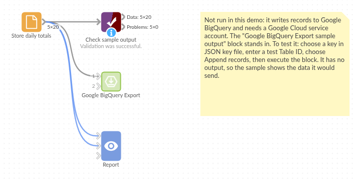

# Google BigQuery Export

*Omniscope custom block · Outputs*

**Built a clean table in Omniscope that others need in BigQuery? Load it into a BigQuery table on every run, appended or replaced, with field names made into valid column names.**

**Python** · pandas, google-cloud-bigquery, pyarrow, db-dtypes · Google libraries installed on first run

## The problem it solves

A workflow cleans, joins and enriches data, and the result is wanted in BigQuery: for another team's dashboards, for a data science notebook, or to keep history. Exporting a CSV and uploading it by hand each day is slow and easy to forget, and field names such as "Revenue (£)" are not valid BigQuery column names.

This block loads the records on its input into a BigQuery table on every run.

- **20** daily store totals in the invented demo input, 4 stores over 5 days
- **5** fields, 4 of them renamed for BigQuery: `Sale date` → `Sale_date`, `Revenue (£)` → `Revenue____`
- appended to the table by default, or replacing it

### How it works

- Field names are made valid for BigQuery (letters, digits and underscores; names that clash get `_2`), and the message lists every renamed field.
- The records go to BigQuery as one load job. The table is created if it doesn't exist, with column types from the field types.
- Append adds the records; untick it to replace the table's records and columns on every run.

## What goes in

### Store daily totals

Invented daily totals for four shops, as a workflow might produce them from till data.

| Store | Sale date | Units sold | Revenue (£) | Click & collect % |
|---|---|---|---|---|
| Leeds | 2026-03-02 | 120 | 1204.76 | 17.9 |
| York | 2026-03-02 | 136 | 1010.34 | 6.3 |
| Bristol | 2026-03-02 | 73 | 587.09 | 6.1 |
| Exeter | 2026-03-02 | 86 | 536.97 | 30.0 |

*20 rows in the sample file.*

## The options

| Option | Demo setting | What it does |
|---|---|---|
| JSON key file | (yours) | A service account's key file on the server; empty for the server's own credentials. |
| Table ID | `example-project.retail.store_daily_totals` | The table to load into, as project.dataset.table. |
| Append records | ticked | Add the records; untick to replace the table on every run. |

## What comes out

### In BigQuery: the table `store_daily_totals`

| Store | Sale_date | Units_sold | Revenue____ | Click___collect__ |
|---|---|---|---|---|
| Leeds | 2026-03-02 00:00:00 UTC | 120 | 1204.76 | 17.9 |
| York | 2026-03-02 00:00:00 UTC | 136 | 1010.34 | 6.3 |

20 rows loaded (2,172 units, £17,798.84). The block has no output of its own; its message says "Appended 20 records in example-project.retail.store_daily_totals" and lists the renamed fields. Omniscope dates load as TIMESTAMP columns.

## Where it pays off

### Data teams: Publishing cleaned data

Load the output of a cleaning and matching workflow into BigQuery for other teams to query.

### Forecasting: Writing predictions back

Append each day's forecast or score to a table, building a history to compare with actuals.

### Finance: Monthly snapshots

Replace a snapshot table each month with the latest reconciled figures.

### Operations: Feeding other dashboards

Keep a BigQuery table up to date for tools that read only from the warehouse.

*Use cases describe typical scenarios and are illustrative; the sample data is invented.*

## Why do this in Omniscope

- **Prepare and publish in one workflow**: the blocks that clean and total the till data feed this block directly, so the table in BigQuery is always the output of the same steps.
- **The same load on every run**: scheduled, the project rebuilds the totals and appends them; a Validate data block before this one can stop a run with missing or unexpected values before anything reaches BigQuery.
- **Column names handled**: names Omniscope allows but BigQuery refuses (spaces, symbols, names differing only in case) are renamed predictably, and the message says how.
- **Adjustable load**: around 100 lines of Python drive it; set partitioning or clustering on the load job, or a schema, if the table needs them.

## How it fits into an Omniscope workflow

File (till export) → Aggregate (totals by store and day) → Validate data → **Google BigQuery Export** (retail.store_daily_totals)

Rename fields in a Field Organiser first if you want tidier column names than the automatic ones.

## Try it

1. Open the demo project (`demo.iox` on the demo server, or import `demo.ioz` from this folder). It holds a File block with the 20 store totals feeding the block, which is not signed in to Google Cloud, so it does not run there.
2. The question: how would these totals look as a BigQuery table?
3. Look at the File block's output: 20 records with the field names above.
4. To load into your own project: create a service account with BigQuery Job User on the project and BigQuery Data Editor on a dataset, save its JSON key on the server, choose it in the block, enter `your-project.your_dataset.store_daily_totals` and run it. The table is created; run again and the records are appended.

## Running in Omniscope

*The demo project's workflow: the sample totals in a File block, a Validate data check, and the block.*

<!--language-->
## Language and libraries

Python. It uses pandas, google-cloud-bigquery, pyarrow and db-dtypes.

pandas is part of Omniscope's Python environment. google-cloud-bigquery, pyarrow and db-dtypes (all Apache License 2.0) are listed in the manifest's dependencies; Omniscope installs them on first run if they are missing.
<!--/language-->

## Tested

The block is covered by automated tests that run its script against a stand-in for Omniscope's Python API and a stand-in for Google's BigQuery library that records the load it would send (no call reaches Google): the sample loaded with the expected column names and types, append and replace, names that clash or use reserved prefixes, an emptied key file and a key file, empty input, an unconnected input, an empty table ID and a load error, mixed field types, and 300,000 records.
