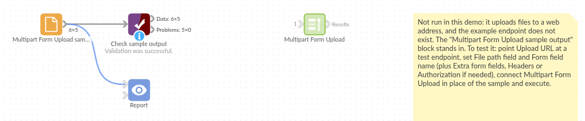

# Multipart Form Upload

*Omniscope custom block · Outputs*

**A service that takes files through a web form or a file-upload API? Send each file from the workflow and keep a record of every answer.**

**Python** · requests, pandas · requests installed on first run if missing

## The problem it solves

Invoices to an accounts system, signed documents to an archive, daily extracts to a partner's intake: many services accept files only through a multipart upload, the request a browser sends when a form has a file field. Sending them by hand means logging in and attaching each file; scripting it means code outside the workflow, and no record of what was accepted.

This block posts each file listed in its input to the endpoint, one request per file, and outputs the input records with the status, the response and any error.

- **5** invoice files listed, **4** uploaded with status **201**
- **1** listed file missing on the server, recorded as "File not found" and not sent
- the service's answer kept for each file, here the id it gave the upload
- headers, an Authorization token and extra form fields set as options

### How it works

- Enter the upload URL, connect the list of files and choose the field with their paths (or choose one file, with no input).
- Set the form field name the endpoint expects (`file` for most), and any extra fields, headers or Authorization value.
- Each file is posted on its own; a refused or failed upload is recorded in Error and the others carry on.

## What goes in

### Upload list (`upload-list.csv`, paths added)

Five invented invoices, each a small CSV file in `sample-data/files/`. INV-1005 is listed but has no file, to show what a missing file looks like.

| Invoice | File name | File path |
|---|---|---|
| INV-1001 | INV-1001.csv | /data/omniscope/outgoing/invoices/INV-1001.csv |
| INV-1002 | INV-1002.csv | /data/omniscope/outgoing/invoices/INV-1002.csv |
| INV-1003 | INV-1003.csv | /data/omniscope/outgoing/invoices/INV-1003.csv |
| INV-1004 | INV-1004.csv | /data/omniscope/outgoing/invoices/INV-1004.csv |
| INV-1005 | INV-1005.csv | /data/omniscope/outgoing/invoices/INV-1005.csv |

## The options

| Option | Demo setting | What it does |
|---|---|---|
| Upload URL | `https://uploads.example.com/api/files` | The endpoint each file is posted to. |
| File to upload (no input) | (empty) | A single file, used when nothing is connected. |
| File path field | `File path` | The field with each record's file path. |
| Form field name | `file` | The multipart field that carries the file. |
| Extra form fields | (empty) | `name=value` lines sent with every file, such as `folder=invoices`. |
| Headers | (empty) | `Name: value` lines, such as `Accept: application/json`. Saved as plain text: put a secret in Authorization, which is kept as a password. |
| Authorization | (a token) | The Authorization header, such as `Bearer` and a token. |

## What comes out

### Results

| Invoice | File name | HTTP status | Response | Error |
|---|---|---|---|---|
| INV-1001 | INV-1001.csv | 201 | {"status": "received", "file": "INV-1001.csv", "id": "upl-0001"} | |
| INV-1002 | INV-1002.csv | 201 | {"status": "received", "file": "INV-1002.csv", "id": "upl-0002"} | |
| INV-1003 | INV-1003.csv | 201 | {"status": "received", "file": "INV-1003.csv", "id": "upl-0003"} | |
| INV-1004 | INV-1004.csv | 201 | {"status": "received", "file": "INV-1004.csv", "id": "upl-0004"} | |
| INV-1005 | INV-1005.csv | | | File not found: /data/omniscope/outgoing/invoices/INV-1005.csv |

The File path field is kept too. The responses are invented answers from the tests; a real endpoint answers in its own format.

## Where it pays off

### Finance: Invoices and statements to another system

Send the invoice or remittance files a workflow produces to an accounts or payments service that takes uploads.

### Document management: Filing reports

Upload the PDFs printed from a Report, one per client or region, to a document store, with the folder as an extra form field.

### Data exchange: Partner and regulator intakes

Post daily or monthly extract files to a partner's or regulator's upload endpoint, and keep the receipt it returns.

### Operations: Feeding other tools

Push files to a ticketing, e-signature or workflow tool's upload API, with its token in the Authorization option.

*Use cases describe typical scenarios and are illustrative; the sample data is invented.*

## Why do this in Omniscope

- **Make the files and send them in one workflow.** The block that writes or prints the files feeds this one directly, and the results join back to the invoice list, so the Report can show what was sent and what the service answered.
- **A record of every upload, checked automatically.** Each run outputs the status and response per file; Validate data can stop the scheduled run, or a Filter can pick out the failures to retry, instead of someone checking a mailbox.
- **What the endpoint needs, without code.** Form field name, extra fields, headers and the Authorization value are options; the request itself is a short requests call in the block editor, for endpoints that want something unusual.

## How it fits into an Omniscope workflow

File Attributes (the outgoing folder) or a PDF-printing block → Formula (file path) → **Multipart Form Upload** → Validate data (no errors) → Report

Join the results back to the source records on the file path to report which were accepted.

## Try it

1. Open the demo project (`demo.iox` on the demo server, or import `demo.ioz` from this folder). It holds the Multipart Form Upload block with an example address (not run) and a File block with `placeholder.csv`, the results the block gives for the invented answers in its tests.
2. The question: which invoices were accepted, and which need attention?
3. Follow the File block into the rest of the workflow: 4 records with status 201 and 1 with an error.
4. To use it for real: enter your endpoint's URL and any headers or token, connect your list of files, run the block and connect its output where the File block was.

## Running in Omniscope

*The demo project's workflow: the placeholder data, the block, and a Validate data check on the output.*

<!--language-->
## Language and libraries

Python, with requests (Apache License 2.0) and pandas (BSD 3-Clause).

pandas is part of Omniscope's Python environment. requests is listed in the block's dependencies, so Omniscope installs it with pip on first run if it is missing.
<!--/language-->

## Tested

The block is covered by automated tests that check the requests it would send, against a fake endpoint (no live calls): one request per record, the multipart body (field name, file name, content type, file contents), headers, the Authorization value and extra form fields, the single-file mode, rejected uploads and connection failures, long responses, missing files and paths, empty input, option checks, and 2,000 files.
