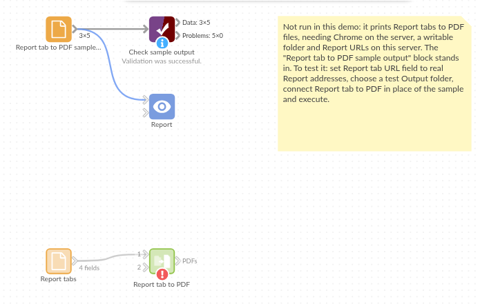

# Report tab to PDF

*Omniscope custom block · Outputs*

**The month's board pack as PDF files, one per Report tab, written to a folder on every run without opening a browser.**

**Python** · visokio-omniprint (Chrome), pandas · visokio-omniprint installed on first run; needs Chrome or the block's Docker image

## The problem it solves

Each month someone opens the board pack, prints every tab to PDF from the browser, renames the files and copies them to the shared folder. It is slow, easy to get wrong (a tab missed, last month's file name), and it can't happen at 6 a.m. when the data has just refreshed.

This block prints each Report tab in its input, in Omniscope's print layout, and saves the PDFs in a folder under the names you give.

- **5** tabs of an invented board pack in, **5** PDF files out
- **4** named from the input's file name field, **1** given the default `<Report>-<Tab>-<n>.pdf`
- Passwords stay out of the files: a login for Basic Authentication opens the page and goes no further

### How it works

- Each record's URL, `.../Project.iox/r/Report/#Tab`, is opened as `.../r/Report/#device=printer&tab=Tab`: Omniscope's print layout of that tab.
- Chrome, driven by the visokio-omniprint package, waits until the Report has finished drawing, then for the loading delay, and saves the page as a PDF.
- The output lists each file written: URL, file name and full path.

## What goes in

### Report tabs

The five tabs of an invented monthly board pack, as a Project metadata block would list them, with the file names to use.

| Report | Tab | Report tab URL | File name |
|---|---|---|---|
| Board Pack | Overview | `http://127.0.0.1:24679/Sales/Monthly%20Review.iox/r/Board%20Pack/#Overview` | 2025-03 Overview |
| Board Pack | Regions | `.../Board%20Pack/#Regions` | 2025-03 Regions |
| Board Pack | Products | `.../Board%20Pack/#Products` | 2025-03 Products |
| Board Pack | Margins | `.../Board%20Pack/#Margins` | 2025-03 Margins |
| Board Pack | Customers | `.../Board%20Pack/#Customers` | |

*5 rows in the sample file.*

## The options

| Option | Demo setting | What it does |
|---|---|---|
| Report tab URL field | `Report tab URL` | The field holding each tab's address. |
| File name field | `File name` | Each PDF's name; empty gives `<Report>-<Tab>-<n>.pdf`. |
| Output folder | a folder on the server | Where the PDFs go (created if missing). |
| Page width / height (pixels) | (empty) | Override the Report's page size. |
| Loading delay (seconds) | 3 | Extra wait before printing, for slow charts. |
| Username / Password | (empty) | For a Report behind Basic Authentication. |

## What comes out

### PDF files written

| URL | PDF filename | PDF path |
|---|---|---|
| `.../Board%20Pack/#Overview` | 2025-03 Overview.pdf | `<folder>/2025-03 Overview.pdf` |
| `.../Board%20Pack/#Regions` | 2025-03 Regions.pdf | `<folder>/2025-03 Regions.pdf` |
| `.../Board%20Pack/#Products` | 2025-03 Products.pdf | `<folder>/2025-03 Products.pdf` |
| `.../Board%20Pack/#Margins` | 2025-03 Margins.pdf | `<folder>/2025-03 Margins.pdf` |
| `.../Board%20Pack/#Customers` | Board Pack-Customers-4.pdf | `<folder>/Board Pack-Customers-4.pdf` |

5 records. The Customers tab has no file name in the input, so it gets the default name (its record is number 4, counting from 0).

## Where it pays off

### Finance: Month-end board pack

Print every tab of the board pack after the month's data is loaded, named by month, ready to circulate.

### Account management: Client reports

One tab per client, filtered by the URL, printed under the client's name for sending or uploading to a portal.

### Compliance: Dated archive

Keep a PDF of the regulatory dashboard as it stood each week, in a folder per year.

### Operations: Shift handover

Print the overnight operations summary before the morning shift starts, so it is waiting on the shared drive.

*Use cases describe typical scenarios and are illustrative; the sample data is invented.*

## Why do this in Omniscope

- **The PDFs follow the data refresh.** The block sits in the workflow after the blocks that load and prepare the data, so the files are printed from the Report just refreshed, never from yesterday's.
- **A list of tabs, not a list of clicks.** Project metadata lists the tabs; a filter picks the ones to print and a formula field builds the file names, so adding a tab to the Report adds its PDF without changing the block.
- **Printed the same way every month.** The scheduler runs it unattended, with the same names and the same print layout each time; the output lists every file written, ready for Append PDF files or an email.
- **Naming rules in the script.** File naming, the print address and the folder layout live in a few lines of Python you can edit: put each month in its own folder, or add the date, without another tool.

## How it fits into an Omniscope workflow

Project metadata → filter (the board pack's tabs) → Field Organiser (a formula field for the file name) → **Report tab to PDF** → Append PDF files → Batch Output (email)

## Try it

1. Open the demo project (`demo.iox` on the demo server, or import `demo.ioz` from this folder). It holds the block, not run (it needs Chrome on the server and a folder to write to), and a File block with `placeholder.csv`: what the block outputs for the sample.
2. The question: which PDFs did the month-end run produce, and where are they?
3. Look at the placeholder records: one per tab, with its file name and path.
4. To print for real, on a server with Chrome (or Docker): connect a Project metadata block of your own project, choose its URL field and an output folder, and run the block.

## Running in Omniscope

*The demo project's workflow: the sample data, the block, and a Validate data check on its output.*

<!--language-->
## Language and libraries

Python. It uses visokio-omniprint (MIT), which drives Chrome with selenium (Apache License 2.0), and pandas (BSD 3-Clause).

pandas is part of Omniscope's Python environment. visokio-omniprint is listed in the block's dependencies, so Omniscope installs it with pip on first run. Chrome must be on the machine running Omniscope, or the server must run custom blocks in Docker, where the block uses an image with Chrome included.
<!--/language-->

## Tested

The block is covered by automated tests that run its script against a stand-in for Omniscope's Python API and a stand-in for Chrome (no page is printed): the sample, with the print address checked for each tab; default names, page size, loading delay and Docker mode; an address without `/` before the tab; file names with `.pdf`, missing, repeated and with characters a file name can't hold; a login that opens the page but stays out of the output; a print failure, with the password hidden in the message; empty input; missing URLs and a new folder; bad options; and 2,000 tabs.
