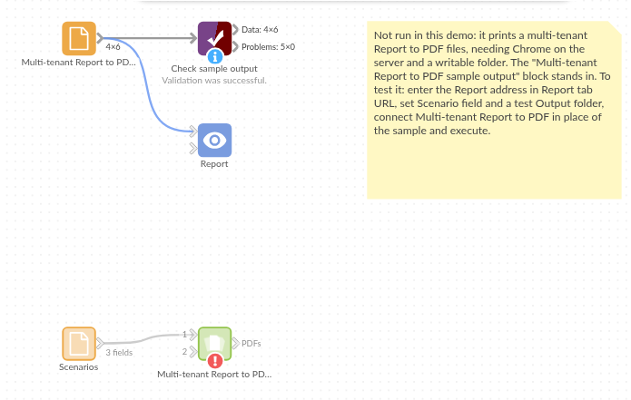

# Multi-tenant Report to PDF

*Omniscope custom block · Outputs*

**One Report design, a PDF for every region, customer or user who sees their own version of it.**

**Python** · visokio-omniprint (Chrome), pandas · visokio-omniprint installed on first run; needs Chrome or the block's Docker image

## The problem it solves

A regional sales pack is one Report with a multi-tenant configuration: each regional manager sees their region. At month end each manager also wants the pack as a PDF. Printing it by hand means opening the Report six times, once per scenario, and naming six files.

This block reads the configuration and prints the tab once per scenario, saving `<Report>-<scenario>.pdf` for each.

- **6** scenarios in an invented regional configuration, **6** PDF files out
- **1** tab address entered once; the block adds `/s/<scenario>/` for each
- No login details in the PDFs: the Basic Authentication username and password are used only to open each page

### How it works

- For the scenario `north`, the tab `.../r/Region%20Pack/#Summary` is printed as `.../r/Region%20Pack/s/north/#device=printer&tab=Summary`: Omniscope's print layout of that scenario's view.
- Chrome, driven by the visokio-omniprint package, waits until the Report has finished drawing, then for the loading delay, and saves the page as a PDF.
- The output lists each file written: scenario, address, file name and full path.

## What goes in

### Scenarios

An invented multi-tenant configuration: one scenario per sales region, with the account manager who receives it.

| scenario | Region | Account manager |
|---|---|---|
| north | North | Priya Shah |
| midlands | Midlands | Tom Hughes |
| south-east | South East | Grace Okafor |
| south-west | South West | Owen Price |
| scotland | Scotland | Isla Fraser |
| wales | Wales | Rhys Morgan |

*6 rows in the sample file.*

## The options

| Option | Demo setting | What it does |
|---|---|---|
| Report tab URL | `http://127.0.0.1:24679/Sales/Regional%20Review.iox/r/Region%20Pack/#Summary` | The tab to print, without a scenario. |
| Scenario field | (empty: `scenario`) | The field holding the scenario IDs. |
| Output folder | a folder on the server | Where the PDFs go (created if missing). |
| Page width / height (pixels) | (empty) | Override the Report's page size. |
| Loading delay (seconds) | 3 | Extra wait before printing, for slow charts. |
| Username / Password | (empty) | For a Report behind Basic Authentication. |

## What comes out

### PDF files written (first 3)

| Scenario | URL | PDF filename | PDF path |
|---|---|---|---|
| north | `.../Region%20Pack/s/north/#Summary` | Region Pack-north.pdf | `<folder>/Region Pack-north.pdf` |
| midlands | `.../Region%20Pack/s/midlands/#Summary` | Region Pack-midlands.pdf | `<folder>/Region Pack-midlands.pdf` |
| south-east | `.../Region%20Pack/s/south-east/#Summary` | Region Pack-south-east.pdf | `<folder>/Region Pack-south-east.pdf` |

6 records in all, one per scenario.

## Where it pays off

### Sales: Regional packs

The same monthly pack for each region, each showing only its own figures, ready for each regional manager.

### Customer reporting: Statements per customer

A usage or account statement for every customer in the configuration, named by customer ID for a portal upload.

### Franchises and branches: Branch scorecards

One scorecard per branch from a single design, printed after the weekly data load.

### Membership bodies: Member reports

An annual summary for each member organisation, from one Report and the member list.

*Use cases describe typical scenarios and are illustrative; the sample data is invented.*

## Why do this in Omniscope

- **The PDF shows exactly what that scenario sees.** Each file is printed from the multi-tenant Report itself, so a regional manager's PDF holds the same filtered figures as their view in the browser.
- **The scenario list drives the run.** The configuration feeding the block is the one the Report uses: add a region to it and the next run prints its PDF, with no change to the block.
- **Each month's batch the same way.** On the scheduler the block prints every scenario after the data refresh, and its output (one record per file, with the scenario) joins straight to the recipient list for **Batch Output**.
- **The naming is a script you can change.** The address pattern and the file names are a few lines of Python in the block's editor: put each region's file in its own folder, or add the month to the name.

## How it fits into an Omniscope workflow

Multi-tenant configuration (Text Input or Database) → **Multi-tenant Report to PDF** → Join (recipients by scenario) → Batch Output (email)

## Try it

1. Open the demo project (`demo.iox` on the demo server, or import `demo.ioz` from this folder). It holds the scenarios, the block, not run (it needs Chrome on the server, a multi-tenant Report and a folder to write to), and a File block with `placeholder.csv`: what the block outputs for the sample.
2. The question: which file was made for each region?
3. Look at the placeholder records: one per scenario, with its address and file.
4. To print for real, on a server with Chrome (or Docker): point the block at a tab of your own multi-tenant Report, connect the same configuration and choose an output folder.

## Running in Omniscope

*The demo project's workflow: the sample data, the block, and a Validate data check on its output.*

<!--language-->
## Language and libraries

Python. It uses visokio-omniprint (MIT), which drives Chrome with selenium (Apache License 2.0), and pandas (BSD 3-Clause).

pandas is part of Omniscope's Python environment. visokio-omniprint is listed in the block's dependencies, so Omniscope installs it with pip on first run. Chrome must be on the machine running Omniscope, or the server must run custom blocks in Docker, where the block uses an image with Chrome included.
<!--/language-->

## Tested

The block is covered by automated tests that run its script against a stand-in for Omniscope's Python API and a stand-in for Chrome (no page is printed): the sample, with the print address checked; a login that opens the page but stays out of the output; another scenario field and IDs with spaces, `&`, `/`, numbers and gaps; a tab address without `/` before `#`, and without a tab; repeated scenarios; a print failure, with the password hidden; empty input; bad options (no scenario field, an address that already holds a scenario, no folder); and 2,000 scenarios into a new folder.
